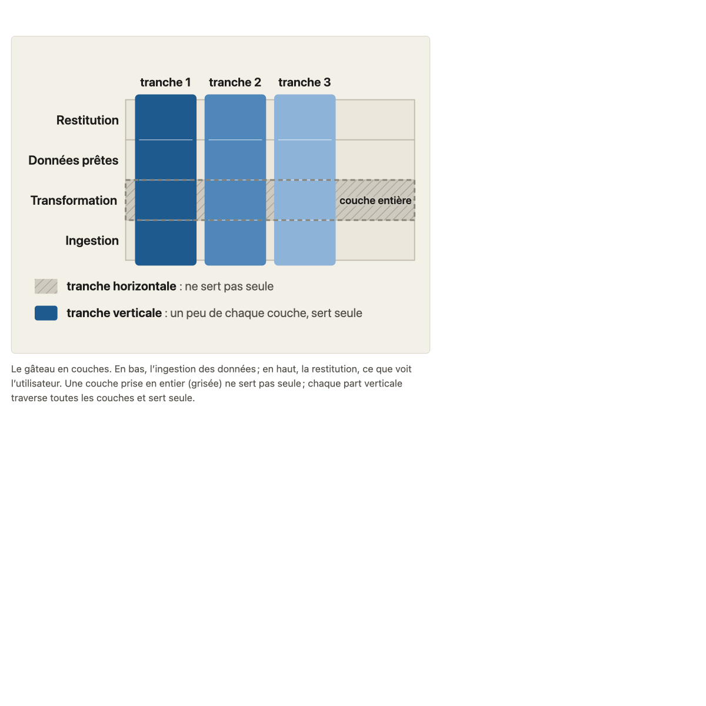
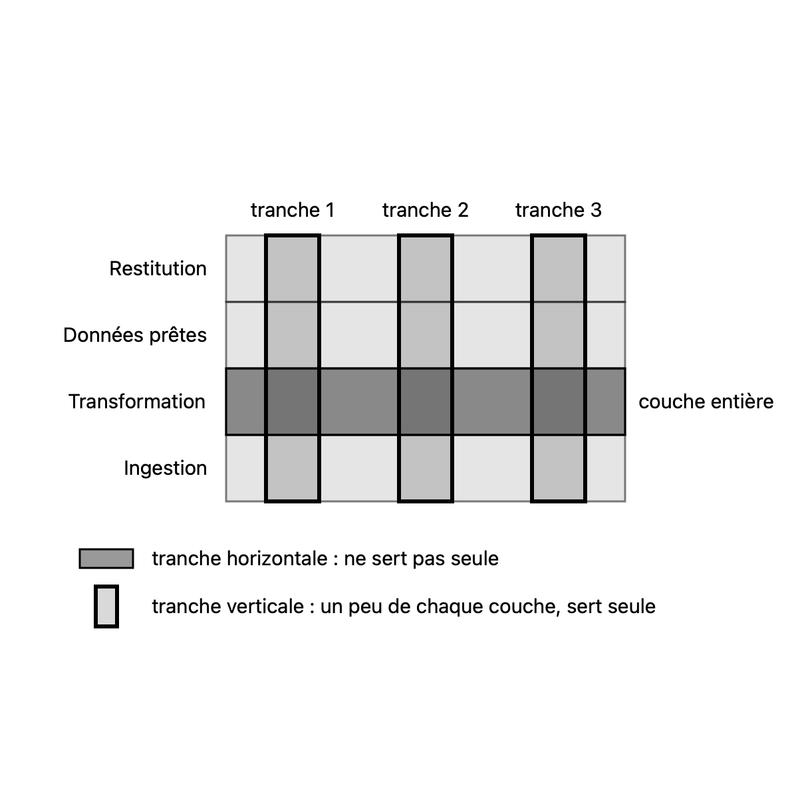
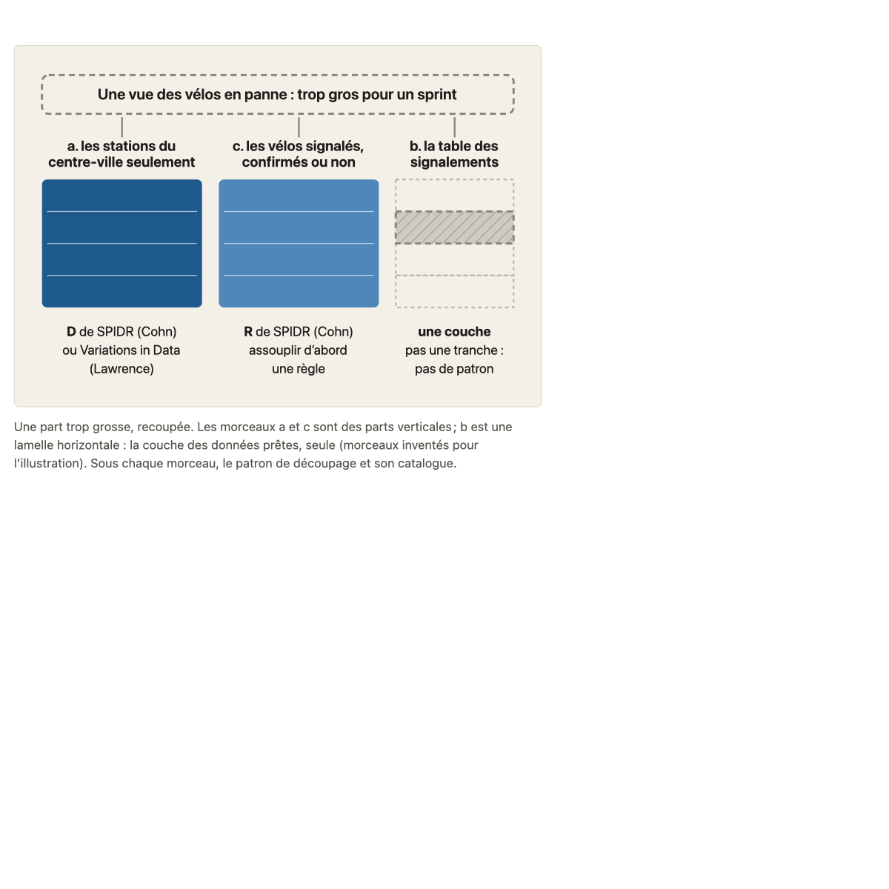
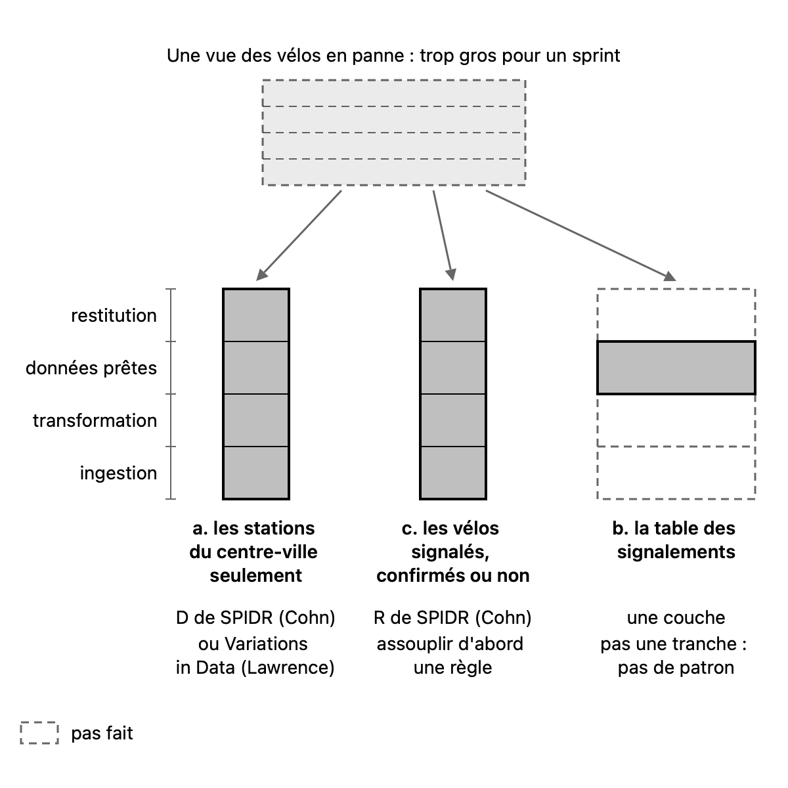

# Migration report: concept 9

Workflow `migrate-concept`, course `parcours-po`, concept folder `concepts/09-decoupage-vertical/`. Paths in the course folder are relative to it; the old files are named from their repository folder (`parcours-po`, `parcours-po-website`).
Old files: `parcours-po/course/concepts/09-decoupage-vertical.md` (CF), `parcours-po/course/sources/09-decoupage-vertical.md` (SF), `parcours-po-website/src/content/concepts/fr/09-decoupage-vertical.mdx` (MDX), `parcours-po-website/src/components/schemas/Gateau.astro`, `parcours-po-website/src/components/schemas/PartRecoupee.astro` (ASTRO).

## Summary

| kept | moved | by design | lost | invented | refuted | checks | target existed | accepted |
|---|---|---|---|---|---|---|---|---|
| 46 | 43 | 8 | 0 | 0 | 0 | pass | no | yes |

Result: **passed**. lost and invented count the rows confirmed by the verification; the rows it refuted (refuted) are listed at the end and count in no other column. checks is read in code from the output below, which the check agent returns; target existed is read in code from the listing below, which the scope agent returns.

## Target before the run

`ls -ld concepts/09-decoupage-vertical; ls -la concepts/09-decoupage-vertical`, as the scope agent returned it: no such folder.

```
ls: cannot access 'concepts/09-decoupage-vertical': No such file or directory
ls: cannot access 'concepts/09-decoupage-vertical': No such file or directory
```

## CF: old to new

| Old item | Where it is now | Verdict | Rule | Detail |
|---|---|---|---|---|
| frontmatter (concept, titre) | course.yaml (number, title) | by design | M1 | M1: CF frontmatter not written in the folder; course.yaml holds it (M12). |
| H1 « Découpage en tranches verticales » | course.yaml title | by design | M1 | M1: no H1 in the three files (M12). |
| « Objectif » | course.yaml objective; concept.md « Objectif » | moved | M1 | Carried to course.yaml objective (S1-08 Objective merge: concept 9 merged, CF kept); concept.md « Objectif » restates it with a capital first letter and a final period, no clause missing. |
| « L'essentiel » | concept.md « L'essentiel » | moved | M4 | Merged with the MDX text before the first <Sous>: MDX wording as the base; the CF-only clause « de haut en bas » carried in at its CF place (« traverse toutes les couches, de haut en bas, en tranche fine »). |
| « Consensus et choix d'école » | concept.md frontmatter stances.consensus, stances.school, stances.course, neighbors | moved | M3 | Not written as a section; each claim matched to a frontmatter item (Scrum Guide, pratique établie, SPIDR, Lawrence, Wake Twenty Ways, recoupement des catalogues, choix du cours, walking skeleton). |
| Consensus (pratique établie): « sous le V d'INVEST, concept 7 » | concept.md frontmatter stances.consensus[1].text | moved | M3 | CF-only concept reference « concept 7 » carried into the MDX item: « sous le V d'INVEST, concept 7 ». |
| Choix du cours: « (concept 3b) » and « (concept 17b1) » | concept.md frontmatter stances.course[4].text | moved | M3 | CF's more precise references win over MDX « concept 3 » / « concept 17 »: « (concept 3b) » and « (concept 17b1) ». |
| Choix du cours hint « (sans source externe, à présenter comme tels) » | none (protocol rule stances-told-apart) | by design | M3 | M3: CF's teacher hint on the course's choices is carried by the protocol rule stances-told-apart (M12). |
| « Sous-concepts » | teaching.md « Consignes » | moved | M9 | Renamed « Consignes », text verbatim (mechanical diff: only the heading differs). No citation line added. |
| « Banque d'exemples » lead paragraph (Faits du fil rouge utilisés : …) | teaching.md « Faits du fil rouge utilisés » | moved | M9 | Lead words « Faits du fil rouge utilisés : » dropped; the rest verbatim, including the « Ne sont pas fixés » and « propositions d'exercice » sentences. |
| « Banque d'exemples » cases (6 cases, all fields) | teaching.md « Banque d'exemples » | kept | M9 | Same ### headings, every field verbatim (mechanical diff: no difference). |
| « Pièges » | concept.md « Pièges » | moved | M7 | Merged into the MDX <Erreurs> list in MDX order; CF precisions kept: « Le walking skeleton (Cockburn) » becomes « Un walking skeleton (Cockburn) »; « (concept 4) » on « Appliquer le vertical aux tâches »; the sentence « Une story qui ne nomme pas l'écran livre quand même quelque chose de visible. » on « Nommer la forme »; « (concept 8a2) » where MDX had concept 8. No CF item missing. |
| « Le test rapide » | concept.md « Le test rapide » | kept | M8 | CF question as the blockquote; nothing CF-only to add to the note paragraph. |
| « Schéma » | teaching.md « Schéma » | kept | M9 | Verbatim (diff: only a blank line). |

## SF: old to new

| Old item | Where it is now | Verdict | Rule | Detail |
|---|---|---|---|---|
| frontmatter (concept: 9) | none | by design | M10 | M10: frontmatter dropped (M1). |
| H1 « Sources : Découpage en tranches verticales » | none | by design | M10 | M10: H1 dropped (M1). |
| intro paragraph | sources.md intro | kept | M10 | Identical; no old path or pointer in it. |
| « Affirmations » table | sources.md « Affirmations » | moved | M10 | Same 39 rows in the same order, claim and verification texts unchanged; header becomes « Affirmation (section de `concept.md` ou de `teaching.md`) \| Source \| Ce qui a été vérifié \| Nature »; Nature column filled from the MDX sources.affirmations kinds (ecole written école), empty where the MDX item has no kind or no item states the claim. |
| Affirmations row « Le Scrum Guide ne parle ni de tranche verticale… » | sources.md « Affirmations », Source column | moved | M10 | Paths: `course/sources/04-hierarchie.md` to `concepts/04-hierarchie/sources.md`; `course/sources/07-invest.md` to `concepts/07-invest/sources.md`. Nature consensus. |
| Affirmations row « Découper un élément en éléments plus petits fait partie du refinement » | sources.md « Affirmations », Source column | moved | M10 | Path: `course/sources/04-hierarchie.md` to `concepts/04-hierarchie/sources.md`. Nature consensus. |
| Affirmations row « L'incrément doit être utilisable » | sources.md « Affirmations », Source column | moved | M10 | Path: `course/sources/00-scrum.md` to `concepts/00-scrum/sources.md`. Nature consensus. |
| Affirmations row « Que chaque story soit une tranche verticale… » | sources.md « Affirmations », Source column | moved | M10 | Paths: `course/sources/03-backlog-produit.md` to `concepts/03-backlog-produit/sources.md`; `course/sources/17-hypotheses-exploration.md` to `concepts/17-hypotheses-exploration/sources.md`. Nature cours. |
| Affirmations row « « Tranche » est une façon de découper, pas un niveau… » | sources.md « Affirmations », columns 1 and 2 | moved | M10 | Section name « (Sous-concepts 9a1 et 9a2, … » to « (Consignes 9a1 et 9a2, … »; path `course/sources/04-hierarchie.md` to `concepts/04-hierarchie/sources.md`. Nature cours. |
| Affirmations row « Le vertical s'arrête à la story… » | sources.md « Affirmations », Source column | moved | M10 | Path: `course/sources/04-hierarchie.md` to `concepts/04-hierarchie/sources.md`. Nature empty (MDX item has no kind). |
| Affirmations row « Le PO juge la story sur ses critères… » | sources.md « Affirmations », Source column | moved | M10 | Path: `course/sources/08-criteres-regles.md` to `concepts/08-criteres-regles/sources.md`. Nature empty. |
| Affirmations row « SPIDR, P et I : un chemin à la fois… » | sources.md « Affirmations », Source column | moved | M10 | orphan [S5b] added: old source « [S5] », new « [S5], [S5b] »; [S5b] is cited by no other source cell, and the verification column names it as support: « l'affiche [S5b] ajoute « Consider building a minimal user interface first » ». Nature école. |
| Affirmations row « SPIDR, S (Spike) : une activité de recherche… » | sources.md « Affirmations », Source column | moved | M10 | Path: `course/sources/07-invest.md` to `concepts/07-invest/sources.md`. Nature école. |
| Affirmations row « Lawrence, Defer Performance… » | sources.md « Affirmations », Nature column | moved | M10 | No MDX sources item states it; Nature école from the MDX ecoles.ecole item « Richard Lawrence : neuf patrons (2009) » it matches (a judgement: that item names only Variations in Data and Simple/Complex). |
| Affirmations row « Une tranche qui traverse toutes les couches sans servir seule (compteur)… » | sources.md « Affirmations », Nature column | moved | M10 | Nature cours, taken from the MDX item « Traverser les couches ne suffit pas : la tranche doit servir seule » (cours); the MDX walking skeleton item, with no kind, is the other candidate (would give empty). Judgement, flagged. |
| Affirmations row « Une story qui ne nomme pas l'écran… » | sources.md « Affirmations », Source column | moved | M10 | Paths: `course/sources/05-user-story.md` to `concepts/05-user-story/sources.md`; `course/sources/07-invest.md` to `concepts/07-invest/sources.md`; `course/sources/01-produit-et-po.md` to `concepts/01-produit-et-po/sources.md`. Nature empty. |
| Affirmations row « Un mot flou dans la tranche… » | sources.md « Affirmations », Source column | moved | M10 | Paths: `course/sources/08-criteres-regles.md` to `concepts/08-criteres-regles/sources.md`; `course/sources/07-invest.md` to `concepts/07-invest/sources.md`. Nature empty. |
| Affirmations row « Le spike livre une réponse… » | sources.md « Affirmations », Source column | moved | M10 | Path: `course/sources/07-invest.md` to `concepts/07-invest/sources.md`. Nature empty. |
| Affirmations row « Les Developers estiment la taille d'un élément… » | sources.md « Affirmations », Source column | moved | M10 | Paths: `course/sources/04-hierarchie.md` to `concepts/04-hierarchie/sources.md`; `course/sources/07-invest.md` to `concepts/07-invest/sources.md`. Nature empty. |
| Affirmations row « Les tâches se découpent au Sprint Planning… » | sources.md « Affirmations », Source column | moved | M10 | Path: `course/sources/04-hierarchie.md` to `concepts/04-hierarchie/sources.md`. Nature empty. |
| Affirmations row « Couches d'un produit data… » (source « aucune ») | sources.md « Affirmations » | moved | M10 | Source « aucune » kept as is; only Nature cours added. |
| « Références » | sources.md « Références » | kept | M10 | Identical (S1 to S9, S5b); no old path. |
| « Non vérifié » | sources.md « Non vérifié » | kept | M10 | Identical; no old path or pointer. |

## MDX: old to new

| Old item | Where it is now | Verdict | Rule | Detail |
|---|---|---|---|---|
| numero, titre, prerequis | course.yaml (number "9", title, prerequisites [8]) | moved | M1 | Not written in the folder; course.yaml holds them, values matching. |
| objectif | course.yaml objective | moved | M1 | Every clause (tranches qui traversent les couches, servent seules à l'utilisateur) carried by the course.yaml objective (S1-08: concept 9 merged). |
| description | concept.md frontmatter description | kept | M2 |  |
| ecoles.consensus | concept.md frontmatter stances.consensus | moved | M3 | Keys renamed (auteur/texte to author/text), texts and refs unchanged, but item 2 gains CF's « concept 7 » (see CF row). |
| ecoles.ecole | concept.md frontmatter stances.school | moved | M3 | Renamed; five items, texts and refs unchanged. |
| ecoles.cours | concept.md frontmatter stances.course | moved | M3 | Renamed; texts and refs unchanged (item 4 refs [] kept), but item 5 « (concept 3) » / « (concept 17) » become CF's « (concept 3b) » / « (concept 17b1) ». |
| ecoles.voisines | concept.md frontmatter neighbors | moved | M3 | Renamed; walking skeleton item, text and refs [S8] unchanged. |
| sources (affirmations, references, nonVerifie) | none (kinds only, in sources.md Nature column) | by design | M10 | M10/M12: the MDX sources texts are by design; only their kind is used. |
| alignement | none | by design | M12 | M12: MDX alignement, nowhere. |
| import lines (Gateau, PartRecoupee) | none | by design | M6 | M6/M12: import lines, nothing. |
| text before the first <Sous> | concept.md « L'essentiel » | moved | M4 | Base of « L'essentiel », merged with CF (« de haut en bas » added); « (le besoin d'un utilisateur, à la taille d'un sprint) » kept. |
| <Figure> Gateau (in L'essentiel) | concept.md « L'essentiel »,  after the paragraph | moved | M6 | One image, alone in its paragraph, at the same place. |
| <Sous id="9a"> La tranche verticale | concept.md « 9a La tranche verticale » | moved | M5 | Converted to ## heading plus the promise in italics; title equals course.yaml. |
| <h4 9a1> La tranche qui sert seule | concept.md « 9a1 La tranche qui sert seule » | moved | M5 | ### heading; reader text unchanged; <Pastille kind="cours"/> to [cours]. |
| <h4 9a2> Où s'arrête le vertical | concept.md « 9a2 Où s'arrête le vertical » | moved | M5 | ### heading; text unchanged; <Renvoi n="4"/> to « concept 4 », <Renvoi n="15"/> to « concept 15 », pastille to [cours]. |
| <Sous id="9b"> Les patrons de découpage | concept.md « 9b Les patrons de découpage » | moved | M5 | ## heading plus italic promise. |
| <h4 9b1> Couche ou tranche (with <FilRouge>) | concept.md « 9b1 Couche ou tranche » | moved | M5 | ### heading; text unchanged; <FilRouge> to a blockquote opening « **Fil rouge :** »; renvois 4 and 17 to « concept 4 », « concept 17 ». |
| <Figure> PartRecoupee (in 9b1) | concept.md « 9b1 »,  after the Fil rouge blockquote | moved | M6 | One image, alone in its paragraph, at the same place. |
| <h4 9b2> Les patrons et leur catalogue | concept.md « 9b2 Les patrons et leur catalogue » | moved | M5 | ### heading; text and list unchanged; [école], [cours], « concept 17 ». |
| <Reflexe note> | concept.md « Le test rapide » | moved | M8 | Slot as the blockquote (same as CF question), note as one paragraph, unchanged. |
| <Erreurs> | concept.md « Pièges » | moved | M7 | Nine items in MDX order and sentences, merged with CF precisions (Cockburn, concept 4, concepts 5 et 7b, concept 8a2, CF sentence on the screen); « Légender une part « story » » typographic apostrophes made straight (form). |

## ASTRO: old to new

| Old item | Where it is now | Verdict | Rule | Detail |
|---|---|---|---|---|
| E1 « Ingestion » | gateau.svg, group 9a1-gateau-ingestion | kept | M11 | Label verbatim; class muted (context); the bottom layer of the four. |
| E2 « Transformation » | gateau.svg, group 9a1-gateau-transformation | kept | M11 | Label verbatim; class muted (context); second layer from the bottom. |
| E3 « Données prêtes » | gateau.svg, group 9a1-gateau-donnees-pretes | kept | M11 | Label verbatim; class muted (context); third layer from the bottom. |
| E4 « Restitution » | gateau.svg, group 9a1-gateau-restitution | kept | M11 | Label verbatim; class muted (context); top layer. |
| E5 « couche entière » | gateau.svg, group 9a1-gateau-couche-entiere | kept | M11 | Label verbatim; the rect is class secondary (contrast), covering the whole Transformation layer. |
| E6 « tranche 1 » | gateau.svg, group 9a1-gateau-tranche-1 | kept | M11 | Label verbatim; class primary (subject); a thin part crossing the four layers. |
| E7 « tranche 2 » | gateau.svg, group 9a1-gateau-tranche-2 | kept | M11 | Label verbatim; class primary (subject); a thin part crossing the four layers. |
| E8 « tranche 3 » | gateau.svg, group 9a1-gateau-tranche-3 | kept | M11 | Label verbatim; class primary (subject); a thin part crossing the four layers. |
| Relation: E1 to E4 stacked, Ingestion at the bottom to Restitution at the top | gateau.svg, layer groups (y 212, 162, 112, 62) | kept | M11 | Ingestion at the bottom, then Transformation, Données prêtes, Restitution at the top. |
| Relation: E5 is the whole of layer E2 and of no other layer | gateau.svg, group 9a1-gateau-couche-entiere | kept | M11 | The rect matches the Transformation layer exactly (x 170 to 470, y 162 to 212), and touches no other layer. |
| Relation: E6, E7, E8 each cross all four layers and hold a bit of each | gateau.svg, tranche groups | kept | M11 | Each slice runs from y 62 to 262, the full height of the four layers. Its fill is translucent, so the layer bands show through each slice. |
| Relation: E5 runs through E6, E7 and E8 | gateau.svg, groups 9a1-gateau-couche-entiere and tranche groups | kept | M11 | The whole-layer rect spans the full width and crosses all three slices. |
| Relation: E5 set against E6, E7, E8 (does not serve alone / each serves alone) | gateau.svg, group 9a1-gateau-legende | kept | M11 | Shown as a contrast of rendering (secondary against primary). The key names it: « tranche horizontale : ne sert pas seule » against « tranche verticale : un peu de chaque couche, sert seule ». |
| Relation: E6, E7, E8 of equal standing, named 1, 2, 3, never story | gateau.svg, tranche groups | kept | M11 | Three identical slices, labelled tranche 1, 2 and 3 in order; the word story appears nowhere. |
| Key: E5 sample « tranche horizontale : ne sert pas seule » | gateau.svg, group 9a1-gateau-legende | kept | M11 | Secondary sample matching the E5 rendering, text verbatim. |
| Key: E6 sample « tranche verticale : un peu de chaque couche, sert seule » | gateau.svg, group 9a1-gateau-legende | kept | M11 | Primary sample matching the slice rendering, text verbatim. |
| Legende: « Le gâteau en couches. » | concept.md frontmatter caption of gateau.svg | kept | M11 | Verbatim. |
| Legende: « En bas, l'ingestion des données ; en haut, la restitution, ce que voit l'utilisateur. » | concept.md frontmatter caption of gateau.svg | kept | M11 | Verbatim. |
| Legende: « Une couche prise en entier (grisée) ne sert pas seule ; chaque part verticale traverse toutes les couches et sert seule. » | concept.md frontmatter caption of gateau.svg | kept | M11 | Verbatim. |
| E1 « Une vue des vélos en panne : trop gros pour un sprint » | part-recoupee.svg, group 9b1-besoin-trop-gros | kept | M11 | Label verbatim; the part is drawn muted (context) with a dashed outline (not done), its four layer lines dashed inside it. |
| E2 the four layers of the data product (no label in the old diagram) | part-recoupee.svg, group 9b1-echelle-couches | kept | M11 | Drawn muted (context) as a scale beside the pieces; its labels « restitution », « données prêtes », « transformation », « ingestion » come from the concept text (L'essentiel, 9a1), which names them, as the inventory notes. |
| E3 « a. les stations du centre-ville seulement » | part-recoupee.svg, group 9b1-morceau-a-centre | kept | M11 | Label verbatim (split over three tspans); class primary (subject), a thin vertical part across the four layers. |
| E4 « D de SPIDR (Cohn) », « ou Variations in Data (Lawrence) » | part-recoupee.svg, group 9b2-patron-a-donnees | kept | M11 | Both labels verbatim; muted text under piece a; the group takes leaf 9b2, which teaches the patterns. |
| E5 « c. les vélos signalés, confirmés ou non » | part-recoupee.svg, group 9b1-morceau-c-signales | kept | M11 | Label verbatim (three tspans); class primary (subject), a thin vertical part across the four layers. |
| E6 « R de SPIDR (Cohn) », « assouplir d'abord une règle » | part-recoupee.svg, group 9b2-patron-c-regle | kept | M11 | Both labels verbatim (straight apostrophe); muted text under piece c; leaf 9b2. |
| E7 « b. la table des signalements » | part-recoupee.svg, group 9b1-morceau-b-table | kept | M11 | Label verbatim; class secondary (contrast), a wide band at the données prêtes layer only. |
| E8 the three other layers left empty in b (no label) | part-recoupee.svg, group 9b1-morceau-b-vides | kept | M11 | Drawn muted (context), dashed (not done), at the restitution, transformation and ingestion rows of b. |
| E9 « une couche », « pas une tranche : pas de patron » | part-recoupee.svg, group 9b1-note-b-couche | kept | M11 | Both labels verbatim; muted text under piece b, in the place of a pattern. |
| Relation: E1 is recut into three pieces, E3, E5 and E7 | part-recoupee.svg, group 9b1-recoupe-en-trois | kept | M11 | Three arrows from the too-big part to a, c and b. |
| Relation: E3 crosses all four layers of E2 | part-recoupee.svg, groups 9b1-morceau-a-centre and 9b1-echelle-couches | kept | M11 | Piece a spans y 205 to 365, the four rows of the layer scale, with a line at each layer boundary. |
| Relation: E5 crosses all four layers of E2 | part-recoupee.svg, groups 9b1-morceau-c-signales and 9b1-echelle-couches | kept | M11 | Piece c spans the same four rows as the scale. |
| Relation: E3 and E5 go together as the two vertical parts; E7 stands beside them as the contrast | part-recoupee.svg, groups 9b1-morceau-a-centre, 9b1-morceau-c-signales, 9b1-morceau-b-table | kept | M11 | a and c drawn alike in primary side by side; b set apart at the right in secondary. |
| Relation: E7 holds only the données prêtes layer; E8, the other three layers, stay empty | part-recoupee.svg, groups 9b1-morceau-b-table and 9b1-morceau-b-vides | kept | M11 | Solid band at the données prêtes row (245 to 285); dashed empty rows for the other three. |
| Relation: E4 belongs to E3 | part-recoupee.svg, group 9b2-patron-a-donnees | kept | M11 | Placed under piece a, same x. |
| Relation: E6 belongs to E5 | part-recoupee.svg, group 9b2-patron-c-regle | kept | M11 | Placed under piece c, same x. |
| Relation: E9 belongs to E7, in place of a pattern | part-recoupee.svg, group 9b1-note-b-couche | kept | M11 | Placed under piece b, where the other pieces have their pattern. |
| Legende « Une part trop grosse, recoupée. » | concept.md frontmatter caption of part-recoupee.svg | kept | M11 | Verbatim, first sentence. |
| Legende « Les morceaux a et c sont des parts verticales ; b est une lamelle horizontale : la couche des données prêtes, seule (morceaux inventés pour l'illustration). » | concept.md frontmatter caption of part-recoupee.svg | kept | M11 | Verbatim, second sentence. |
| Legende « Sous chaque morceau, le patron de découpage et son catalogue. » | concept.md frontmatter caption of part-recoupee.svg | kept | M11 | Verbatim, third sentence. |

## Lost

None.

## Invented

None.

## Refuted by the verification

None.

## Diagrams (M11)

Each old diagram was inventoried (what it shows, by idea), drawn anew from its inventory and concept.md alone under SPEC.md 7.2, and compared on information (the ASTRO rows above). Renderings: the old diagram from the frozen site's build, the new one in one colour.

### `parcours-po-website/src/components/schemas/Gateau.astro`

Figure legende, in « L'essentiel »: « Le gâteau en couches. En bas, l'ingestion des données ; en haut, la restitution, ce que voit l'utilisateur. Une couche prise en entier (grisée) ne sert pas seule ; chaque part verticale traverse toutes les couches et sert seule. »

One idea.

#### gateau.svg

- Title: Le gâteau en couches : une tranche horizontale contre trois tranches verticales
- Caption: Le gâteau en couches. En bas, l'ingestion des données ; en haut, la restitution, ce que voit l'utilisateur. Une couche prise en entier (grisée) ne sert pas seule ; chaque part verticale traverse toutes les couches et sert seule.
- Sub-concept: 9a
- Idea: « Une couche prise en entier (grisée) ne sert pas seule ; chaque part verticale traverse toutes les couches et sert seule. » (the legende)

| Id | Element | Labels | Role | State |
|---|---|---|---|---|
| E1 | the ingestion layer of a data product: the data coming in (relevés des stations), the first of the four stacked layers | « Ingestion » | context | none |
| E2 | the transformation layer of a data product, the second of the four stacked layers | « Transformation » | context | none |
| E3 | the ready-data layer of a data product (données prêtes), the third of the four stacked layers | « Données prêtes » | context | none |
| E4 | the restitution layer of a data product: what the user sees, the last of the four stacked layers | « Restitution » | context | none |
| E5 | a horizontal slice: one layer taken whole (the transformation layer, all of it and nothing of the other layers); it does not serve the user on its own while the other layers are missing | « couche entière » | contrast | none |
| E6 | a vertical slice, the first of three: a thin part cut through all the layers, a bit of each layer, that serves the user on its own | « tranche 1 » | subject | none |
| E7 | a vertical slice, the second of three: a thin part cut through all the layers, a bit of each layer, that serves the user on its own | « tranche 2 » | subject | none |
| E8 | a vertical slice, the third of three: a thin part cut through all the layers, a bit of each layer, that serves the user on its own | « tranche 3 » | subject | none |

Relations:
- E1 to E4 stacked in this order, from E1 ingestion at the bottom (the data coming in) to E4 restitution at the top (what the user sees), as the legende and the concept text say: E1, E2, E3, E4
- E5 is the whole of layer E2 (transformation), and of no other layer
- E6, E7 and E8 each cross all four layers E1 to E4, from top to bottom, and hold a bit of each layer
- E5 runs through E6, E7 and E8: each vertical slice holds a part of the whole layer E5, and E5 holds a part of every slice
- E5 is set against E6, E7 and E8: the whole layer does not serve on its own; each vertical slice serves on its own
- E6, E7, E8 are three slices of equal standing, named in order 1, 2, 3 (never named story)

Key: E5 « tranche horizontale : ne sert pas seule »; E6 « tranche verticale : un peu de chaque couche, sert seule ».

| Old | New |
|---|---|
|  |  |

### `parcours-po-website/src/components/schemas/PartRecoupee.astro`

Figure legende, in the section 9b1: « Une part trop grosse, recoupée. Les morceaux a et c sont des parts verticales ; b est une lamelle horizontale : la couche des données prêtes, seule (morceaux inventés pour l'illustration). Sous chaque morceau, le patron de découpage et son catalogue. »

One idea.

#### part-recoupee.svg

- Title: Une part trop grosse recoupée en parts verticales plus fines
- Caption: Une part trop grosse, recoupée. Les morceaux a et c sont des parts verticales ; b est une lamelle horizontale : la couche des données prêtes, seule (morceaux inventés pour l'illustration). Sous chaque morceau, le patron de découpage et son catalogue.
- Sub-concept: 9b1
- Idea: « Les morceaux a et c sont des parts verticales ; b est une lamelle horizontale : la couche des données prêtes, seule (morceaux inventés pour l'illustration). » (the legende)

| Id | Element | Labels | Role | State |
|---|---|---|---|---|
| E1 | la part d'origine : une vue des vélos en panne pour Étienne, un besoin trop gros pour un sprint, qui ne se livre pas telle quelle et se recoupe en trois morceaux | « Une vue des vélos en panne : trop gros pour un sprint » | context | not done |
| E2 | les quatre couches du produit data (ingestion, transformation, données prêtes, restitution), que les morceaux traversent ou non ; l'ancien schéma ne les nomme pas, le texte du concept les nomme | none | context | none |
| E3 | le morceau a, les stations du centre-ville seulement : une part verticale, qui traverse les quatre couches et sert seule | « a. les stations du centre-ville seulement » | subject | none |
| E4 | le patron de découpage du morceau a et son catalogue : le D de SPIDR (Mike Cohn), ou Variations in Data (Richard Lawrence), même idée sous deux noms ; ces patrons sont enseignés en 9b2 | « D de SPIDR (Cohn) », « ou Variations in Data (Lawrence) » | text | none |
| E5 | le morceau c, les vélos signalés, confirmés ou non par un technicien : une part verticale, qui traverse les quatre couches et sert seule | « c. les vélos signalés, confirmés ou non » | subject | none |
| E6 | le patron de découpage du morceau c et son catalogue : le R de SPIDR (Mike Cohn), assouplir d'abord une règle ; ce patron est enseigné en 9b2 | « R de SPIDR (Cohn) », « assouplir d'abord une règle » | text | none |
| E7 | le morceau b, une table des signalements prête, sans vue : une lamelle horizontale, la seule couche des données prêtes ; une couche, pas une tranche | « b. la table des signalements » | contrast | none |
| E8 | les trois autres couches (ingestion, transformation, restitution), que le morceau b laisse vides | none | context | not done |
| E9 | la note du morceau b : c'est une couche, pas une tranche, et il n'a pas de patron | « une couche », « pas une tranche : pas de patron » | text | none |

Relations:
- E1 is recut into three pieces, E3, E5 and E7: from the too-big part to its pieces
- E3 crosses all four layers of E2, from ingestion to restitution
- E5 crosses all four layers of E2, from ingestion to restitution
- E3 and E5 go together as the two vertical parts; E7 stands beside them as the contrast
- E7 holds only the données prêtes layer of E2; E8, the other three layers, stay empty in it
- E4 belongs to E3: its splitting pattern and that pattern's catalogue, one for each piece
- E6 belongs to E5: its splitting pattern and that pattern's catalogue
- E9 belongs to E7: in place of a pattern, it says that b is a layer and has no pattern

Key: none.

| Old | New |
|---|---|
|  |  |

Renderings in `181-concept-9-report/`, beside this report.

## Writing choices

- M9: no citation line added to « Consignes ». The old « Sous-concepts » cites all six cases of the bank by title. « Redécouper “quelles stations vont se vider ?” » counts as citing the heading « Redécouper « quelles stations vont se vider ? » », because SPEC 4.3 treats « » and “ ” as the same quotes.
- M9: the lead paragraph of « Banque d'exemples » became « Faits du fil rouge utilisés », with the lead words « Faits du fil rouge utilisés : » dropped. It now starts with « Régis, régulateur, ... ». No other lead text was left at the top of « Banque d'exemples ».
- M9: blank lines were added after the ## headings of teaching.md and sources.md, as the templates show. Headings and text are unchanged.
- M10: orphan [S5b] added. The row « SPIDR, P et I ... (9b, si l'échange y mène) » had the source cell « [S5] » and now has « [S5], [S5b] ». Its verification cell says « l'affiche [S5b] ajoute « Consider building a minimal user interface first » ». Counted moved, detail "orphan [S5b] added".
- M10: section name changed in one row, « (Sous-concepts 9a1 et 9a2, Banque 9a1 et 9a2, Pièges) » to « (Consignes 9a1 et 9a2, Banque 9a1 et 9a2, Pièges) ».
- M10: old paths rewritten, each counted moved: `course/sources/04-hierarchie.md` to `concepts/04-hierarchie/sources.md`; `course/sources/07-invest.md` to `concepts/07-invest/sources.md`; `course/sources/00-scrum.md` to `concepts/00-scrum/sources.md`; `course/sources/03-backlog-produit.md` to `concepts/03-backlog-produit/sources.md`; `course/sources/17-hypotheses-exploration.md` to `concepts/17-hypotheses-exploration/sources.md`; `course/sources/08-criteres-regles.md` to `concepts/08-criteres-regles/sources.md`; `course/sources/05-user-story.md` to `concepts/05-user-story/sources.md`; `course/sources/01-produit-et-po.md` to `concepts/01-produit-et-po/sources.md`. These sit in the source cells of 12 rows.
- M10: the intro and « Non vérifié » were kept verbatim. Neither has an old path or a pointer with no new path (no ADR, task id or git history), so nothing was dropped. The decisions/ folder of the course does not exist.
- M10 Nature: the rows on the Scrum Guide (ni tranche, ni couche, ni story), refinement, incrément utilisable and découper par valeur are « consensus », from the kinds of the matching MDX affirmations.
- M10 Nature: these rows are « cours », from the matching MDX affirmation: « Que chaque story soit une tranche verticale ... » (MDX « Chaque story est une tranche verticale »), « Être vertical par les couches ne suffit pas », « « Tranche » est une façon de découper ... » (MDX « Le principe vaut à plusieurs niveaux ... »), « Le test rapide », « Couches d'un produit data » and « Schéma 9b, cas inventé ... ».
- M10 Nature: these rows are empty because the matching MDX affirmation has no kind: « La métaphore du gâteau ... », « Origine des mots ... », « Une couche seule ne sert pas seule ... », « Le vertical s'arrête à la story ... », « Le PO juge la story ... », « Le walking skeleton ... », « Exemples du fil rouge ... » (MDX « Les exemples du fil rouge ... sont des faits inventés »), « Les Developers estiment la taille ... » and « Les tâches se découpent au Sprint Planning ... » (MDX « Le vertical s'arrête à la story ... »).
- M10 Nature: the rows on catalogues choix d'école, SPIDR, SPIDR D, SPIDR R, SPIDR P et I, SPIDR S, Simple/Complex, Variations in Data, Business Rule Variations, choisir le découpage, and Wake Twenty Ways are « école », from the matching MDX affirmations (kind ecole, written école).
- M10 Nature: the two rows « Patrons de Richard Lawrence : neuf patrons, 28 octobre 2009 » and « Ces patrons sont aujourd'hui publiés par Humanizing Work ... » both match one MDX affirmation (« Lawrence : neuf patrons, publiés le 28 octobre 2009, aujourd'hui publiés avec Peter Green », kind ecole). Both are « école ».
- M10 Nature, inferred: the row « Lawrence, Defer Performance ... » has no matching MDX affirmation. It is one of Lawrence's nine patterns, so it matches the ecoles.ecole item « Richard Lawrence : neuf patrons (2009) ». Set to « école ».
- M10 Nature, inferred: the row « Les patrons SPIDR et Lawrence se recoupent (données, règles) sans se confondre » has no MDX affirmation stating it as a whole. It matches the ecoles.ecole item « Entre les catalogues ». Set to « école ».
- M10 Nature, inferred: the row « Une tranche qui traverse toutes les couches sans servir seule (« afficher le nombre de relevés ingérés par heure ») ... » is matched to the MDX affirmation « Traverser les couches ne suffit pas : la tranche doit servir seule. » (kind cours). Set to « cours ». The ecoles.cours item « « Sert seule à l'utilisateur » est l'exigence de chaque tranche » would give the same value.
- M10 Nature, inferred: these rows are empty because no MDX affirmation states the claim and no consensus, ecole or cours item of ecoles matches it: « Une story qui ne nomme pas l'écran ... », « Un mot flou dans la tranche ... », « Le spike livre une réponse ... pas une fonction ... » (the SPIDR ecoles item does not carry this deduction) and « Walking skeleton daté « années 1990 » » (only ecoles.voisines carries the date, and voisines is not a stance).
- M10: the separator between ids in the added source cell is « , », as the file writes elsewhere (« [S2], [S4] »).
- M13: no em-dash, arrow or typographic apostrophe in the copied texts, so nothing was replaced. The en dash in the S4 reference (« © 2000–2026 ») is not an em-dash and was kept as is.
- M1: « Objectif » written as the course.yaml objective (capital first letter, final period). It is identical to CF « Objectif ». MDX objectif (« Découper un besoin data en tranches qui traversent les couches du produit et servent seules à l'utilisateur. ») is a shorter form the objective carries, so nothing is lost; it goes to course.yaml under S1-08's « merged » entry for concept 9.
- M3: in the consensus item « Pratique établie, hors du Scrum Guide », CF's « sous le V d'INVEST, concept 7 » adds the reference « concept 7 », which MDX lacks. It is carried into the MDX text at that spot: « ... sous le V d'INVEST, concept 7), Richard Lawrence (2009) ... ».
- M3: in the course item « Chaque story est une tranche verticale... », CF's more precise references win: MDX « (concept 3) » becomes « (concept 3b) » and MDX « (concept 17) » becomes « (concept 17b1) ». course.yaml was not an input, so I could not check that 17b1 exists there.
- M3: CF's school claim « les catalogues de patrons de découpage, chacun avec son auteur » is matched to the five MDX school items as a set, each item carrying its author. The claims about SPIDR's five techniques, Lawrence's 2009 patterns published with Peter Green, Wake 2005, and the overlap (« on attribue chaque patron à son catalogue, on ne les fond pas en un seul ») are already in the MDX items. No text added.
- M3: the CF consensus item on the Scrum Guide, the CF course items on the four layers, « sert seule » and the test, and the CF neighbour item on the walking skeleton carry nothing the MDX items lack. MDX texts kept unchanged. The CF teacher hint « (sans source externe, à présenter comme tels) » is dropped by design: the protocol rule stances-told-apart carries it.
- M3: neighbors comes from MDX ecoles.voisines (one item, author, text and refs S8 unchanged).
- M4: « L'essentiel » uses the MDX text as base. CF's « de haut en bas », which only CF has, is inserted where CF puts it: « traverse toutes les couches, de haut en bas, en tranche fine, comme une part de gâteau ». The gateau.svg image follows at the Figure's place.
- M6: <Renvoi n="5" />, <Renvoi n="7b" /> in one parenthesis of the pitfall « Nommer la forme dans la tranche » written « (concepts 5 et 7b) », which is also CF's form.
- M6: FilRouge in 9b1 written as a blockquote led by « **Fil rouge :** » followed by the MDX text unchanged.
- M6: Pastille kind="ecole" in 9b2 written « [école] »; the three Pastille kind="cours" (9a1, 9a2, 9b2) written « [cours] ».
- M7: pitfall « Croire que traverser les couches suffit »: CF's named author is kept, so MDX « Un walking skeleton sert l'équipe » becomes « Un walking skeleton (Cockburn) sert l'équipe ».
- M7: pitfall « Appliquer le vertical aux tâches »: CF's reference « (concept 4) » is added after « appartiennent aux Developers ». MDX had no reference there.
- M7: pitfall « Nommer la forme dans la tranche »: the CF sentence MDX lacks, « Une story qui ne nomme pas l'écran livre quand même quelque chose de visible. », is kept at the end of the item.
- M7: pitfall « Fixer une règle en découpant »: CF's more precise « (concept 8a2) » replaces MDX « (concept 8) ».
- M7: every CF pitfall is in MDX, so no item was added. The list keeps the MDX order: « Trancher une hypothèse » comes before « Légender une part « story » » and « Préparer une couche », unlike CF.
- M8: « Le test rapide » is the CF question as a blockquote, then the Reflexe note. CF adds nothing beyond the question.
- M13: typographic apostrophes in the MDX pitfall « Légender une part « story » » (« n’est », « qu’au ») became straight apostrophes (form, not counted). The inputs I copied have no em-dash or arrow, so no character was replaced.
- M5: the bare reference « qu'en 9a » in 9b1 is kept as plain text, as in MDX (no Renvoi there).

## Checks

`mise exec -- specs/linear-course/checks/check-course courses/parcours-po --only course-yaml,concept-folder,conventions,svg-contract,sources,glossary-order,typography --concept 9`

```
course-yaml: ok
concept-folder: ok
conventions: ok
svg-contract: ok
sources: ok
glossary-order: ok
typography: ok
```
