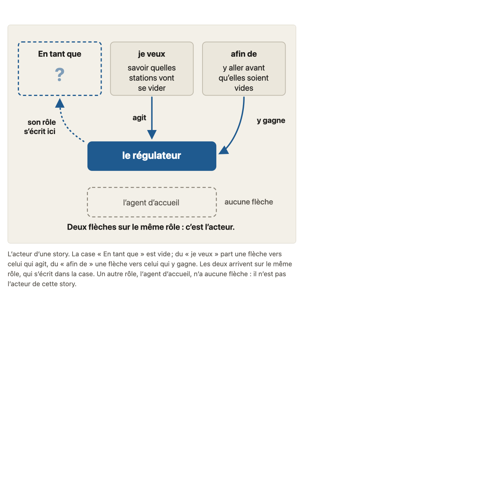
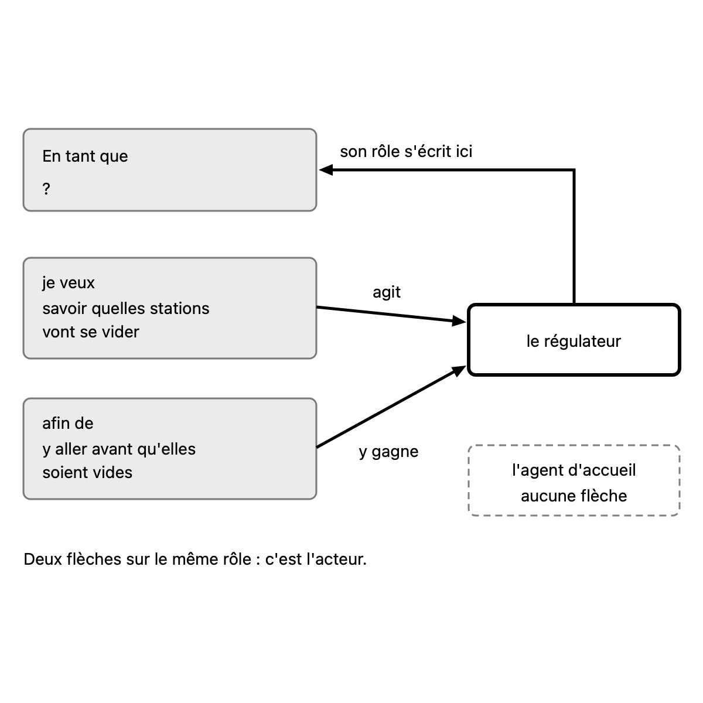

# Migration report: concept 6

Workflow `migrate-concept`, course `parcours-po`, concept folder `concepts/06-roles-personas/`. Paths in the course folder are relative to it; the old files are named from their repository folder (`parcours-po`, `parcours-po-website`).
Old files: `parcours-po/course/concepts/06-roles-personas.md` (CF), `parcours-po/course/sources/06-roles-personas.md` (SF), `parcours-po-website/src/content/concepts/fr/06-roles-personas.mdx` (MDX), `parcours-po-website/src/components/schemas/Schema06.astro` (ASTRO).

## Summary

| checks | target existed | old diagrams | new diagrams | captions of more than one sentence |
|---|---|---|---|---|
| pass | no | 1 | 1 | 1 |

Result: **passed**. checks is read in code from the output below, which the check agent returns; target existed is read in code from the listing below, which the scope agent returns. The new concept is not compared with the old one (rule D on #23): the fresh-agent review judges it against SPEC.md and PROTOCOL.md.

Captions of more than one sentence (SPEC.md 7.2, principle 1: a caption that needs two sentences means two diagrams): acteur-story.svg (4 sentences). Flagged for the review, not refused.

## Target before the run

`ls -ld concepts/06-roles-personas; ls -la concepts/06-roles-personas`, as the scope agent returned it: no such folder.

```
ls: cannot access 'concepts/06-roles-personas': No such file or directory
ls: cannot access 'concepts/06-roles-personas': No such file or directory
```

## Diagrams (M11)

Each old diagram was inventoried (what it shows, by idea), drawn anew from its inventory and concept.md alone under SPEC.md 7.2. Renderings: the old diagram from the frozen site's build; the new one in one colour.

### `parcours-po-website/src/components/schemas/Schema06.astro`

Figure legende, in « L'essentiel »: « L'acteur d'une story. La case « En tant que » est vide ; du « je veux » part une flèche vers celui qui agit, du « afin de » une flèche vers celui qui y gagne. Les deux arrivent sur le même rôle, qui s'écrit dans la case. Un autre rôle, l'agent d'accueil, n'a aucune flèche : il n'est pas l'acteur de cette story. »

One idea.

Its sentences, where the inventory sends them (M11):
- « L'acteur d'une story. »: caption of acteur-story.svg
- « La case « En tant que » est vide ; du « je veux » part une flèche vers celui qui agit, du « afin de » une flèche vers celui qui y gagne. »: caption of acteur-story.svg
- « Les deux arrivent sur le même rôle, qui s'écrit dans la case. »: caption of acteur-story.svg
- « Un autre rôle, l'agent d'accueil, n'a aucune flèche : il n'est pas l'acteur de cette story. »: caption of acteur-story.svg

#### acteur-story.svg

- Title: Deux flèches vers l'acteur de la story
- Caption: L'acteur d'une story. La case « En tant que » est vide ; du « je veux » part une flèche vers celui qui agit, du « afin de » une flèche vers celui qui y gagne. Les deux arrivent sur le même rôle, qui s'écrit dans la case. Un autre rôle, l'agent d'accueil, n'a aucune flèche : il n'est pas l'acteur de cette story. (**4 sentences**: SPEC.md 7.2, principle 1)
- Sub-concept: 6a
- Idea: « Les deux arrivent sur le même rôle, qui s'écrit dans la case. » (MDX « L'essentiel » (Figure legende))

| Id | Element | Labels | Role | State |
|---|---|---|---|---|
| E1 | la case « En tant que » de la phrase de la story, vide, à remplir par le rôle de l'acteur | « En tant que », « ? » | context | none |
| E2 | le bloc « je veux » de la phrase de la story, qui dit l'action | « je veux », « savoir quelles stations vont se vider » | context | none |
| E3 | le bloc « afin de » de la phrase de la story, qui dit le gain | « afin de », « y aller avant qu'elles soient vides » | context | none |
| E4 | le rôle qui fait l'action du « je veux » et y gagne ce que dit le « afin de » : l'acteur de la story | « le régulateur » | subject | none |
| E5 | un autre rôle, qui n'a aucune flèche et n'est pas l'acteur de cette story | « l'agent d'accueil », « aucune flèche » | contrast | none |
| E6 | la note qui donne la règle de lecture : deux flèches sur le même rôle désignent l'acteur | « Deux flèches sur le même rôle : c'est l'acteur. » | text | none |

Relations:
- E2 vers E4 : une flèche, celui qui agit, légendée « agit »
- E3 vers E4 : une flèche, celui qui y gagne, légendée « y gagne »
- Les deux flèches de E2 et de E3 arrivent sur le même rôle, E4
- E4 vers E1 : le rôle s'écrit dans la case, légendé « son rôle s'écrit ici »
- E5 n'a aucune flèche : il n'est lié ni à E2 ni à E3

Key of the inventory: none. Key drawn: none.

| Old | New |
|---|---|
|  |  |

Renderings in `S1-10-06-report/`, beside this report.

## Writing choices

- M9 citation line: none written. The old « Sous-concepts » cites all six cases of the bank by title in « » (« Théo ou Maud ? », « Diego, acteur de sa story ? », « Une vue, deux acteurs », « Abba, on lui fait dire ce qu'on veut ? », « Le trait qu'Anna veut ajouter », « En tant qu'Abba ? »; the last wraps across two lines). « Consignes » is the old text verbatim.
- M9 lead paragraph of « Banque d'exemples »: it says the drafts are invented and not storyline facts, and lists the concepts not to re-teach. It lists no storyline fact used, so it stays at the top of « Banque d'exemples » and no « Faits du fil rouge utilisés » section is written (judgement call).
- M9 « Schéma »: CF text verbatim, with a blank line after the heading.
- M10 « Affirmations »: the old three sub-tables (### 6a, ### 6b, ### Renvois) are merged into one table (SPEC 4.4 requires one table); the ### headings are dropped, the 26 rows keep their order.
- M10 section name: row 'Exemple du fil rouge en 6a' column 1: '(Sous-concepts)' becomes '(Consignes)'.
- M10 Nature, rows matched to an MDX affirmation item (kind): rows 1 consensus; 2 cours; 3, 4, 5 école; 6, 7, 8 cours; 9 (PO verifies) cours; 10 (mauvais acteur) cours; 11 (celui qui demande) cours; 12 (choix de l'acteur change la story, matched to the MDX 'Utilisateur suffit parfois' item) école; 6b rows 'persona choix d'école', 'portrait fictif', 'prénom, objectifs, comportements', 'construit à partir d'utilisateurs réels', 'viennent d'Alan Cooper', 'pas obligatoires', 'critiqués', 'fictif par son identité' école; 'garder le rôle' cours. Renvois row 'consommateurs de données' cours.
- M10 Nature, empty: the fil rouge example row (the MDX item states it with no kind); the two Renvois rows for concepts 5 and 4 (no MDX item, no matching ecoles item).
- M10 Nature, by ecoles stance (no MDX affirmation item states the claim): row 'Le trait qu'Anna veut ajouter' école (matches the Cooper persona item); row 'Les consommateurs de données sont des utilisateurs (renvoi au concept 1)' cours (matches the cours item on the data consumer).
- M10 orphans: none. Every reference S1 to S8 is cited by a source cell, so no 'orphan [Sx] added'.
- M10 old paths: none in the file (the 'sources 01', 'sources 05', 'sources 04' mentions are source-cell text, left as they are); no old decision number (ADR) anywhere; no pointer dropped from the intro or « Non vérifié ».
- M13 replacement 1 (banned arrow): row 'Le choix de l'acteur change la story', 'rôle plus précis: règles, données' became 'rôle plus précis : règles, données' (colon).
- M13 replacement 2 (banned em-dash): in the Cooper quotation of the row 'Le persona est un choix d'école', '"personas" — hypothetical archetypes — as a practical' became '"personas", hypothetical archetypes, as a practical' (commas).
- M13 apostrophes: the old files already had straight apostrophes only; nothing to convert.
- M1/M10: frontmatter and H1 of SF dropped; intro, Références and Non vérifié copied unchanged. M1 objective reading (CF/MDX against course.yaml) concerns concept.md, not these two files, so no writing choice was made here.
- M1: Objectif is the course.yaml objective verbatim, capitalised, final period; no MDX or CF clause lost beyond what S1-08 merged (MDX objectif is a shorter subset; S1-08 note not opened, no extra clause found).
- M4: Essentials built on the MDX wording; CF-only content added at its place: persona '(prénom, objectifs, comportements) construit à partir d'utilisateurs réels' (merged in one sentence, comma-adjusted: 'Un persona, portrait fictif d'un rôle (...) construit à partir d'utilisateurs réels, aide à se le représenter'). CF 'Un rôle est une catégorie...' already covered by the MDX first sentence.
- M3: stances.school Cohn item: added 'répandue,' (CF-only claim) after 'Recommandation de Cohn'. CF 'le prof l'attribue à Cohn, sans l'appeler consensus' and 'à présenter comme une règle pratique' / 'à présenter comme tels' dropped as teacher hints (by design). No CF reference more precise than MDX in the stances.
- M7: Pièges merged, MDX order and sentences, CF-only additions: item 1 'Un consommateur de données reste un utilisateur (choix du cours, concept 1).'; item 2 '(concept 5)'; item 3 'Il ne choisit pas l'acteur sur le papier (qui fait l'action, qui y gagne).'; item 5 'Il suffit quand tous ont le même besoin pour la même raison.'; item 7 '(un portrait tiré de l'imagination de l'équipe)' placed after the bold lead; item 8 'le Scrum Guide n'en parle pas.'. CF item bold labels differ ('Acteur technique', 'Celui qui demande pris pour l'acteur'), MDX labels kept.
- M8: Quick test: CF question kept verbatim as the blockquote (it already holds '(choix du cours, pas règle absolue)'); the Reflexe note 'Choix du cours, pas règle absolue.' as the one paragraph, which repeats the parenthesis of the question; MDX Reflexe body (nearly identical to CF question) not otherwise used.
- M5: 6a and 6b have no children in course.yaml, so no ### headings; reader text follows the promise. The 'Quatre confusions' bullets and the Fil rouge blockquote kept inside 6a.
- M6: Renvoi n=1/5/4/8 became 'concept 1', 'concept 5', 'concept 4', 'concept 8'; pastilles became [cours], [école], [cours] after the claim; Figure became the single image line acteur-story.svg at its place, alt = declared title.
- M13: typographic apostrophes (’) in MDX 6a ('l’action') and Pièges items 2 and 6 replaced by '; no banned character (em-dash, arrow) found in the text, so no replacement was needed.
- M2/M3: description unchanged; neighbors from ecoles.voisines (auteur, texte, refs mapped to author, text, refs); stances.* items use author, text, refs.

## Checks

`mise exec -- specs/linear-course/checks/check-course courses/parcours-po --only course-yaml,concept-folder,conventions,svg-contract,sources,glossary-order,typography --concept 6`

```
course-yaml: ok
concept-folder: ok
conventions: ok
svg-contract: ok
sources: ok
glossary-order: ok
typography: ok
```
