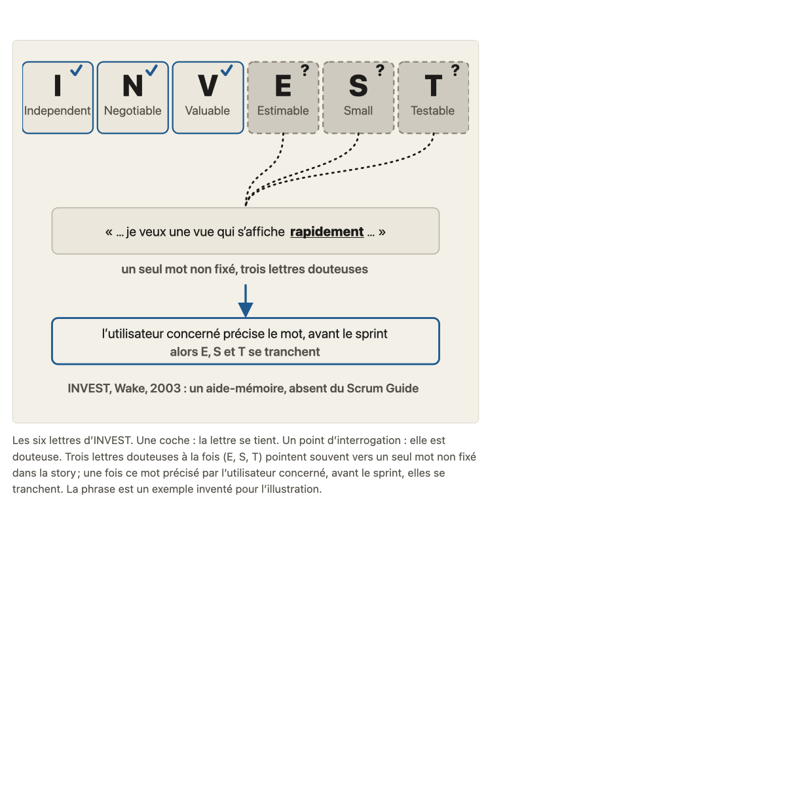
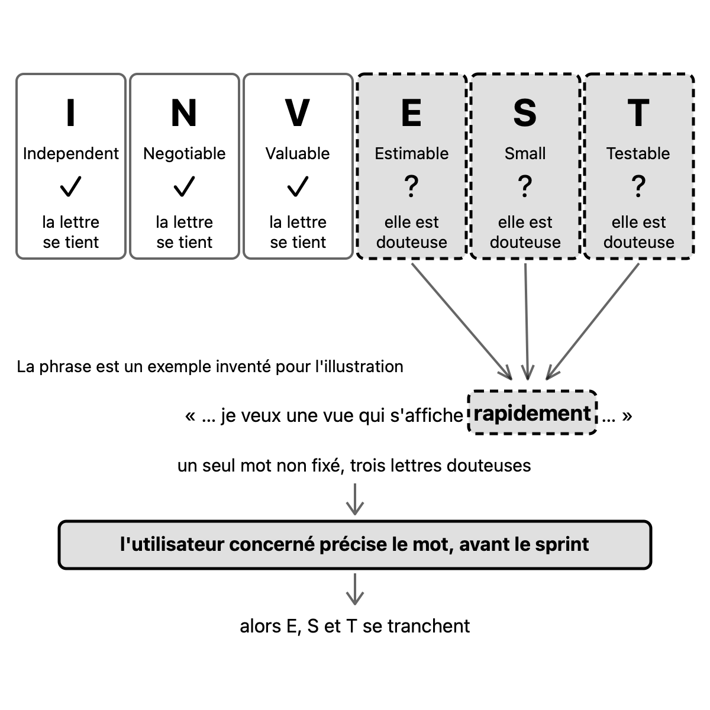

# Migration report: concept 7

Workflow `migrate-concept`, course `parcours-po`, concept folder `concepts/07-invest/`. Paths in the course folder are relative to it; the old files are named from their repository folder (`parcours-po`, `parcours-po-website`).
Old files: `parcours-po/course/concepts/07-invest.md` (CF), `parcours-po/course/sources/07-invest.md` (SF), `parcours-po-website/src/content/concepts/fr/07-invest.mdx` (MDX), `parcours-po-website/src/components/schemas/Schema07.astro` (ASTRO).

## Summary

| checks | target existed | old diagrams | new diagrams | captions of more than one sentence |
|---|---|---|---|---|
| fail | no | 1 | 1 | 0 |

Result: **failed**. checks is read in code from the output below, which the check agent returns; target existed is read in code from the listing below, which the scope agent returns. The new concept is not compared with the old one (rule D on #23): the fresh-agent review judges it against SPEC.md and PROTOCOL.md.

## Target before the run

`ls -ld concepts/07-invest; ls -la concepts/07-invest`, as the scope agent returned it: no such folder.

```
ls: cannot access 'concepts/07-invest': No such file or directory
ls: cannot access 'concepts/07-invest': No such file or directory
```

## Diagrams (M11)

Each old diagram was inventoried (what it shows, by idea), drawn anew from its inventory and concept.md alone under SPEC.md 7.2. Renderings: the old diagram from the frozen site's build; the new one in one colour.

### `parcours-po-website/src/components/schemas/Schema07.astro`

Figure legende, in « L'essentiel »: « Les six lettres d'INVEST. Une coche : la lettre se tient. Un point d'interrogation : elle est douteuse. Trois lettres douteuses à la fois (E, S, T) pointent souvent vers un seul mot non fixé dans la story ; une fois ce mot précisé par l'utilisateur concerné, avant le sprint, elles se tranchent. La phrase est un exemple inventé pour l'illustration. »

One idea.

Its sentences, where the inventory sends them (M11):
- « Les six lettres d'INVEST. »: title of six-lettres-invest.svg
- « Une coche : la lettre se tient. »: labels of six-lettres-invest.svg
- « Un point d'interrogation : elle est douteuse. »: labels of six-lettres-invest.svg
- « Trois lettres douteuses à la fois (E, S, T) pointent souvent vers un seul mot non fixé dans la story ; une fois ce mot précisé par l'utilisateur concerné, avant le sprint, elles se tranchent. »: caption of six-lettres-invest.svg
- « La phrase est un exemple inventé pour l'illustration. »: labels of six-lettres-invest.svg

#### six-lettres-invest.svg

- Title: Les six lettres d'INVEST
- Caption: Trois lettres douteuses à la fois (E, S, T) pointent souvent vers un seul mot non fixé dans la story ; une fois ce mot précisé par l'utilisateur concerné, avant le sprint, elles se tranchent.
- Sub-concept: 7a
- Idea: « Trois lettres douteuses à la fois (E, S, T) pointent souvent vers un seul mot non fixé dans la story ; une fois ce mot précisé par l'utilisateur concerné, avant le sprint, elles se tranchent. » (MDX « L'essentiel » (Figure legende))

| Id | Element | Labels | Role | State |
|---|---|---|---|---|
| E1 | la lettre I d'INVEST, Independent | « I », « Independent », « ✓ », « la lettre se tient » | contrast | done (« Une coche : la lettre se tient ») |
| E2 | la lettre N d'INVEST, Negotiable | « N », « Negotiable », « ✓ », « la lettre se tient » | contrast | done (« Une coche : la lettre se tient ») |
| E3 | la lettre V d'INVEST, Valuable | « V », « Valuable », « ✓ », « la lettre se tient » | contrast | done (« Une coche : la lettre se tient ») |
| E4 | la lettre E d'INVEST, Estimable | « E », « Estimable », « ? », « elle est douteuse » | subject | uncertain (« Un point d'interrogation : elle est douteuse ») |
| E5 | la lettre S d'INVEST, Small | « S », « Small », « ? », « elle est douteuse » | subject | uncertain (« Un point d'interrogation : elle est douteuse ») |
| E6 | la lettre T d'INVEST, Testable | « T », « Testable », « ? », « elle est douteuse » | subject | uncertain (« Un point d'interrogation : elle est douteuse ») |
| E7 | la phrase d'une story, exemple inventé, qui contient le mot flou | « « … je veux une vue qui s'affiche rapidement … » », « La phrase est un exemple inventé pour l'illustration » | context | none |
| E8 | le mot flou de la phrase, le seul mot non fixé dont dépendent E, S et T | « rapidement » | subject | none |
| E9 | note sur le mot flou | « un seul mot non fixé, trois lettres douteuses » | text | none |
| E10 | l'étape qui suit : l'utilisateur concerné précise le mot, avant le sprint | « l'utilisateur concerné précise le mot, avant le sprint » | subject | none |
| E11 | le résultat de la précision : E, S et T se tranchent | « alors E, S et T se tranchent » | text | none |

Relations:
- E1, E2, E3, E4, E5, E6 : les six lettres d'INVEST, dans cet ordre (I, N, V, E, S, T)
- E1, E2 et E3 (les lettres qui se tiennent) sont mises en regard de E4, E5 et E6 (les lettres douteuses)
- E8 est un mot de la phrase E7
- E4, E5 et E6 pointent chacune vers E8 : une seule racine, trois lettres douteuses
- E9 dit ce que montrent E8 et E4, E5, E6 : un seul mot non fixé, trois lettres douteuses
- E7 puis E10, dans cet ordre : une fois le mot précisé, avant le sprint
- E10 mène à E11 : après la précision, E4, E5 et E6 se tranchent

Key of the inventory: none. Key drawn: none.

| Old | New |
|---|---|
|  |  |

Renderings in `S1-10-07-report/`, beside this report.

## Writing choices

- M9 citation line: none written. « Consignes » (old « Sous-concepts ») already cites all five cases by title in « »: « La story d'Abba, lettre par lettre », « Huit jours, trop gros ? », « Heures de pointe », « Le SMS d'Abba », « Le canal dans le critère ». No « Poser » or other sentence added.
- M9 « Faits du fil rouge utilisés »: lead words « Les faits viennent du fil rouge : » dropped; the next word « la » capitalised to « La » (smallest change so the paragraph starts a sentence). CF had no other lead text for the bank, so « Banque d'exemples » goes straight to the cases.
- M10 Nature, rows with no MDX sources.affirmations item, stance inferred from the matching MDX ecoles item: 'S, exercice « Huit jours, trop gros ? »' = école (ecoles.ecole « Bill Wake : la taille d'une story »); 'Exercice « Heures de pointe »' = cours (the mot-flou cours items); 'Un critère qui nomme une solution (« Abba reçoit un SMS »)' = cours (the « Négociable ne veut pas dire tout ouvert » cours item).
- M10 Nature, empty: 'I, illustration : la story d'Abba dépend de l'équipe appli' (fil rouge fact, no matching item), '« Heures de pointe » sert aussi à la mesure de l'objectif produit' (fil rouge), 'Le canal relève de l'équipe appli' (fil rouge), 'Mots flous typiques ... exemples inventés' (MDX item has no kind), 'Story d'Abba ... un tiers des abonnés' and 'Règles fixées ...' (fil rouge).
- M10 Nature, claim merged in MDX: 'Spike : son usage varie selon les écoles' = école (the MDX spike item, kind ecole, states both).
- M10 path rewrite: `course/sources/01-produit-et-po.md`: `concepts/01-produit-et-po/sources.md`.
- M10 path rewrite: `course/sources/05-user-story.md`: `concepts/05-user-story/sources.md` (3 rows).
- M10 path rewrite: `course/sources/04-hierarchie.md`: `concepts/04-hierarchie/sources.md` (2 rows).
- M10 path rewrite: `course/fil-rouge-velos.md`: `storyline.md` (2 rows).
- M10 path rewrite: `course/concepts/02-objectif-produit-resultat.md`: `concepts/02-objectif-produit-resultat/concept.md`.
- M10 section name: '(Sous-concepts 7a2 et 7b)': '(Consignes 7a2 et 7b)' in the mots flous typiques row.
- M10 pointers left as they are (not in the intro or « Non vérifié », so they stay): `07-invest.md`, historique git in two verification cells (rows 'Négociable ne veut pas dire tout est ouvert' and 'Une contrainte s'écrit dans un critère'), and 'cadrage T-018a §8' in the S1 Références row. No old decision number (ADR-nnn) occurs in SF, so no decision slug was needed. The intro and « Non vérifié » contain no old path or dropped pointer.
- M10 orphan: reference S5 (North, Introducing BDD) is cited by no source cell and no row names it in its verification column as support, so it is left uncited; the sources check will fail on S5 (the run fails on it per M10).
- M13 replacement (banned ': '): in the 'Test rapide' row, 'client qui ne sait pas tester: story pas assez claire' became 'client qui ne sait pas tester : story pas assez claire' (colon).
- M13 apostrophes: no typographic apostrophe in the source texts, nothing to convert. Sources Source column untouched otherwise: '[S1] en partie', 'aucune', 'fil rouge', 'proposition d'exercice' copied as is.
- M1: « Objectif » is CF's objective, which matches the course.yaml entry verbatim, with a final period. The S1-08 note records CF as kept and MDX as a shorter form. The MDX clauses 'et distinguer la solution... (qui va dans un critère)' are shorter forms of the same meaning, so no unrecorded clause.
- M3: no ecoles.voisines in MDX, so no neighbors key. Stances items are MDX's, with auteur/texte as author/text. CF's claims all match an MDX item and CF carries no more precise reference (concept 5, 17 and 4 are the same in both), so nothing was carried over.
- M4: the MDX essentials paragraph is the base. I added CF's letter glosses in parentheses after each of I, N, V, E, S, T, at the place CF says them. This includes the I gloss about another team's work, S 'chez Wake... concept 4' and the T gloss.
- M7 item 1: CF's tail 'puis faire préciser par l'utilisateur concerné' was added after 'creuser'.
- M7 item 2: CF's sentence was kept as a separate sentence after the MDX one, although it partly repeats it: 'Le PO le fait préciser par l'utilisateur avant le sprint (concept 15) ; la story attend.'
- M7 item 4: CF's clause 'quelques jours-personnes, c'est le choix de certaines équipes' was inserted between the Wake clause and the course-reference clause.
- M7 item 5: CF's tail was added after the MDX example: 'l'équipe ne peut plus proposer mieux. Écrire le besoin ; la contrainte réelle va dans un critère.'
- M7 item 6: CF's example was added in parentheses at the end of the sentence: '(par exemple, se lire sur un petit écran, exemple inventé)'.
- M7 item 7: CF's precise reference '(concept 10)' was added after 'se traite'. Item 8 is unchanged and the order is MDX's. CF has no item that MDX lacks.
- M8: the CF question and the MDX Reflexe question are identical, so one blockquote. The Reflexe note is the single paragraph. CF adds nothing to it.
- M5/M6: 7a is a sub-concept with children, so it holds only the promise and the ### 7a1 and 7a2 sections. 7b is a leaf, so its text follows the promise. The pastille 'ecole' became '[école]' and 'cours' became '[cours]'. Renvois became 'concept N' (7b, 9, 4, 8, 10, 15). The span.num markup is dropped.
- M11: the Figure in « L'essentiel » became the single line '' after the essentials paragraph. The diagrams entry is as given, subconcept 7a.
- M13: no banned character (em-dash, arrow) was present, so there are no replacements. No typographic apostrophes were present either.

## Checks

`mise exec -- specs/linear-course/checks/check-course courses/parcours-po --only course-yaml,concept-folder,conventions,svg-contract,sources,glossary-order,typography --concept 7`

```
course-yaml: ok
concept-folder: ok
conventions: ok
svg-contract: ok
sources: fail: concepts/07-invest/sources.md:56 reference S5 is cited by no claim
glossary-order: fail: concepts/07-invest/concept.md:38 uses the term "Critère d'acceptation", introduced by concept 8 (glossary.md:46), which comes later
glossary-order: fail: concepts/07-invest/concept.md:52 uses the term "Dépendance", introduced by concept 10 (glossary.md:56), which comes later
typography: ok
```

Form fixes:
- concepts/07-invest/sources.md: merged the four « Affirmations » sub-tables (### Origine et statut de la grille, ### 7a, ### 7b, ### Banque d'exemples et test rapide) into one table, same rows and order, sub-headings and repeated headers dropped; fixed concept-folder 'holds one table, found 4' and the false 'S4 and S7 cited by no claim' (their rows were outside the first table).
- concepts/07-invest/sources.md: reference S7 type 'secondaire, en partie marketing' became 'secondaire (en partie marketing)', same words, parenthesis form as S3/S4/S6; fixed the type-list failure.

Left:
- sources.md:56 reference S5 (North, Introducing BDD) is cited by no claim: no row of the file names [S5] in its verification column as support, so by M10 there is no orphan to add and the run fails on it.
- concept.md:38 uses 'Critère d'acceptation' (introduced by concept 8) and concept.md:52 uses 'Dépendance' (introduced by concept 10): removing the terms would change what the text says, so they are left for the maintainer.

Failing the run:
- sources: fail: concepts/07-invest/sources.md:56 reference S5 is cited by no claim
- glossary-order: fail: concepts/07-invest/concept.md:38 uses the term "Critère d'acceptation", introduced by concept 8 (glossary.md:46), which comes later
- glossary-order: fail: concepts/07-invest/concept.md:52 uses the term "Dépendance", introduced by concept 10 (glossary.md:56), which comes later

## Fixes after the run

- sources: reference S5 (North, « Introducing BDD ») removed from « Références »: the frozen sources file (`parcours-po/course/sources/07-invest.md`) and the MDX tie it to no claim. Re-run: `sources: ok`.
- glossary-order: the two failures (« Critère d'acceptation », « Dépendance ») stay, by rule A (fixed once for all concepts by #166).
- `->` at frozen sources line 69: none in the output; `typography: ok`.
- Fresh review, SVG (SPEC 7.2): the origin band (second idea, E12 of the inventory) dropped and the viewBox shortened to 495; I, N, V boxes unfilled with a weaker stroke, E, S, T keep the dashes and the fill, so the subject is the most marked; arrowheads redrawn clear of the « rapidement » box. PNG regenerated. « Schéma » of `teaching.md`: the banner sentence removed.
- Fresh review,  pitfalls: the duplicated « avant le sprint » sentence merged; « exemple inventé » made « cas inventé ».
