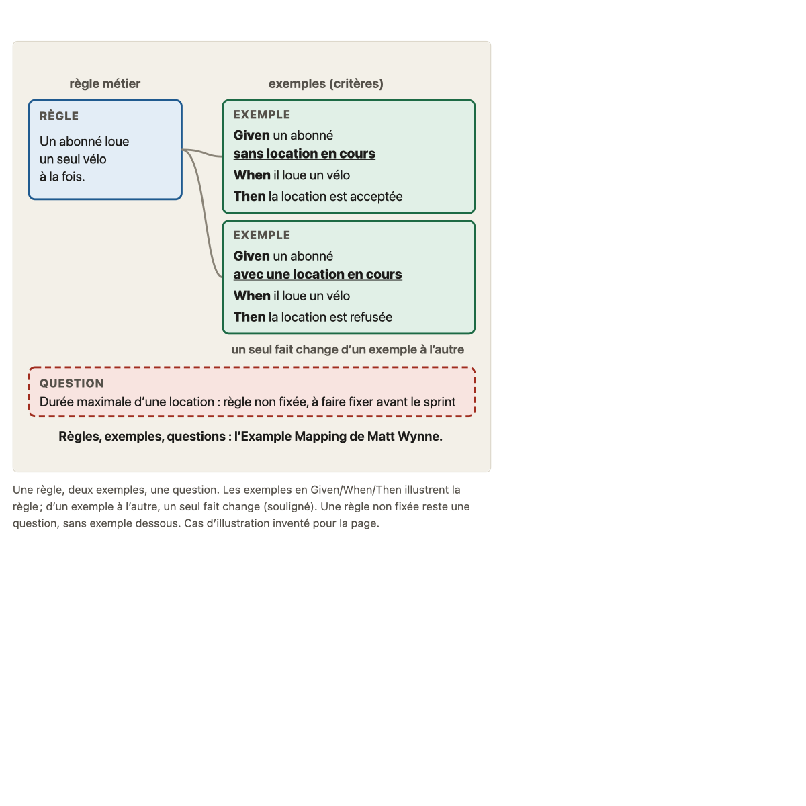
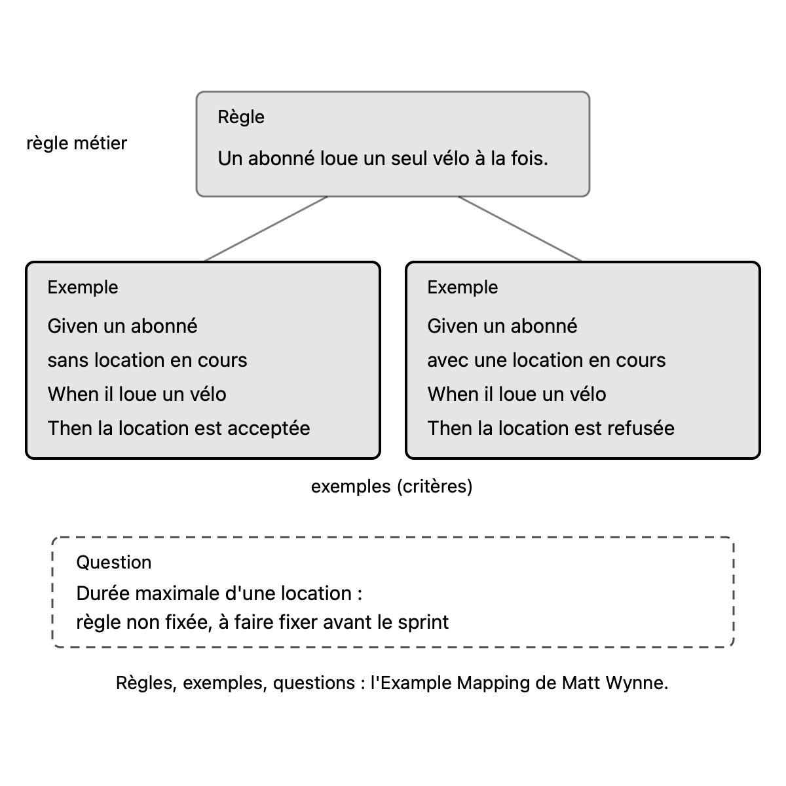

# Migration report: concept 8

Workflow `migrate-concept`, course `parcours-po`, concept folder `concepts/08-criteres-regles/`. Paths in the course folder are relative to it; the old files are named from their repository folder (`parcours-po`, `parcours-po-website`).
Old files: `parcours-po/course/concepts/08-criteres-regles.md` (CF), `parcours-po/course/sources/08-criteres-regles.md` (SF), `parcours-po-website/src/content/concepts/fr/08-criteres-regles.mdx` (MDX), `parcours-po-website/src/components/schemas/Schema08.astro` (ASTRO).

## Summary

| checks | target existed | old diagrams | new diagrams | captions of more than one sentence |
|---|---|---|---|---|
| fail | no | 1 | 1 | 0 (1 before the fixes) |

Result: **failed**. checks is read in code from the output below, which the check agent returns; target existed is read in code from the listing below, which the scope agent returns. The new concept is not compared with the old one (rule D on #23): the fresh-agent review judges it against SPEC.md and PROTOCOL.md.

Captions of more than one sentence (SPEC.md 7.2, principle 1: a caption that needs two sentences means two diagrams): regle-exemples-question.svg (4 sentences). Flagged for the review, not refused.

## Target before the run

`ls -ld concepts/08-criteres-regles; ls -la concepts/08-criteres-regles`, as the scope agent returned it: no such folder.

```
ls: concepts/08-criteres-regles: No such file or directory
ls: concepts/08-criteres-regles: No such file or directory
```

## Diagrams (M11)

Each old diagram was inventoried (what it shows, by idea), drawn anew from its inventory and concept.md alone under SPEC.md 7.2. Renderings: the old diagram from the frozen site's build; the new one in one colour.

### `parcours-po-website/src/components/schemas/Schema08.astro`

Figure legende, in « L'essentiel »: « Une règle, deux exemples, une question. Les exemples en Given/When/Then illustrent la règle ; d'un exemple à l'autre, un seul fait change (souligné). Une règle non fixée reste une question, sans exemple dessous. Cas d'illustration inventé pour la page. »

One idea.

Its sentences, where the inventory sends them (M11):
- « Une règle, deux exemples, une question. »: caption of regle-exemples-question.svg
- « Les exemples en Given/When/Then illustrent la règle ; d'un exemple à l'autre, un seul fait change (souligné). »: caption of regle-exemples-question.svg
- « Une règle non fixée reste une question, sans exemple dessous. »: caption of regle-exemples-question.svg
- « Cas d'illustration inventé pour la page. »: caption of regle-exemples-question.svg

#### regle-exemples-question.svg

- Title: Une règle métier, deux exemples, une règle non fixée
- Caption: Une règle métier est illustrée par des exemples en Given/When/Then, et une règle non fixée reste une question, sans exemple dessous. (1 sentence; the review reduced the diagram to 8a, dropped the one-variable note, and moved the invented-case sentence to sources.md)
- Sub-concept: 8a
- Idea: « Les critères sont souvent des exemples qui illustrent une règle, écrits en **Given/When/Then** (contexte, événement, résultat observable), **une variable à la fois**. Un critère ne fixe pas une règle restée ouverte. » (MDX and CF « L'essentiel » (Figure legende: « Les exemples en Given/When/Then illustrent la règle ; d'un exemple à l'autre, un seul fait change (souligné). Une règle non fixée reste une question, sans exemple dessous. »))

| Id | Element | Labels | Role | State |
|---|---|---|---|---|
| E1 | a business rule, on an invented illustration case (a subscriber rents one bike at a time) | « Règle », « Un abonné loue un seul vélo à la fois. », « règle métier » | context | none |
| E2 | first example (acceptance criterion) in Given/When/Then: a subscriber with no rental in progress rents a bike, the rental is accepted | « Exemple », « Given un abonné », « sans location en cours », « When il loue un vélo », « Then la location est acceptée », « exemples (critères) » | subject | none |
| E3 | second example (acceptance criterion) in Given/When/Then: a subscriber with a rental in progress rents a bike, the rental is refused | « Exemple », « Given un abonné », « avec une location en cours », « When il loue un vélo », « Then la location est refusée » | subject | none |
| E4 | the one fact that changes in the first example (its Given condition) | « sans location en cours » | subject | none |
| E5 | the one fact that changes in the second example (its Given condition) | « avec une location en cours » | subject | none |
| E6 | a question: an unfixed rule (maximum duration of a rental), to be fixed before the sprint, with no example under it | « Question », « Durée maximale d'une location : règle non fixée, à faire fixer avant le sprint » | contrast | uncertain (« règle non fixée, à faire fixer avant le sprint ») |
| E7 | note on the two examples | « un seul fait change d'un exemple à l'autre » | text | none |
| E8 | closing note naming the mapping method the cards come from | « Règles, exemples, questions : l'Example Mapping de Matt Wynne. » | text | none |

Relations:
- E1 is illustrated by E2 and by E3: E1 to E2, E1 to E3 (the examples illustrate the rule)
- E2 and E3 differ by one fact only: E4 in E2 against E5 in E3 (D'un exemple à l'autre, un seul fait change); E7 says it
- E6 has no example under it: no link from E6 to an example

Key of the inventory: none. Key drawn: none.

| Old | New |
|---|---|
|  |  |

Renderings in `S1-10-08-report/`, beside this report.

## Writing choices

- M9 citation line: none added. The old « Sous-concepts » cites all five cases by their titles in « » (Trier les phrases de la story d'Abba, Le seuil des stations presque vides, Le critère d'Abba à corriger, Fraîcheur : que vérifie le Then ?, Les vélos disponibles d'Étienne), so « Consignes » is the old section verbatim.
- M9: « Faits du fil rouge utilisés » is the old bank lead paragraph with its lead words « Faits du fil rouge utilisés : » dropped. The rest is verbatim, so the paragraph now starts in lowercase (« la story d'Abba … »). The bank has no other lead text.
- M13 banned character: in teaching.md, « B1, ... retiré du service: 5 disponibles ; B2, ... signalé en panne: 6 disponibles » became ': 5 disponibles' and ': 6 disponibles' (the arrows of the old text, banned by the French pack, replaced by a colon).
- M13 banned character: in sources.md, the two rows 'Test rapide : « ... »: règle' and ': critère' became ': règle' and ': critère' (the arrows of the old text replaced by a colon).
- M10 structure: the old sub-tables (### Consensus et choix d'école, ### 8a, ### 8b, ### Renvois sans enseignement) are merged into the single « Affirmations » table that SPEC 4.4 requires. Rows keep their old order, and the ### headings are dropped.
- M10 Nature, claim stated by an MDX affirmations item, so its kind: Scrum Guide row consensus; 'story porte des critères' consensus; critère et condition de satisfaction école; PO écrit les critères école (both rows map to the same MDX item, kind ecole); G/W/T créée par North et Matts école; BDD école; G/W/T sans outil école; Gherkin école; Specification by Example école; critère = condition vérifiable cours; T d'INVEST école; règle métier cours; critères = exemples école; Example Mapping école; both test-rapide rows cours (one MDX item 'Test de séparation' holds both questions); contrainte d'usage cours; règle non fixée cours; Given/When/Then définition école; Then vague cours and Critère sans When cours (both map to the MDX item 'Un When absent, un Then vague ou un mot flou'); variable à la fois cours; mot flou cours; solution dans le Then cours; G/W/T non obligatoire cours; DoD/DoR cours.
- M10 Nature, no MDX item states the claim, so the matching ecoles item: row 'Le Then d'un critère de fraîcheur vérifie l'âge…' cours (matches the ecoles.cours item 'Le Then vérifie un résultat observable…', a general item, so the match is an inference); row 'La story attend tant qu'une règle n'est pas fixée' cours (the MDX affirmation on the règle non fixée states it); row 'Les 3C : la confirmation est le critère' consensus (ecoles.consensus item 2).
- M10 Nature left empty: 'Un Then qui exclut le vélo signalé en panne invente une règle', '« Pas de smartphone » est trop large…', and 'Dépendances (10) et DoR (11) : nommés avec renvoi'. No MDX affirmations item and no ecoles item states them.
- M10 old paths rewritten, one line each (old text, new text): `course/sources/07-invest.md`: `concepts/07-invest/sources.md`; `course/sources/05-user-story.md`: `concepts/05-user-story/sources.md`; `course/fil-rouge-velos.md`: `storyline.md`; `course/sources/11-dor-dod.md`: `concepts/11-dor-dod/sources.md`; `course/plan.md`: `plan.md`; S11 link `course/glossary.md`: `glossary.md`. The slugs 07-invest, 05-user-story and 11-dor-dod are taken from the old file names, because course.yaml was not an input beyond concept 8.
- M10 pointers: none dropped. The intro and « Non vérifié » hold no old decision number, off-course.md, task id or git-history pointer. The intro's pointer to « Consensus et choix d'école » stays.
- M10 left as they are: `07-invest.md` and 'historique git' in the verification cell of the contrainte d'usage row and in the S12 reference. They are table cells, not the intro or « Non vérifié », and `07-invest.md` is a bare file name, not an old-repository path. Source cells 'aucune', '[S7] en partie', '[S3] en partie' and the like are kept as written. The Références table is otherwise unchanged.
- M10 orphans: none. All references S1 to S12 are cited by a source cell, so none was added to a row. 'Orphan [Sx] added': not applicable.
- M10: no old ADR number appears in the file, so decisions/team-in-sprints.md was not used.
- M10: no 'Sous-concepts' section name appears in the rows, so none became 'Consignes'. The row texts keep their old section names ('banque', 'Pièges', 'L'essentiel', 'Schéma', 'Le test rapide', '8a', '8b'), which are not renamed.
- M1 objective merge: not needed for these two files. concept.md is out of scope, so no clause check was made.
- M1: Objectif is the course.yaml objective verbatim. CF and MDX objectifs carry no clause that the objective lacks, so there is no writing choice to report.
- M3: the MDX has no ecoles.voisines, so there is no neighbors key. CF's consensus claims all match MDX items, with the same concept references, so nothing CF-only was carried into the stances.
- M4: the CF-only reference (8a2) at the end of L'essentiel is written "(concept 8a2)", because a bare id with no word before it is not a concept reference (SPEC 4.5).
- M7 Pièges, item 1: CF-only sentence "Le test rapide les sépare." added at the end of the item.
- M7 Pièges, item 2: the MDX sentence "Le PO la fait fixer avant que la story parte" is replaced by CF's fuller sentence "Le PO ne l'invente pas et ne la tranche pas à la place de l'utilisateur concerné ; il la fait fixer avant que la story parte", with the MDX references kept. CF's sentence carries all of the MDX one.
- M7 Pièges, item 4: CF-only sentences added. "le testeur doit encore poser une question." now comes before the MDX instruction, which takes a capital ("Écrire la valeur fixée") because it starts a sentence. "Un mot dont la règle n'est pas fixée (« location trop longue ») relève du piège précédent." ends the item.
- M7 Pièges, item 5: CF's two items (Then vague, When absent) merge into the MDX item. The MDX sentence is kept, and the CF-only example and advice follow it verbatim: "Un Then vague (« l'utilisateur est informé ») : écrire ce que le testeur vérifie (un nombre, son âge)."
- M7 Pièges, item 7: CF's more precise reference "(concept 7b)" added at the end of the item.
- M7 Pièges, last item: CF-only clause "; un critère écrit autrement convient s'il reste tranchable" added after "c'est un choix d'école".
- M8: the blockquote is the CF quick-test text (Règle / Critère / un seul fait change). The paragraph is the Reflexe note "Formulation du cours, sans source externe." CF adds nothing beyond the blockquote.
- M5/M6: the FilRouge becomes a blockquote opening "**Fil rouge :**". The three Pastilles of 8a1, 8b1 and 8b2 are kept where they stood: [cours], [école], [cours], [cours]. The MDX had no <h4> outside course.yaml.
- M6/M11: the Figure in L'essentiel becomes one image line, placed after the essentials paragraph. Its alt text is the diagram title, and the frontmatter diagrams entry is verbatim as given.
- M13: apart from the arrows replaced above, no banned character (em-dash) and no typographic apostrophe found.

## Checks

`mise exec -- specs/linear-course/checks/check-course courses/parcours-po --only course-yaml,concept-folder,conventions,svg-contract,sources,glossary-order,typography --concept 8`

```
course-yaml: ok
concept-folder: ok
conventions: ok
svg-contract: ok
sources: fail: concepts/08-criteres-regles/sources.md:63 reference S11: type "interne (définition du cours, pas une source externe)" must be one or more of primaire, secondaire, marketing, separated by commas
sources: fail: concepts/08-criteres-regles/sources.md:64 reference S12: type "interne (observation de session, un seul apprenant : base faible)" must be one or more of primaire, secondaire, marketing, separated by commas
glossary-order: fail: concepts/08-criteres-regles/concept.md:63 uses the term "Definition of Ready", introduced by concept 11 (glossary.md:58), which comes later
typography: ok
```

Left:
- sources.md:63 (S11) and :64 (S12): the Références type cells say 'interne (...)', copied from the old sources file (M10: Références unchanged). Giving them primaire, secondaire or marketing would invent a source classification and change what the text says, not a form fix.
- concept.md:63 (Fil rouge blockquote): uses 'Definition of Ready', introduced by concept 11 (glossary.md:58). The sentence already defines the term inline and points to concept 11; removing or rewording it would change what the text says, so it was left. Run once; nothing was edited.

Failing the run:
- sources: fail: concepts/08-criteres-regles/sources.md:63 reference S11: type "interne (définition du cours, pas une source externe)" must be one or more of primaire, secondaire, marketing, separated by commas
- sources: fail: concepts/08-criteres-regles/sources.md:64 reference S12: type "interne (observation de session, un seul apprenant : base faible)" must be one or more of primaire, secondaire, marketing, separated by commas
- glossary-order: fail: concepts/08-criteres-regles/concept.md:63 uses the term "Definition of Ready", introduced by concept 11 (glossary.md:58), which comes later

## Fixes after the run

- sources.md S11 and S12 types rewritten "primaire (interne : <old remark>)" (ruling on #23, until #140 and #141). `sources` now passes.
- `glossary-order` remains on "Definition of Ready" (concept.md:63): rule A, fixed by #166.
- No arrow or em-dash survives (`typography` ok); no orphan reference; "Consignes" cites all five cases already (rule B, no line added).
- Review of PR #189: the diagram is now for 8a only (rule, two examples, the unfixed rule as a question), one-sentence caption, the 8b2 note and its underlines dropped, group ids all `8a-*`, viewBox 600x500. The question card is `secondary` (contrast, as the inventory says). The sentence "Cas d'illustration inventé pour la page." moved to a row of sources.md.
- concept.md: the sentence pointing to the drawing reworded; Pièges "Un Then vague" merged. teaching.md: « Schéma » rewritten for the new drawing, « Faits du fil rouge utilisés » capitalised, the fallback case headed "(8b1, rechange)". PNG regenerated.
