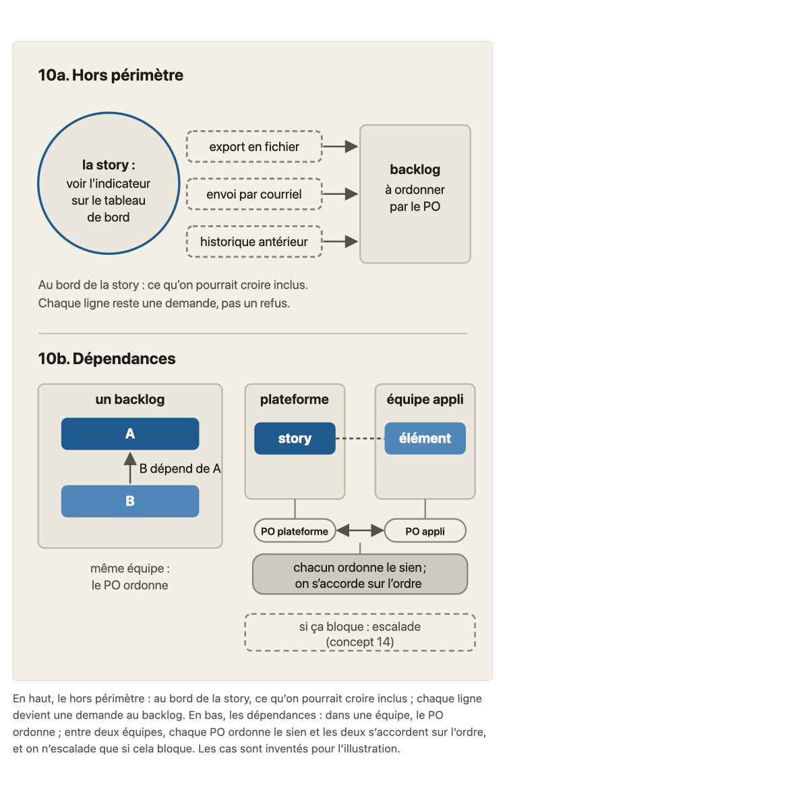
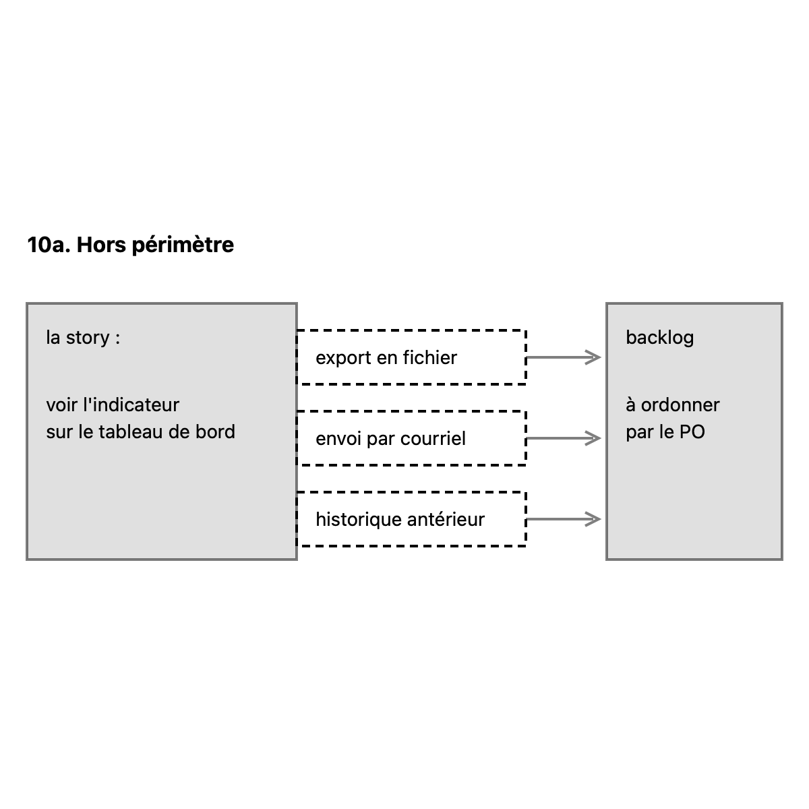
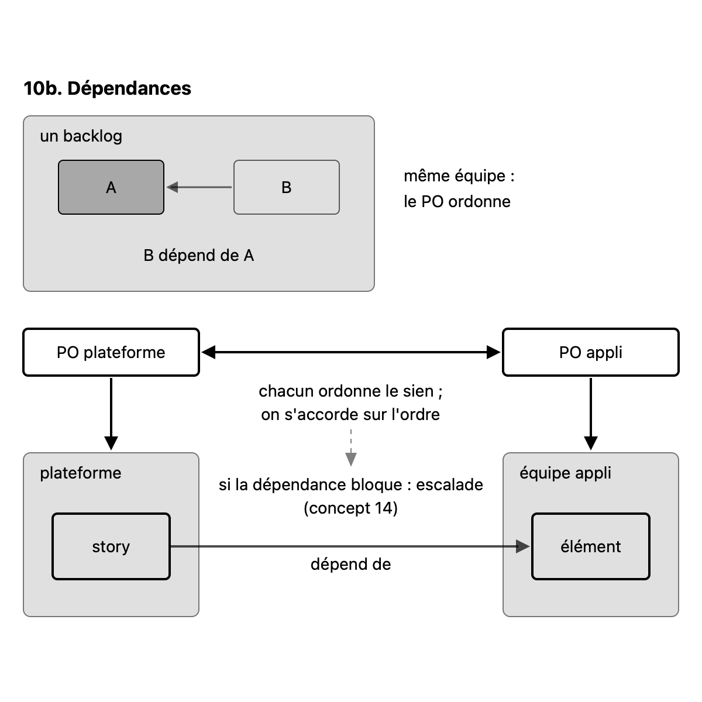

# Migration report: concept 10

Workflow `migrate-concept` (run `wf_409f303c-4a2`), course `parcours-po`, concept folder `concepts/10-hors-perimetre-dependances/`. Paths in the course folder are relative to it; the old files are named from their repository folder (`parcours-po`, `parcours-po-website`).
Old files: `parcours-po/course/concepts/10-hors-perimetre-dependances.md` (CF), `parcours-po/course/sources/10-hors-perimetre-dependances.md` (SF), `parcours-po-website/src/content/concepts/fr/10-hors-perimetre-dependances.mdx` (MDX), `components/schemas/Schema10.astro` (ASTRO).

## Summary

| checks | target existed | old diagrams | new diagrams | captions of more than one sentence |
|---|---|---|---|---|
| fail | no | 1 | 2 | 0 |

Result: **failed**. checks is read in code from the output below, which the check agent returns; target existed is read in code from the listing below, which the scope agent returns. The new concept is not compared with the old one (rule D on #23): the fresh-agent review judges it against SPEC.md and PROTOCOL.md.

## Target before the run

`ls -ld concepts/10-hors-perimetre-dependances; ls -la concepts/10-hors-perimetre-dependances`, as the scope agent returned it: no such folder.

```
ls: cannot access 'concepts/10-hors-perimetre-dependances': No such file or directory
ls: cannot access 'concepts/10-hors-perimetre-dependances': No such file or directory
```

## Diagrams (M11)

Each old diagram was inventoried (what it shows, by idea), drawn anew from its inventory and concept.md alone under SPEC.md 7.2. Renderings: the old diagram from the frozen site's build; the new one in one colour.

### `components/schemas/Schema10.astro`

Figure legende, in « L'essentiel »: « Le hors périmètre : au bord de la story, ce qu’on pourrait croire inclus ; chaque ligne devient une demande au backlog. En bas, les dépendances : dans une équipe, le PO ordonne ; entre deux équipes, chaque PO ordonne le sien et les deux s’accordent sur l’ordre, et on n’escalade que si cela bloque. Les cas sont inventés pour l’illustration. »

Split by idea: 2 diagrams.

Its sentences, where the inventory sends them (M11):
- « Le hors périmètre : au bord de la story, ce qu'on pourrait croire inclus ; chaque ligne devient une demande au backlog. »: caption of hors-perimetre.svg
- « Les dépendances : dans une équipe, le PO ordonne ; entre deux équipes, chaque PO ordonne le sien et les deux s'accordent sur l'ordre, et on n'escalade que si cela bloque. »: caption of dependances.svg
- « Les cas sont inventés pour l'illustration. »: labels of hors-perimetre.svg

#### hors-perimetre.svg

- Title: Le hors périmètre d'une story
- Caption: Le hors périmètre : au bord de la story, ce qu'on pourrait croire inclus ; chaque ligne devient une demande au backlog (cas inventé pour l'illustration).
- Sub-concept: 10a
- Review fix: the three note sentences of the diagram were removed (7.2 principle 6); their content moved to the caption.
- Idea: « Le hors périmètre : au bord de la story, ce qu’on pourrait croire inclus ; chaque ligne devient une demande au backlog. » (MDX « L'essentiel », legende de la Figure)

| Id | Element | Labels | Role | State |
|---|---|---|---|---|
| E1 | le titre du panneau, le hors périmètre | « 10a. Hors périmètre » | text | none |
| E2 | la story qui affiche un indicateur sur un tableau de bord, dont le bord sépare ce qu'elle fait de ce qu'on pourrait croire inclus | « la story : », « voir l'indicateur sur le tableau de bord » | context | none |
| E3 | une ligne du hors périmètre, au bord de la story : l'export en fichier | « export en fichier » | subject | none |
| E4 | une ligne du hors périmètre, au bord de la story : l'envoi par courriel | « envoi par courriel » | subject | none |
| E5 | une ligne du hors périmètre, au bord de la story : l'historique antérieur | « historique antérieur » | subject | none |
| E6 | le backlog, où chaque ligne devient une demande que le PO ordonne | « backlog », « à ordonner par le PO » | context | none |

Relations:
- E3, E4 et E5 se tiennent au bord de E2, à l'extérieur : ce qu'on pourrait croire inclus dans la story
- E3, E4 et E5 vont chacun vers E6 : chaque ligne devient une demande au backlog, que le PO ordonne

Key of the inventory: none. Key drawn: none.

#### dependances.svg

- Title: Les dépendances dans une équipe et entre deux équipes
- Caption: Les dépendances : dans une équipe, le PO ordonne ; entre deux équipes, chaque PO ordonne le sien et les deux s'accordent sur l'ordre, et on n'escalade que si cela bloque (cas inventés pour l'illustration).
- Sub-concept: 10b
- Idea: « Les dépendances : dans une équipe, le PO ordonne ; entre deux équipes, chaque PO ordonne le sien et les deux s’accordent sur l’ordre, et on n’escalade que si cela bloque. » (MDX « L'essentiel », legende de la Figure)

| Id | Element | Labels | Role | State |
|---|---|---|---|---|
| E1 | le titre du panneau, les dépendances | « 10b. Dépendances » | text | none |
| E2 | un seul backlog, celui d'une équipe | « un backlog » | context | none |
| E3 | un élément du backlog dont l'autre dépend | « A » | contrast | none |
| E4 | un élément du backlog qui dépend du premier | « B » | contrast | none |
| E5 | la mention de la dépendance dans l'équipe | « B dépend de A » | text | none |
| E6 | note : dans une même équipe, le PO ordonne | « même équipe : », « le PO ordonne » | text | none |
| E7 | le backlog de la plateforme | « plateforme » | context | none |
| E8 | une story du backlog de la plateforme | « story » | subject | none |
| E9 | le backlog de l'équipe appli | « équipe appli » | context | none |
| E10 | un élément du backlog de l'équipe appli | « élément » | subject | none |
| E11 | le PO de la plateforme, qui ordonne son backlog | « PO plateforme » | subject | none |
| E12 | le PO de l'équipe appli, qui ordonne son backlog | « PO appli » | subject | none |
| E13 | l'accord entre les deux PO sur l'ordre | « chacun ordonne le sien ; », « on s'accorde sur l'ordre » | subject | none |
| E14 | l'escalade, seulement si la dépendance bloque, vue au concept 14 | « si ça bloque : escalade », « (concept 14) » | context | none |

Relations:
- E4 dépend de E3 : B dépend de A, dans E2, et E5 le dit ; dans cette équipe le PO ordonne (E6)
- E2 contient E3 et E4, dans cet ordre de l'élément dont l'autre dépend à celui qui en dépend
- E7 contient E8 ; E9 contient E10
- E8 et E10 sont liés par une dépendance entre les deux backlogs
- E11 ordonne E7 ; E12 ordonne E9 : chaque PO ordonne le sien
- E11 et E12 s'accordent sur l'ordre, dans les deux sens (E13)
- E14 vient après E13, seulement si cela bloque

Key of the inventory: none. Key drawn: none.

| Old | New |
|---|---|
|  |  |
|  |  |

Renderings in `S1-10-10-report/`, beside this report.

## Writing choices

- M9 citation line: none. The four cases (« Écrire le hors périmètre de la tournée », « Maud crie au bug », « Fusionner les deux stories de Charlotte ? », « Le canal d'Abba dépend de l'équipe appli ») are all cited by title in the old « Sous-concepts », so « Consignes » is verbatim and has no « Cas de la banque » line.
- M9: the lead paragraph of « Banque d'exemples » became « Faits du fil rouge utilisés » with its lead words « Faits du fil rouge utilisés : » dropped; the text then starts with the lowercase « la story de tournée », left lowercase (nothing else reworded).
- M9: « Banque d'exemples » has no other lead text, so the cases follow its heading directly. « Schéma » verbatim.
- M10 intro: no old path, no pointer to drop, no change. « Non vérifié »: unchanged, no pointer to drop.
- M10 path rewrite: `course/fil-rouge-velos.md` becomes `storyline.md` (rows 'Le hors périmètre de la story de Théo', 'Scarlette, Scrum Master', 'Faits de 10b2'; 3 times).
- M10 path rewrite: `course/glossary.md` becomes `glossary.md` (source cell of the row 'Définition d'une dépendance').
- M10 path rewrite: `course/sources/07-invest.md` becomes `concepts/07-invest/sources.md` (source cell of the row 'Les Developers estiment la taille').
- M10 path rewrite: `course/sources/08-criteres-regles.md` becomes `concepts/08-criteres-regles/sources.md` (source cell of the row 'Règle de blocage').
- M10 left as they are: bare file names with no `course/` prefix (`05-user-story.md`, `00-scrum.md`, `01-produit-et-po.md`, `07-invest.md`, `09-decoupage-vertical.md` in the verification column and in S3's consultation date); they are not paths of the old repository in the forms the rule lists.
- M10 header: 'Affirmation (section du fichier du concept)' replaced by the M10 header 'Affirmation (section de `concept.md` ou de `teaching.md`)', and the fourth column 'Nature' added.
- M10 Nature, empty because the matching MDX item has no kind: rows 'Écrire ce que la story ne fait pas...' (S2 item), 'Une dépendance qui reste se traite en ordonnant', 'Deux stories dont aucune n'a de valeur seule', 'Le Scrum Guide ne traite pas deux produits ayant chacun son PO' (MDX item 'Plusieurs équipes Scrum sur un même produit partagent un PO...').
- M10 Nature, empty because no MDX item states the claim and no ecoles item matches: the 5 fil rouge rows (Théo's hors périmètre, Scarlette/Odile/Pia, faits de 10b2) plus 'Règle de blocage' and 'signalements par téléphone absents'. The MDX last item on invented fil rouge examples (no kind) was not taken as stating those claims.
- M10 Nature, choice: the row 'Chaque PO ordonne seul son backlog... le PO écrit la dépendance dans son backlog et demande à l'autre PO...' is composite; matched to the MDX item 'Envers une autre équipe, écrire la dépendance...' (kind cours, same 'lecture du cours' sentence in its verification), not to the consensus item 'Le PO ordonne le backlog; qui veut changer l'ordre le convainc'. Nature: cours.
- M10 Nature, choice: the row 'La puce « Consensus (pratique établie...) »' matched to the MDX item 'Réduire les dépendances et rendre visibles celles qui restent' (consensus).
- M10 Nature, choice: the row 'Dépendance envers une autre équipe : la rendre visible et s'accorder...' matched to the MDX 'Envers une autre équipe...' item (cours); the SAFe and tool rows to their ecole items (written école).
- M10 orphans: none. S1 to S10 are all cited by a source cell, so no 'orphan [Sx] added'.
- M13: no typographic apostrophe, em-dash or arrow in the old files read (checked by grep), so no replacement was needed; all apostrophes written straight.
- The target folder did not exist; the Write calls created it. Not run: check-course (task says write only these two files).
- M3: CF's 'concepts 0, 1, 3' (more precise than MDX, which has none) carried into the Scrum Guide consensus item after 'que le PO ordonne'; written 'concepts 0, 1 et 3' (list joined by 'et', SPEC 4.5), a comma-list form replaced.
- M1: no objective clause is a writing choice: CF and MDX objectifs are carried by the course.yaml objective (MDX 'savoir' vs 'dire', 'dans l'équipe' vs 'entre deux stories de l'équipe' are covered by S1-08's CF-kept merge). Nothing to report.
- M4: CF 'L'essentiel' adds nothing beyond the MDX text; MDX wording kept as it is. The Figure becomes the two image lines after the paragraph (end of the zone).
- M7: CF clause 'on ne sait plus ce qui est exclu' added to the 'Lister des évidences' item, after the MDX 'une ligne vague (« le reste ») est aussi à éviter'.
- M7: CF's three items (refus / traiter aussitôt / trancher en revue) are already merged in one MDX item; kept as one MDX item, with CF's precise references added: '(concept 13)' and '(concept 8a2)'.
- M7: CF endings added: '; s'accorder avec le PO de l'autre équipe' (Livrer sa part), ': on convainc son PO ; l'escalade vient ensuite (concept 14)' (Ordonner le backlog d'une autre équipe), '; ce sont des choix d'école' (Croire que le Scrum Guide prescrit). CF's first-item ending 'dispute sur ce qui était prévu' not added: MDX 'c'est un bug' sentence kept as base.
- M8: the quick-test blockquote is the CF question (with its 'Si oui et que ce n'est pas le cas, la ligne s'écrit' and 'Envers une autre équipe'); the paragraph is the MDX Reflexe note 'Formulation du cours.'; the MDX three-line form is not kept as it says less than CF.
- M6: Renvoi n='A1' written 'annexe A1' in plain text; Pastilles written [cours], [école], [consensus] where they stood.
- M13: typographic apostrophes in 10b2 changed to straight (form, not a choice); no banned characters found, no replacement made.
- M3/M5: no stances section in the body; no MDX sub-headings outside course.yaml; MDX Sous titles equal the course.yaml titles.

## Checks

`mise exec -- specs/linear-course/checks/check-course courses/parcours-po --only course-yaml,concept-folder,conventions,svg-contract,sources,glossary-order,typography --concept 10`

```
course-yaml: ok
concept-folder: ok
conventions: ok
svg-contract: ok
sources: ok
glossary-order: fail: concepts/10-hors-perimetre-dependances/concept.md:89 uses the term "Escalade", introduced by concept 14 (glossary.md:74), which comes later
typography: ok
```

Left:
- glossary-order, concepts/10-hors-perimetre-dependances/concept.md:89: the term "Escalade" (introduced by concept 14, glossary.md:74) appears before its introduction. Removing or replacing it would change what the text says, so it is not a form fix. Whether to reword it or reorder the glossary is for the reviewer or maintainer to decide. One run only; nothing was changed, so no rerun.

Failing the run:
- glossary-order: fail: concepts/10-hors-perimetre-dependances/concept.md:89 uses the term "Escalade", introduced by concept 14 (glossary.md:74), which comes later

