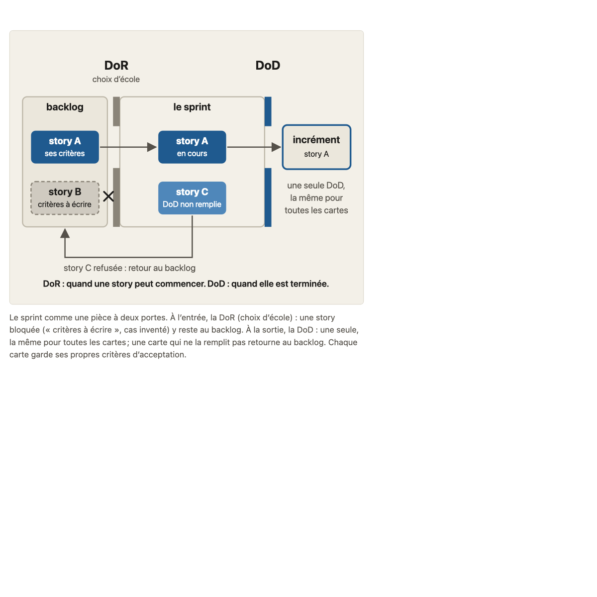
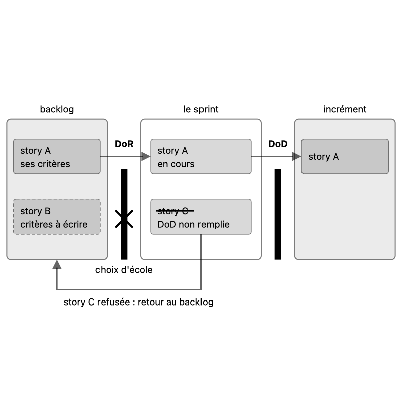

# Migration report: concept 11

Workflow `migrate-concept`, course `parcours-po`, concept folder `concepts/11-dor-dod/`. Paths in the course folder are relative to it; the old files are named from their repository folder (`parcours-po`, `parcours-po-website`).
Old files: `parcours-po/course/concepts/11-dor-dod.md` (CF), `parcours-po/course/sources/11-dor-dod.md` (SF), `parcours-po-website/src/content/concepts/fr/11-dor-dod.mdx` (MDX), `parcours-po-website/src/components/schemas/Schema11.astro` (ASTRO).

## Summary

| checks | target existed | old diagrams | new diagrams | captions of more than one sentence |
|---|---|---|---|---|
| fail | no | 1 | 1 | 1 |

Result: **failed**. checks is read in code from the output below, which the check agent returns; target existed is read in code from the listing below, which the scope agent returns. The new concept is not compared with the old one (rule D on #23): the fresh-agent review judges it against SPEC.md and PROTOCOL.md.

Captions of more than one sentence (SPEC.md 7.2, principle 1: a caption that needs two sentences means two diagrams): sprint-piece-deux-portes.svg (3 sentences as the run wrote it). Flagged for the review; the contributor rewrote it as one sentence (fresh-agent review, PR #190).

## Target before the run

`ls -ld concepts/11-dor-dod; ls -la concepts/11-dor-dod`, as the scope agent returned it: no such folder.

```
ls: concepts/11-dor-dod: No such file or directory
ls: concepts/11-dor-dod: No such file or directory
```

## Diagrams (M11)

Each old diagram was inventoried (what it shows, by idea), drawn anew from its inventory and concept.md alone under SPEC.md 7.2. Renderings: the old diagram from the frozen site's build; the new one in one colour.

### `parcours-po-website/src/components/schemas/Schema11.astro`

Figure legende, in « L'essentiel » : « Le sprint comme une pièce à deux portes. À l'entrée, la DoR (choix d'école) : une story bloquée (« critères à écrire », cas inventé) y reste au backlog. À la sortie, la DoD : une seule, la même pour toutes les cartes ; une carte qui ne la remplit pas retourne au backlog. Chaque carte garde ses propres critères d'acceptation. »

One idea.

Its sentences, where the inventory sends them (M11):
- « Le sprint comme une pièce à deux portes. »: title of sprint-piece-deux-portes.svg
- « À l'entrée, la DoR (choix d'école) : une story bloquée (« critères à écrire », cas inventé) y reste au backlog. »: caption of sprint-piece-deux-portes.svg
- « À la sortie, la DoD : une seule, la même pour toutes les cartes ; une carte qui ne la remplit pas retourne au backlog. »: caption of sprint-piece-deux-portes.svg
- « Chaque carte garde ses propres critères d'acceptation. »: caption of sprint-piece-deux-portes.svg

#### sprint-piece-deux-portes.svg

- Title: Le sprint comme une pièce à deux portes
- Caption: Le sprint entre deux portes : à l'entrée la DoR (choix d'école), où une story aux critères à écrire (cas inventé) reste au backlog ; à la sortie une seule DoD, qui renvoie au backlog la carte qui ne la remplit pas. (one sentence after the review; the run's caption had 3)
- Sub-concept: 11a
- Idea: « Le sprint comme une pièce à deux portes. » (MDX, « L'essentiel » (legende de la Figure))

| Id | Element | Labels | Role | State |
|---|---|---|---|---|
| E1 | le sprint, la pièce que l'on entre par la porte d'entrée et que l'on quitte par la porte de sortie | « le sprint » | subject | none |
| E2 | la porte d'entrée du sprint, la Definition of Ready, un choix d'école | « DoR », « choix d'école » | subject | none |
| E3 | la porte de sortie du sprint, la Definition of Done, une seule pour toutes les cartes | « DoD » | subject | none |
| E4 | le backlog, où attendent les cartes et où retourne une carte refusée | « backlog » | context | none |
| E5 | la story A dans le backlog, qui a ses propres critères d'acceptation | « story A », « ses critères » | context | none |
| E6 | la story B, bloquée devant la porte d'entrée parce que ses critères d'acceptation ne sont pas écrits (cas inventé) | « story B », « critères à écrire » | context | none |
| E7 | la story A dans le sprint, entrée par la porte d'entrée | « story A », « en cours » | context | none |
| E8 | la story C dans le sprint, qui ne remplit pas la DoD | « story C », « DoD non remplie » | context | refused (« elle est refusée ») |
| E9 | l'incrément, où sort une carte qui remplit la DoD | « incrément » | context | none |
| E10 | la story A dans l'incrément, sortie par la porte de sortie | « story A » | context | none |
| E11 | note sur le retour d'une carte refusée | « story C refusée : retour au backlog » | text | none |
| E12 | note sur la DoD, commune à toutes les cartes | « une seule DoD, », « la même pour », « toutes les cartes » | text | none |
| E13 | note de lecture des deux portes | « DoR : quand une story peut commencer. DoD : quand elle est terminée. » | text | none |

Relations:
- E4 contient E5 et E6; E1 contient E7 et E8; E9 contient E10
- E2 est la porte entre E4 et E1 (entrée du sprint); E3 est la porte entre E1 et E9 (sortie du sprint)
- E5 passe E2 et devient E7 (la story A entre dans le sprint)
- E6 reste dans E4 devant E2, bloquée : ses critères sont à écrire
- E7 passe E3 et devient E10 (la story A sort vers l'incrément)
- E8 est refusée à E3 et retourne à E4 (E11 le dit)
- E12 dit que E3 est une seule pour toutes les cartes
- E13 dit ce que E2 et E3 décident : quand une story peut commencer (E2), quand elle est terminée (E3)

Key of the inventory: none. Key drawn: none.

| Old | New |
|---|---|
|  |  |

Renderings in `S1-10-11-report/`, beside this report.

## Writing choices

- M9 citation line: none written. The old « Sous-concepts » cites all five cases by title (« DoD ou critère : les trois exigences d'Étienne », « L'exception demandée par Étienne », « La DoD évolue », « La story d'Étienne sans accès aux locations », « Une DoR qui devient barrière »). « Consignes » is the old « Sous-concepts » verbatim, two numbered items.
- M9 « Faits du fil rouge utilisés »: lead words « Faits du fil rouge utilisés : » dropped, so the paragraph opens in lowercase (« les vues d'Étienne ... »). Nothing else was reworded, and the old line breaks are kept. « Banque d'exemples » has no other lead text.
- M10 structure: the old file had four tables (Consensus et choix d'école, 11a, 11b, Renvois sans enseignement) under ### subheadings. SPEC 4.4 says « Affirmations » is one table, so the 42 rows are merged into one table, same rows and same order, and the ### subheadings are dropped.
- M10 orphan [S8] added: S8 is cited by no source cell, and only the verification of the row « Une seule DoD, pour toute story (L'essentiel, 11a, « Ce qui marche ») » names it as support (« observation [S8] »). Its source cell became « [S1], [S2], [S8] ». The check no longer reports S8 as uncited.
- M10 Nature, claim matches an MDX affirmation item: consensus for the Scrum Guide rows 1-11 (MDX affirmations 1 to 5, 9) and the 11b rows on SG, planning and no DoR; cours for the règle métier, « sorte de travail », test « vaut-il... » and « A2 » rows; école for the Ambler data example, the DoR rows (conditions, origin, typical conditions, risk, Cohn exception).
- M10 Nature, no MDX affirmation states the claim, so the matching MDX ecoles item decides: « Une exigence recopiée dans les critères de chaque story va dans la DoD » is consensus (Cohn item); « Le contenu de la DoD est propre au produit » is école (« Le contenu de la DoD » item); « Une DoR qui exige toutes les questions réglées... » is école (Cohn risk item); « L'exception demandée par Étienne » is consensus (SG and Cohn items, which both say the DoD adds to the criteria and a story that fails it returns to the backlog; inferred, the row also holds a course deduction).
- M10 Nature left empty: storyline-fact rows (exigences 1, 2 and 3, the aparté « La DoD évolue », « Faire avancer l'accès », the DoR de l'équipe vélos, the story d'Étienne, « Réponse attendue : la story n'est pas prête ») and the five « Renvois sans enseignement » rows, because no MDX item or ecoles item states them.
- M10 paths rewritten (old text, new text): `course/sources/00-scrum.md` to `concepts/00-scrum/sources.md`; `course/sources/08-criteres-regles.md` to `concepts/08-criteres-regles/sources.md`; `course/sources/10-hors-perimetre-dependances.md` to `concepts/10-hors-perimetre-dependances/sources.md`; `course/sources/12-donnees-produit.md` to `concepts/12-donnees-produit/sources.md` (also inside a verification cell); `course/sources/05-user-story.md` to `concepts/05-user-story/sources.md`; `course/sources/01-produit-et-po.md` to `concepts/01-produit-et-po/sources.md`; `course/fil-rouge-velos.md` to `storyline.md`; `course/plan.md` to `plan.md`; `course/glossary.md` to `glossary.md` (S10 link cell). All six concept dirs exist in course.yaml.
- M10 old decision: « ADR-018 » (source cell of the row « 11b suppose des sprints ») became `decisions/team-in-sprints.md`, the course decision that says it carries over the old decisions 018, 031 and 033.
- M10 pointers dropped: none. The intro and « Non vérifié » hold no old path and no pointer without a new path. « (T-021) » and « (T-018g) » stay in a verification cell of the A2 row, because the drop applies only to the intro and « Non vérifié ». The S8 reference line (`11-dor-dod.md`, historique git) stays as it is (« Références » unchanged).
- M13: no banned character (em-dash, arrow) and no typographic apostrophe in the old CF or SF, so there is no replacement. The en-dash in the S4 title is not banned and is kept. The typography check prints ok.
- Check result: the sources check fails on two « Références » rows, S8 and S10, whose type « interne (...) » is not primaire, secondaire or marketing. The rule says « Références » stays unchanged, so I left them. The maintainer decides, or the review does. Orphans and paths are fine.
- M5: 11a and 11b are leaves of course.yaml with no children, so 11a1, 11a2, 11b1, 11b2 became paragraphs of their section, each led by its title in bold; I put a period inside the bold (e.g. '**Une seule DoD, pour toute story.**') to separate title from text (writing choice).
- M3: consensus item 1 gained '(concept 0b)' after 'retourne au backlog', carried from CF 'Consensus et choix d'école' (MDX had no reference there). No other CF stance claim added anything; CF's teacher hint on the course's choices is by design not carried.
- M4: 'L'essentiel' is the MDX text plus CF's 'nommée au concept 0 (0a3)', placed after 'La **DoD** (Definition of Done)' where CF says it, kept in CF's form. MDX's '(Definition of Done)' and '(Definition of Ready)' glosses kept.
- M7: item 3 gained CF's sentence ': la règle dit une vérité du domaine (concept 8), la DoD une exigence de qualité sur le travail'. Item 5 (MDX 'story pressée' kept) gained CF's 'la DoD n'est plus commune' and '(concept 0b)'. Item 7 gained CF's 'le PO fait avancer la dépendance'. The other six items are MDX's wording (CF's differences were only phrasings the MDX already covers).
- M8: the blockquote is the CF quick-test text (three lines, with CF's '(du même type de travail)'), not the MDX Reflexe body lines 'C'est la DoD.' etc.; the paragraph is the Reflexe note verbatim. CF adds nothing beyond the blockquote.
- M1: objective is the course.yaml one verbatim; CF has the same wording, and the MDX objectif lacks the final clause ('et dire quoi faire quand elle ne l'est pas'), which S1-08 recorded as merged: no clause to report.
- M6: Renvoi 'A2' written 'annexe A2' ('sans sprint, voir annexe A2'); Pastilles written [consensus], [école], [cours] where they stood. No FilRouge in this concept.
- M13: typographic apostrophes (l’organisation, d’être, d’être entièrement, s’arrête) became straight. No banned character (em-dash, arrow) found, so no replacement.
- M11: the one Figure became '' in 'L'essentiel' after the paragraph; the diagrams entry is the one given, verbatim.

## Checks

`mise exec -- specs/linear-course/checks/check-course courses/parcours-po --only course-yaml,concept-folder,conventions,svg-contract,sources,glossary-order,typography --concept 11`

```
course-yaml: ok
concept-folder: ok
conventions: ok
svg-contract: ok
sources: fail: concepts/11-dor-dod/sources.md:69 reference S8: type "interne (un seul apprenant : base faible)" must be one or more of primaire, secondaire, marketing, separated by commas
sources: fail: concepts/11-dor-dod/sources.md:71 reference S10: type "interne (définition du cours)" must be one or more of primaire, secondaire, marketing, separated by commas
sources: fail: concepts/11-dor-dod/concept.md:17 stances.school[0] cites S7, which is not in « Références » of sources.md
glossary-order: fail: concepts/11-dor-dod/concept.md:77 uses the term "Escalade", introduced by concept 14 (glossary.md:74), which comes later
typography: ok
```

Left:
- sources.md:69 (S8) and :71 (S10): the Type cells say "interne (...)", copied from the old sources file; M10 says Références is unchanged. Changing them to primaire/secondaire/marketing would rewrite what the cell says, so it is not a form fix.
- concept.md:17 stances.school[0] cites S7: in the MDX, S7 is Ambler (MDX sources item and refs), while the old sources file numbers Ambler S9 and has no S7. Replacing S7 by S9 would change a reference the rules say to copy unchanged and is a content decision (the MDX and SF ids disagree), so it is left.
- concept.md:77 uses "Escalade", a term the glossary introduces at concept 14, after concept 11. Fixing it would mean rewording the reader text, so it is left.

Failing the run:
- sources: fail: concepts/11-dor-dod/sources.md:69 reference S8: type "interne (un seul apprenant : base faible)" must be one or more of primaire, secondaire, marketing, separated by commas
- sources: fail: concepts/11-dor-dod/sources.md:71 reference S10: type "interne (définition du cours)" must be one or more of primaire, secondaire, marketing, separated by commas
- sources: fail: concepts/11-dor-dod/concept.md:17 stances.school[0] cites S7, which is not in « Références » of sources.md
- glossary-order: fail: concepts/11-dor-dod/concept.md:77 uses the term "Escalade", introduced by concept 14 (glossary.md:74), which comes later
