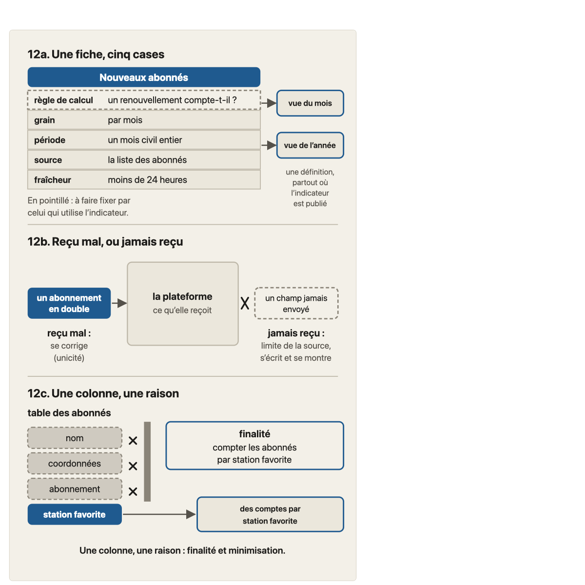
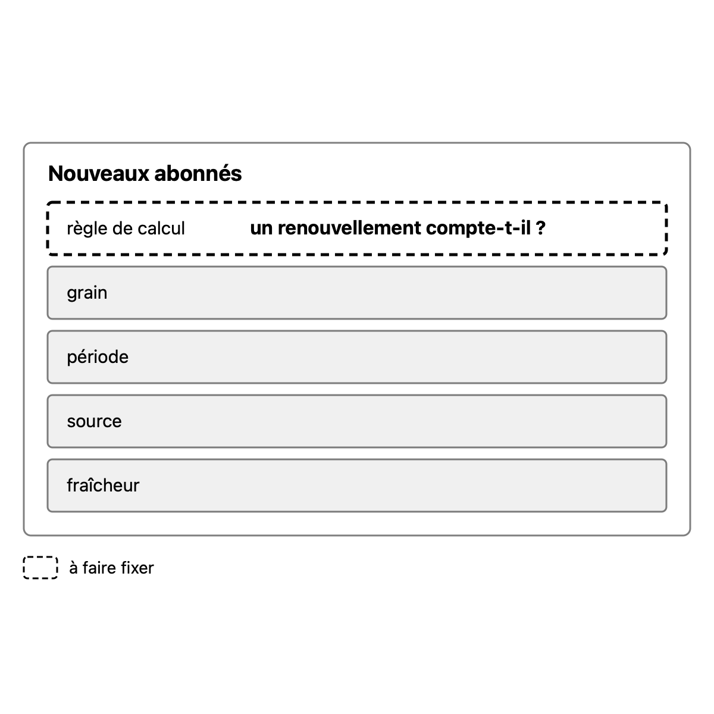
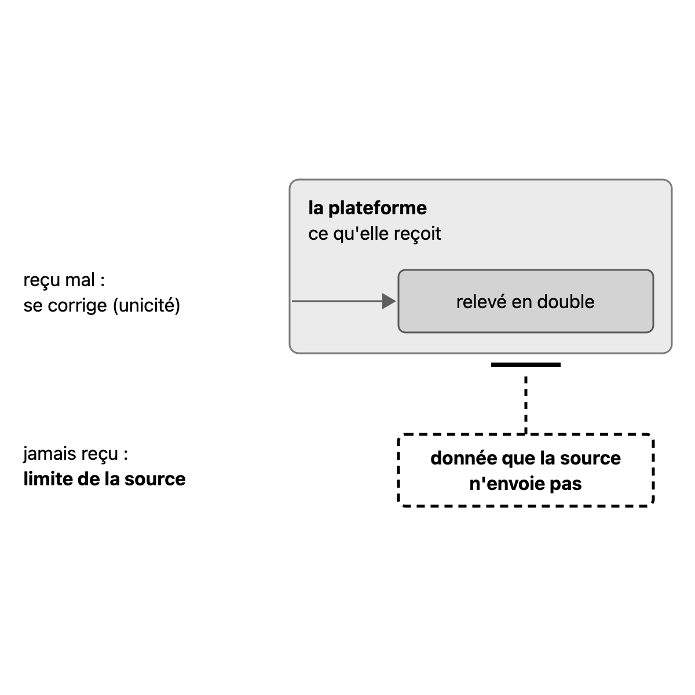
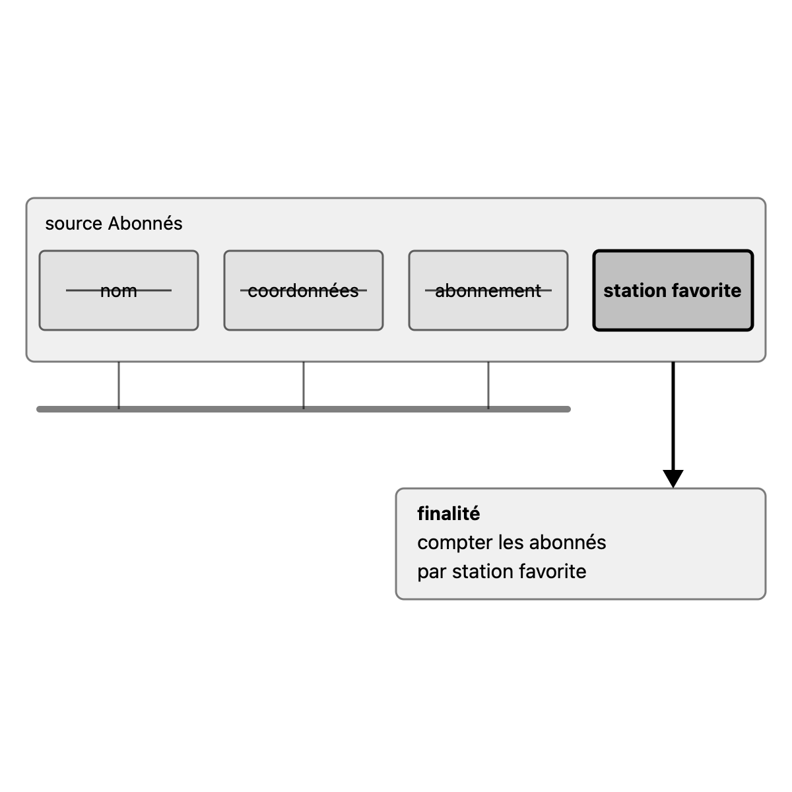

# Migration report: concept 12

Workflow `migrate-concept` (run `wf_d348c0e3-b92`), course `parcours-po`, concept folder `concepts/12-donnees-produit/`. Paths in the course folder are relative to it; the old files are named from their repository folder (`parcours-po`, `parcours-po-website`).
Old files: `parcours-po/course/concepts/12-donnees-produit.md` (CF), `parcours-po/course/sources/12-donnees-produit.md` (SF), `parcours-po-website/src/content/concepts/fr/12-donnees-produit.mdx` (MDX), `parcours-po-website/src/components/schemas/Schema12.astro` (ASTRO).

## Summary

| checks | target existed | old diagrams | new diagrams | captions of more than one sentence |
|---|---|---|---|---|
| fail (run), ok after the corrections below | no | 1 | 3 | 0 |

Result: **failed**. checks is read in code from the output below, which the check agent returns; target existed is read in code from the listing below, which the scope agent returns. The new concept is not compared with the old one (rule D on #23): the fresh-agent review judges it against SPEC.md and PROTOCOL.md.

## Target before the run

`ls -ld concepts/12-donnees-produit; ls -la concepts/12-donnees-produit`, as the scope agent returned it: no such folder.

```
ls: cannot access 'concepts/12-donnees-produit': No such file or directory
ls: cannot access 'concepts/12-donnees-produit': No such file or directory
```

## Diagrams (M11)

Each old diagram was inventoried (what it shows, by idea), drawn anew from its inventory and concept.md alone under SPEC.md 7.2. Renderings: the old diagram from the frozen site's build; the new one in one colour.

### `parcours-po-website/src/components/schemas/Schema12.astro`

Figure legende, in « L'essentiel »: « Trois panneaux (exemples inventés pour l'illustration). 12a : la fiche d'un indicateur a cinq cases, et celles qu'on ne peut pas remplir restent à faire fixer. 12b : ce que la plateforme reçoit mal se corrige, ce qu'elle ne reçoit jamais est une limite de la source. 12c : on ne demande que les colonnes qui servent la finalité. »

Split by idea: 3 diagrams.

Its sentences, where the inventory sends them (M11):
- « Trois panneaux (exemples inventés pour l'illustration). »: title of fiche-cinq-cases.svg
- « 12a : la fiche d'un indicateur a cinq cases, et celles qu'on ne peut pas remplir restent à faire fixer. »: caption of fiche-cinq-cases.svg
- « 12b : ce que la plateforme reçoit mal se corrige, ce qu'elle ne reçoit jamais est une limite de la source. »: caption of recu-mal-jamais-recu.svg
- « 12c : on ne demande que les colonnes qui servent la finalité. »: caption of colonnes-finalite.svg

Corrections after the run (contributor, SPEC.md 7.2): the run drew each panel with its panel title, the slogan « Une colonne, une raison : finalité et minimisation. », the notes « une définition, partout où l'indicateur est publié » and « à faire fixer par celui qui utilise l'indicateur », invented values (« par mois », « moins de 24 heures »), and in 12b the contrast (the duplicate) drawn stronger than the subject. The three drawings were redone and the PNGs regenerated (one colour); the inventory tables of the run are replaced by this summary.

#### fiche-cinq-cases.svg

- Title: Définir un indicateur : la fiche à cinq cases (exemple inventé pour l'illustration)
- Caption: 12a : sur la fiche d'un indicateur à cinq cases, la case qu'on ne peut pas remplir reste à faire fixer.
- Sub-concept: 12a2
- Drawn: the fiche « Nouveaux abonnés » and four solid cases (context, `muted`), five cases in order; the subject, « règle de calcul », « règle de calcul » dashed with « un renouvellement compte-t-il ? » (`primary`, the only full-weight element; state: to be fixed); a key « à faire fixer ». The two output views and their note are dropped (another idea: the definition holds wherever the indicator is published, kept in the reader text); the case values are dropped (not in concept.md).

#### recu-mal-jamais-recu.svg

- Title: Distinguer ce qui se corrige de ce qui manque
- Caption: 12b : ce que la source n'envoie jamais est une limite de la source, et non un défaut que la plateforme corrige.
- Sub-concept: 12b
- Drawn: the platform (context, `muted`); a « relevé en double » entering it (contrast, `secondary`, low opacity, « reçu mal : se corrige (unicité) »); « donnée que la source n'envoie pas » outside, dashed, stopped by a bar at the platform's edge, `primary` opacity 1, with « jamais reçu : limite de la source » (subject). « s'écrit et se montre » is dropped (prescription: reader text). The caption changed so that the diagram has one idea, its subject.

#### colonnes-finalite.svg

- Title: Demander seulement ce qui sert
- Caption: 12c : on ne demande que les colonnes qui servent la finalité.
- Sub-concept: 12c
- Drawn: the source Abonnés with four columns; nom, coordonnées, abonnement struck (contrast, `secondary`, solid: refused is struck, not dashed) and stopped by a bar; station favorite (subject, `primary`) goes to the finalité « compter les abonnés par station favorite ». The slogan, the panel title and the « comptes » result box are dropped.

| Old | New |
|---|---|
|  |  |
|  |  |
|  |  |

Renderings in `S1-10-12-report/`, beside this report.

## Writing choices

- M9 citation line: none added. The old « Sous-concepts » cites all 7 bank cases by title in « » (« Compléter la définition des vélos disponibles », « Les locations par quartier de Charlotte », « La mesure de résultat est aussi un indicateur », « Les signalements par téléphone », « Des chiffres fiables, dit Charlotte », « Quelles colonnes demander à Sid ? », « Prenons toute la table »), so « Consignes » is the old text verbatim.
- M9 Faits du fil rouge utilisés: the lead words « Faits du fil rouge utilisés : » were dropped, the paragraph now opens with the old text « règles fixées (… » kept in lowercase (not capitalised, nothing else reworded). The rest of the old lead paragraph (the non-fixed facts and proposals) stays inside it. There is no other lead text in the old « Banque d'exemples », so none stays at its top.
- M9 Schéma: old « Schéma » copied verbatim. Fields of the cases are verbatim (Explication, Situation, Question with its qualifier, Réponse attendue, Erreurs fréquentes, Ce qui marche; no Usage or Réserve in the old bank).
- M10 Affirmations layout: the old file had the rows in 5 tables under ### sub-headings (Consensus et choix d'école, 12a, 12b, 12c, Renvois sans enseignement); merged into the single table SPEC 4.4 requires, same rows in the same order, the ### sub-headings dropped (structural, since « one table »).
- M10 Nature, from an MDX sources.affirmations item stating the same claim (kind): Ni le Scrum Guide... consensus; règles mesurables sur des dimensions: consensus; liste des dimensions: école; qualité dépend de l'usage: consensus; finalité et minimisation principes du RGPD: consensus (two MDX items, both consensus); PO fait écrire/fixer: cours; Indicateur valeur calculée: cours; contenu d'une définition: cours; grain: école; fraîcheur: cours; définition vaut partout: cours; DoD exige la définition: cours; comment des Developers (requête/jointure): cours; six dimensions DAMA UK: école; relevés en double/unicité: école; où écrire: cours; limite de la source: cours; « Fiables » ... Mesurer une dimension: consensus; donnée personnelle: consensus; pseudonymisée / identifiant piège: consensus; limitation des finalités: consensus; minimisation: consensus; ce que le PO demande: cours; finalité avant d'utiliser: cours; Sid/justifier chaque colonne: cours; délégué à la protection des données: consensus.
- M10 Nature inferred from the matching MDX ecoles item (no MDX sources item states the claim): « Fiables est un mot flou ... règles mesurables par dimension, au niveau que dit l'utilisateur » = consensus (matches ecoles.consensus item 1); « On l'anonymisera dans l'entrepôt » = consensus (matches the RGPD pseudonymisation consensus item); « La comparaison au même mois de l'an dernier ... définition écrite une fois, pour l'indicateur » = cours (matches ecoles.cours « La définition vaut pour l'indicateur partout où il est publié »). These three are judgement calls.
- M10 Nature left empty: all rows that rest on invented storyline facts or exercise propositions (corrigé vélos disponibles, locations par quartier de Charlotte, mesure de résultat indicateur, brouillon d'Anna, exclure les vélos en panne, fraîcheur des locations par quartier, vue d'Étienne, DoR de Charlotte, Maud/Diego, concept 15, colonnes pour les locations par quartier, colonne du vélo/lignes bornées) and the six « Renvois sans enseignement » rows: no MDX item states them and no ecoles item matches.
- M10 old paths rewritten (old text, new text): `course/sources/01-produit-et-po.md`: `concepts/01-produit-et-po/sources.md`; `course/sources/02-objectif-produit-resultat.md`: `concepts/02-objectif-produit-resultat/sources.md`; `course/sources/07-invest.md`: `concepts/07-invest/sources.md`; `course/sources/08-criteres-regles.md`: `concepts/08-criteres-regles/sources.md`; `course/sources/10-hors-perimetre-dependances.md`: `concepts/10-hors-perimetre-dependances/sources.md`; `course/sources/11-dor-dod.md`: `concepts/11-dor-dod/sources.md`; `course/plan.md`: `plan.md`; `course/fil-rouge-velos.md`: `storyline.md`; `course/glossary.md` (S10 in Références): `glossary.md`. Slugs applied as the rule gives them (not checked against course.yaml, which is not an input).
- M10 pointers dropped: none. The old file has no ADR number (so no decision lookup), and the intro and « Non vérifié » hold no off-course.md, git-history or task-id pointer. T-018f remains in two verification cells (rows « Le PO fait écrire... » and « Exercice locations par quartier ») and T-018a in S5's « Consultée le » cell: kept as they are, being source/verification/Références cells and not the intro or « Non vérifié ». Section names: no row cites « Sous-concepts », so no row renamed to « Consignes ».
- M10 orphan: S13 (Cour de justice, arrêt du 4 septembre 2025) is in « Références » but no source cell cites it; it is named only in « Non vérifié » and in no row's verification column, so no row can take it and it is LEFT: the sources check will fail on it (run fails on S13). All other references S2 to S12 are cited by a source cell; no « orphan [Sx] added ».
- M10 intro kept as the old paragraph (frontmatter and H1 dropped), unchanged: it contains no old path. « Références » and « Non vérifié » unchanged apart from the S10 path. The odd double spaces and typos of the old text (« table de faits  », « prochoix », « (11a) . ») are copied as they are.
- M13: no banned character (em-dash, arrow) and no typographic apostrophe found in CF or SF, so no replacement made.
- M1: no objective clause to report. CF Objectif, MDX objectif and course.yaml objective are the same text, so « Objectif » is the yaml objective verbatim with a capital and final period.
- M3 (CF precise wins): first consensus item author reads « reprise par le cadre de qualité des données du gouvernement britannique » (CF) in place of MDX « reprise par le gouvernement britannique ». Every other CF claim of « Consensus et choix d'école » matches an MDX item with the same content, and the CF « à présenter comme tel » hint is dropped by design. MDX-only items (« Le PO fait écrire, fixer ou demander », « Fraîcheur » traduit timeliness) are kept.
- M3: neighbors item keeps « concept 2 » (CF « Consensus et choix d'école » has no more precise reference for it).
- M4: MDX wording is the base of « L'essentiel »; CF says nothing more, so nothing merged. The three diagram images follow the paragraph (M6).
- M5: 12b1, 12b2, 12c1, 12c2 are not in course.yaml, so each becomes a paragraph of its leaf (12b, 12c) led by its title in bold, with a final period added after the title (e.g. « **Des règles mesurables, par dimension.** »). The 12c1 Fil rouge blockquote stays in the 12c reader text.
- M6/M5: 12a1 ends with « (concept 2c) » in place of MDX « (concept 2) »: CF 12a2 case and the CF sub-concept list say concept 2c for the mesure de résultat (CF more precise reference). The pastille in 12c1 « (application du cours [cours]) » kept as MDX wrote it.
- M7: CF more precise references and sentences merged into the pitfalls: « Combler une case vide » gets « (concept 8a2) » (CF); « Écrire le calcul » gets CF's « le PO fait écrire ce que l'indicateur compte, sur quoi, quand » joined with « ; »; « Mettre la définition dans les critères » gets CF's « deux stories qui le publient, chacune dans sa vue, doivent prendre la même ». All other items follow MDX wording (e.g. « Elle borne aussi les lignes », « Poser une exigence de qualité vague »). No CF item absent from MDX.
- M8: the CF test rapide (three lines) is the blockquote, lines kept as three consecutive lines of one blockquote; the Reflexe note « Formulation du cours. » is the following paragraph. Nothing only-CF to add.
- M13: typographic apostrophes (’) in MDX (l'équipe vélos, n'en fixe, d'école, l'unicité) replaced by straight ones (form). No em-dash or arrow in the source, so no banned-character replacement.

## Checks

`mise exec -- specs/linear-course/checks/check-course courses/parcours-po --concept 12`, after the corrections: all checks ok (course-yaml, concept-folder, conventions, svg-contract, sources, course-files, glossary-order, domain-first-sentence, typography, language-pack-keys).

The run itself failed on four `sources` failures, fixed in the output under the rulings on #23:
- sources.md reference S10, type « interne (définition du cours) »: written « primaire (interne : définition du cours) » (ruling on « interne »).
- concept.md stances cited S1 (twice) and S13 was cited by no claim: the stances carry the ids of the site's MDX, whose list of references is numbered from S1 = Kimball, while sources.md keeps the numbering of the old sources file (S2 = Kimball, « Pas de S1 »). All stance refs were mapped to the sources.md ids (S1 to S2, S2 to S3, S3 to S4, S4 to S5, S5 to S6, S6 to S7, S7 to S8, S8 to S9, S9 to S11); S1 was Kimball, hence S2. The MDX claim « une donnée pseudonymisée qu'on peut rattacher à une personne reste personnelle » cites its S11 (the 2025 judgment, S13 here): S13 is attached to that claim, in the « Pseudonymisée » stance and in its row of sources.md (rule C).
- teaching.md: the first line of « Faits du fil rouge utilisés » capitalised; the « Schéma » section describes the new drawings; the cross-reference rows of sources.md name a section of the concept.

Fresh review of PR #195 (2 blocking, fixed): fiche redrawn with the context `muted` and only the open case `primary`, declared 12a2; « Schéma » no longer says the diagrams are shown after the answer; 12b arrow and bar aligned with the text; sources.md section names, typos, empty S10 link, and the neighbors row (indicator is an output) restored.
