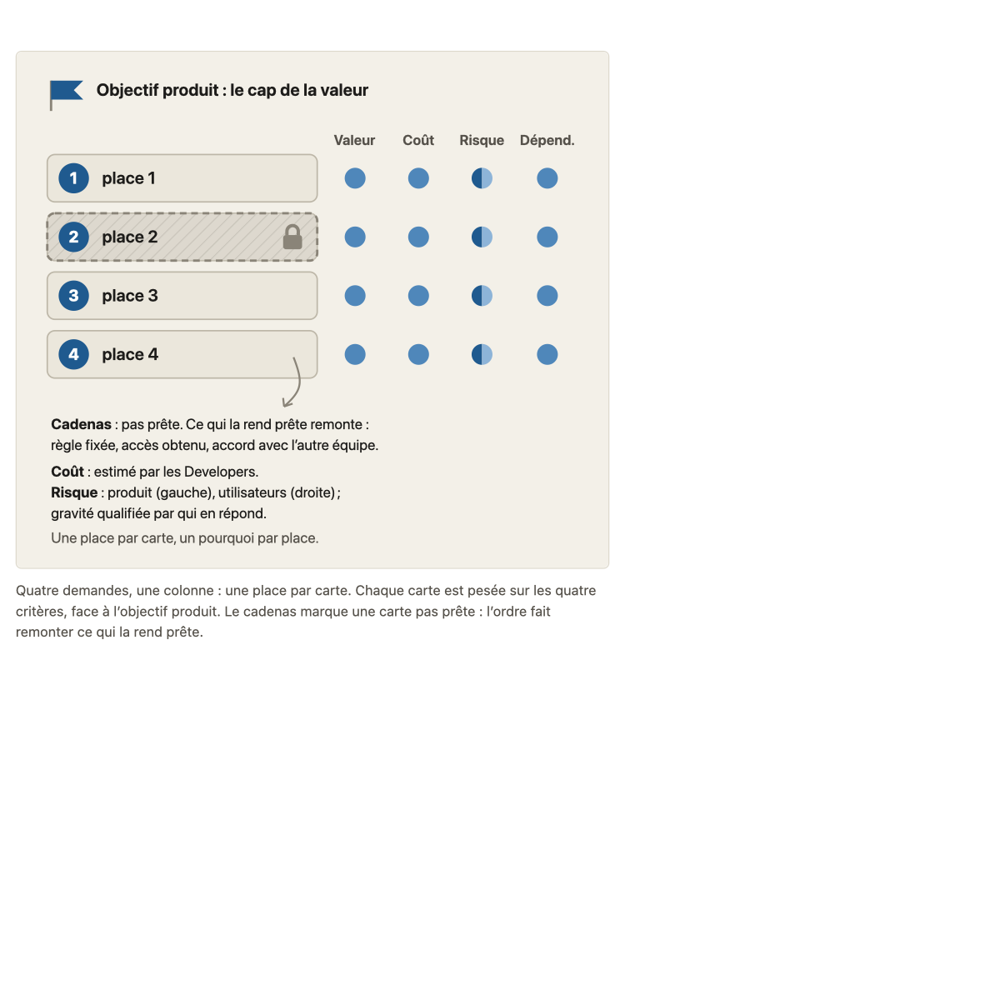
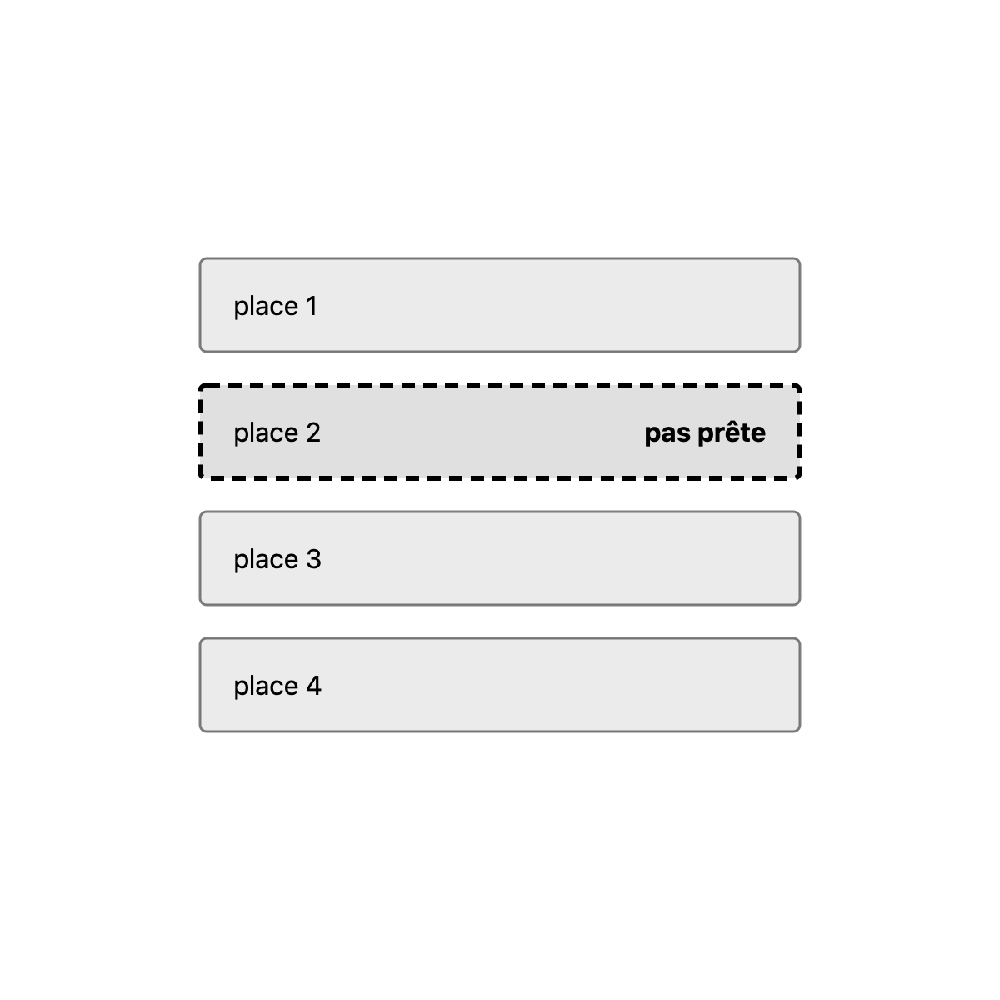
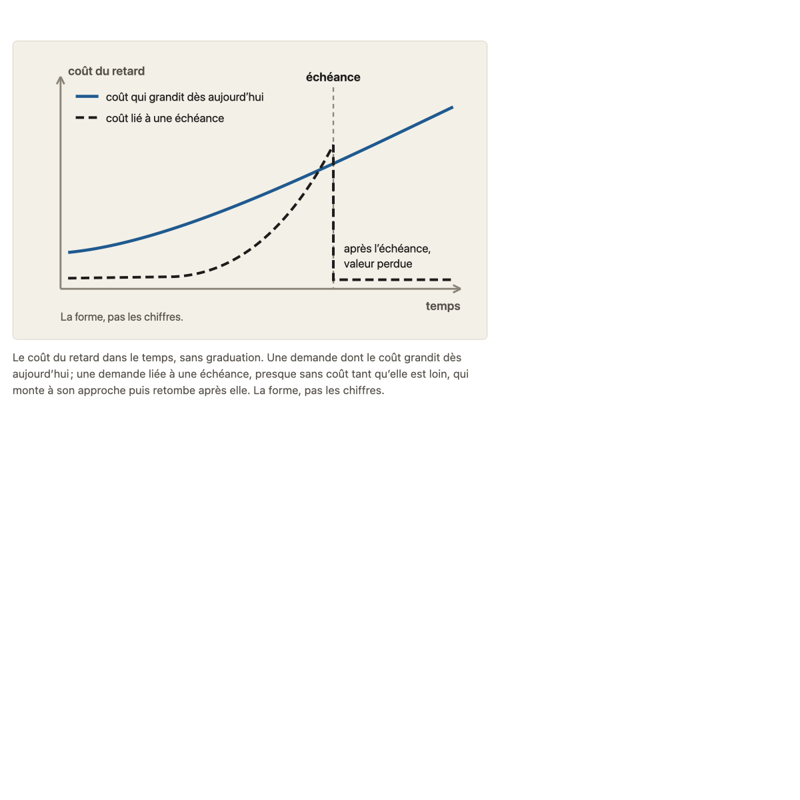
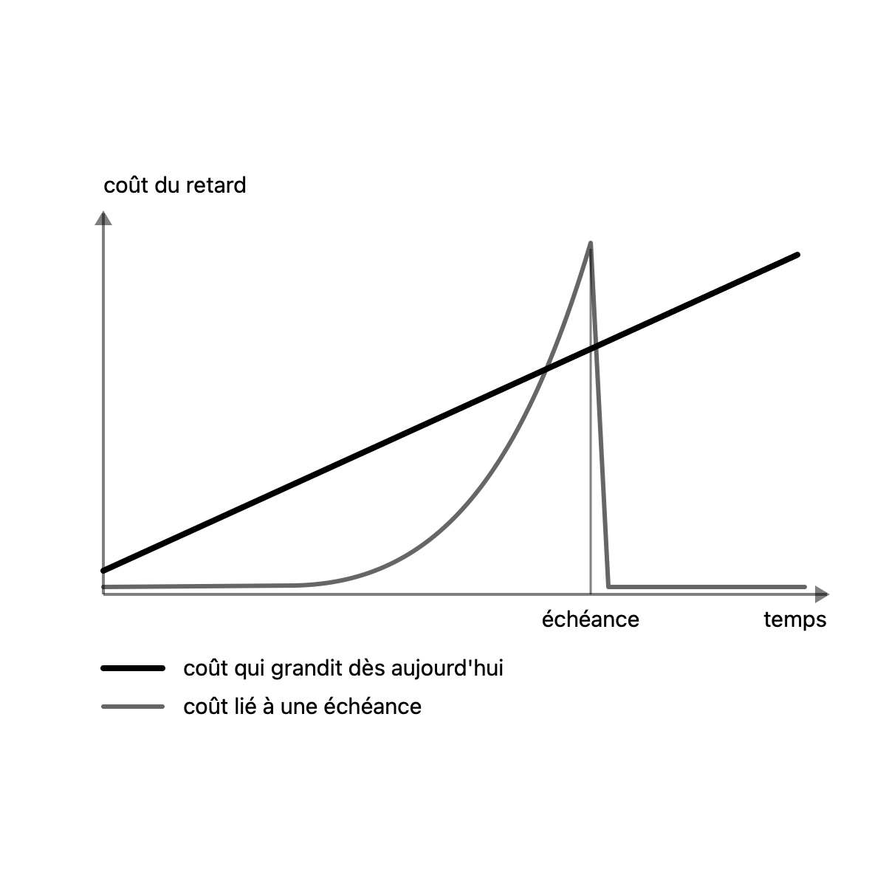
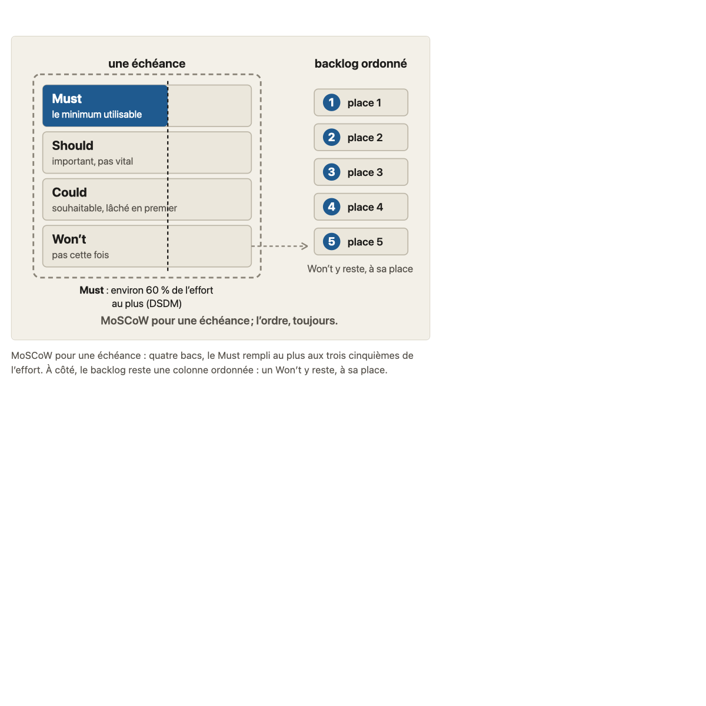
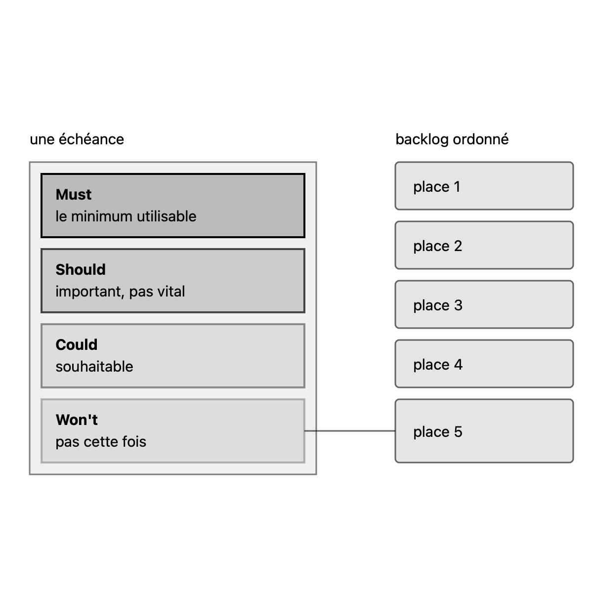

# Migration report: concept 13

Run `wf_6c594204-6b6`. The run reported `failed` on two `sources` checks; the contributor fixed them in the output (section « Corrections after the run »).

Workflow `migrate-concept`, course `parcours-po`, concept folder `concepts/13-ordonner-backlog/`. Paths in the course folder are relative to it; the old files are named from their repository folder (`parcours-po`, `parcours-po-website`).
Old files: `parcours-po/course/concepts/13-ordonner-backlog.md` (CF), `parcours-po/course/sources/13-ordonner-backlog.md` (SF), `parcours-po-website/src/content/concepts/fr/13-ordonner-backlog.mdx` (MDX), `parcours-po-website/src/components/schemas/Schema13.astro` (ASTRO).

## Summary

| checks | target existed | old diagrams | new diagrams | captions of more than one sentence |
|---|---|---|---|---|
| fail (run), pass after the corrections | yes, emptied | 3 | 3 | 0 after the corrections (3 in the run) |

Result: **failed**. checks is read in code from the output below, which the check agent returns; target existed is read in code from the listing below, which the scope agent returns. The new concept is not compared with the old one (rule D on #23): the fresh-agent review judges it against SPEC.md and PROTOCOL.md.

Captions of more than one sentence (SPEC.md 7.2, principle 1: a caption that needs two sentences means two diagrams): ordonner-une-place.svg (3 sentences), formes-cout-retard.svg (2 sentences), moscow-echeance-backlog-ordonne.svg (2 sentences). Flagged for the review, not refused; redrawn after the run (below).

## Target before the run

`ls -ld concepts/13-ordonner-backlog; ls -la concepts/13-ordonner-backlog`, as the scope agent returned it: 2 entries, emptied (args.overwrite).

```
drwxr-xr-x 4 sve staff 128 Oct 28 23:22 concepts/13-ordonner-backlog
total 44
drwxr-xr-x  4 sve staff   128 Oct 28 23:22 .
drwxr-xr-x 19 sve staff   608 Oct 28 22:57 ..
-rw-r--r--  1 sve staff 23105 Oct 28 23:22 sources.md
-rw-r--r--  1 sve staff 19035 Oct 28 23:21 teaching.md
```

## Diagrams (M11)

Each old diagram was inventoried (what it shows, by idea), drawn anew from its inventory and concept.md alone under SPEC.md 7.2. Renderings: the old diagram from the frozen site's build; the new one in one colour.

### `parcours-po-website/src/components/schemas/Schema13.astro`, p="a"

Figure legende, in the section 13a: « Quatre demandes, une colonne : une place par carte. Chaque carte est pesée sur les quatre critères, face à l'objectif produit. Le cadenas marque une carte pas prête : l'ordre fait remonter ce qui la rend prête. »

One idea.

Its sentences, where the inventory sends them (M11):
- « Quatre demandes, une colonne : une place par carte. »: caption of ordonner-une-place.svg
- « Chaque carte est pesée sur les quatre critères, face à l'objectif produit. »: caption of ordonner-une-place.svg
- « Le cadenas marque une carte pas prête : l'ordre fait remonter ce qui la rend prête. »: caption of ordonner-une-place.svg

#### ordonner-une-place.svg

- Title: Ordonner : une place par demande, un pourquoi par place
- Caption: Quatre demandes, une colonne : une place par carte. Chaque carte est pesée sur les quatre critères, face à l'objectif produit. Le cadenas marque une carte pas prête : l'ordre fait remonter ce qui la rend prête. (**3 sentences**: SPEC.md 7.2, principle 1)
- Sub-concept: 13a2
- Idea: « Chaque carte est pesée sur les quatre critères, face à l'objectif produit. Le cadenas marque une carte pas prête : l'ordre fait remonter ce qui la rend prête. » (MDX Figure of section 13a2 (legende))

| Id | Element | Labels | Role | State |
|---|---|---|---|---|
| E1 | L'objectif produit, le cap face auquel on pèse la valeur | « Objectif produit : le cap de la valeur » | context | none |
| E2 | Carte de la place 1 (une demande, une place unique dans la colonne) | « place 1 » | subject | none |
| E3 | Carte de la place 2, pas prête | « place 2 » | subject | not done (« pas prête ») |
| E4 | Carte de la place 3 | « place 3 » | subject | none |
| E5 | Carte de la place 4 | « place 4 » | subject | none |
| E6 | Le cadenas, qui marque la carte de la place 2 comme pas prête | « Cadenas » | subject | not done (« Cadenas : pas prête. ») |
| E7 | Note du cadenas : ce qui rend la carte prête remonte dans l'ordre | « Cadenas : pas prête. Ce qui la rend prête remonte : », « règle fixée, accès obtenu, accord avec l'autre équipe. » | text | none |
| E8 | Critère valeur, un par carte | « Valeur » | subject | none |
| E9 | Critère coût, un par carte | « Coût » | subject | none |
| E10 | Critère risque, un par carte, en deux moitiés (E11 et E12) | « Risque » | subject | none |
| E11 | Moitié du risque : le risque pour le produit | « produit » | subject | none |
| E12 | Moitié du risque : le risque pour les utilisateurs | « utilisateurs » | subject | none |
| E13 | Critère dépendances, un par carte | « Dépend. » | subject | none |
| E14 | Note sur le coût : estimé par les Developers | « Coût : estimé par les Developers. » | text | none |
| E15 | Note sur le risque : la moitié produit et la moitié utilisateurs, gravité qualifiée par ceux qui en répondent | « Risque : produit, utilisateurs ; », « gravité qualifiée par qui en répond. » | text | none |
| E16 | Mot de la fin du schéma | « Une place par carte, un pourquoi par place. » | text | none |

Relations:
- E2, E3, E4, E5 forment une seule colonne, de la place 1 à la place 4, dans cet ordre : une place par carte, aucune carte côte à côte avec une autre
- Chacune de E2, E3, E4, E5 est pesée sur les quatre critères E8, E9, E10, E13 (E10 en deux moitiés E11 et E12)
- La valeur (E8) est pesée face à E1
- E6 marque E3 : la carte de la place 2 n'est pas prête
- E7 explique E6 : ce qui rend E3 prête remonte dans l'ordre
- E14 note E9 ; E15 note E10 (E11, E12)

Key of the inventory: none. Key drawn: none.

| Old | New |
|---|---|
|  |  |

### `parcours-po-website/src/components/schemas/Schema13.astro`, p="b"

Figure legende, in the section 13b: « Le coût du retard dans le temps, sans graduation. Une demande dont le coût grandit dès aujourd'hui ; une demande liée à une échéance, presque sans coût tant qu'elle est loin, qui monte à son approche puis retombe après elle. La forme, pas les chiffres. »

One idea.

Its sentences, where the inventory sends them (M11):
- « Le coût du retard dans le temps, sans graduation. »: caption of formes-cout-retard.svg
- « Une demande dont le coût grandit dès aujourd'hui ; une demande liée à une échéance, presque sans coût tant qu'elle est loin, qui monte à son approche puis retombe après elle. »: caption of formes-cout-retard.svg
- « La forme, pas les chiffres. »: labels of formes-cout-retard.svg

#### formes-cout-retard.svg

- Title: Deux formes de coût du retard dans le temps
- Caption: Le coût du retard dans le temps, sans graduation. Une demande dont le coût grandit dès aujourd'hui ; une demande liée à une échéance, presque sans coût tant qu'elle est loin, qui monte à son approche puis retombe après elle. (**2 sentences**: SPEC.md 7.2, principle 1)
- Sub-concept: 13b
- Idea: « Le cours retient deux formes pour commencer : » (MDX section 13b)

| Id | Element | Labels | Role | State |
|---|---|---|---|---|
| E1 | la demande dont le coût du retard grandit dès aujourd'hui, régulièrement du départ jusqu'à la fin, chaque jour de retard s'ajoutant aux autres | none | subject | none |
| E2 | la demande liée à une échéance : coût du retard presque nul et plat au début, qui monte de plus en plus vite à l'approche de l'échéance, puis retombe au plus bas après elle | none | contrast | none |
| E3 | le temps, sans graduation | « temps » | context | none |
| E4 | le coût du retard, sans graduation | « coût du retard » | context | none |
| E5 | l'échéance, repère dans le temps auquel le coût de la demande qui y est liée est au plus haut avant de retomber | « échéance » | context | none |
| E6 | note sur ce qui suit l'échéance : la valeur est perdue jusqu'à l'échéance suivante | « après l'échéance, », « valeur perdue » | text | none |
| E7 | note de lecture du graphique | « La forme, pas les chiffres. » | text | none |

Relations:
- E1 et E2 sont tracés ensemble, l'un en regard de l'autre, sur E3 (en abscisse) et E4 (en ordonnée)
- E1 monte régulièrement sur E3, du départ jusqu'à la fin
- E2 reste presque nul et plat sur E3 tant que E5 est loin, monte de plus en plus vite à l'approche de E5, puis retombe au plus bas après E5
- E5 repère sur E3 le moment où E2 est au plus haut avant de retomber
- E6 se lit après E5, à côté de la chute de E2
- E7 se lit avec l'ensemble du graphique

Key of the inventory: E1 « coût qui grandit dès aujourd'hui »; E2 « coût lié à une échéance ». Key drawn: « coût qui grandit dès aujourd'hui »; « coût lié à une échéance ».

| Old | New |
|---|---|
|  |  |

### `parcours-po-website/src/components/schemas/Schema13.astro`, p="c"

Figure legende, in the section 13c: « MoSCoW pour une échéance : quatre bacs, le Must rempli au plus aux trois cinquièmes de l'effort. À côté, le backlog reste une colonne ordonnée : un Won't y reste, à sa place. »

One idea.

Its sentences, where the inventory sends them (M11):
- « MoSCoW pour une échéance : quatre bacs, le Must rempli au plus aux trois cinquièmes de l'effort. »: caption of moscow-echeance-backlog-ordonne.svg
- « À côté, le backlog reste une colonne ordonnée : un Won't y reste, à sa place. »: caption of moscow-echeance-backlog-ordonne.svg

#### moscow-echeance-backlog-ordonne.svg

- Title: MoSCoW pour une échéance, et le backlog qui reste ordonné
- Caption: MoSCoW pour une échéance : quatre bacs, le Must rempli au plus aux trois cinquièmes de l'effort. À côté, le backlog reste une colonne ordonnée : un Won't y reste, à sa place. (**2 sentences**: SPEC.md 7.2, principle 1)
- Sub-concept: 13c
- Idea: « MoSCoW pour une échéance : quatre bacs, le Must rempli au plus aux trois cinquièmes de l'effort. À côté, le backlog reste une colonne ordonnée : un Won't y reste, à sa place. » (MDX section 13c, legende of the Figure)

| Id | Element | Labels | Role | State |
|---|---|---|---|---|
| E1 | l'échéance, qui contient les quatre bacs MoSCoW | « une échéance » | context | none |
| E2 | le bac Must, rempli au plus aux trois cinquièmes de l'effort | « Must », « le minimum utilisable » | subject | none |
| E3 | le bac Should | « Should », « important, pas vital » | subject | none |
| E4 | le bac Could | « Could », « souhaitable, lâché en premier » | subject | none |
| E5 | le bac Won't | « Won't », « pas cette fois » | subject | none |
| E6 | le repère du plafond du Must : environ 60 % de l'effort au plus, recommandation de DSDM (trois cinquièmes) | « Must : environ 60 % de l'effort », « au plus (DSDM) » | text | none |
| E7 | le backlog, une colonne ordonnée qui continue d'exister à côté de l'échéance | « backlog ordonné » | contrast | none |
| E8 | les cinq cartes numérotées du backlog, une place chacune | « 1 », « place 1 », « 2 », « place 2 », « 3 », « place 3 », « 4 », « place 4 », « 5 », « place 5 » | contrast | none |
| E9 | note : le Won't reste dans le backlog, à sa place | « Won't y reste, à sa place » | text | none |
| E10 | mention de lecture du schéma | « MoSCoW pour une échéance ; l'ordre, toujours. » | text | none |

Relations:
- E1 contient E2, E3, E4 et E5, empilés dans cet ordre : Must, Should, Could, Won't
- E6 repère le plafond de remplissage de E2 : au plus trois cinquièmes de l'effort
- E7 est la colonne de E8, cinq cartes ordonnées de la place 1 à la place 5
- E5 vers E7 : ce qui n'est pas pour cette échéance reste dans le backlog, à sa place (E9 le dit)
- E1 et E7 sont côte à côte : MoSCoW classe pour une échéance, il ne remplace pas l'ordre du backlog

Key of the inventory: none. Key drawn: none.

| Old | New |
|---|---|
|  |  |

Renderings in `S1-10-13-report/`, beside this report. The new PNGs are those of the diagrams after the corrections below.

## Writing choices

- M9 citation line: none. The old 'Sous-concepts' cites all 5 cases by title in « »: 'La story de blocage face à l'appli', 'Les quatre demandes', 'Le blocage et le bilan au conseil', 'Tout est Must pour le bilan', 'Tout le backlog en MoSCoW ?'. Consignes is the old text verbatim, with no addition.
- M9 Faits du fil rouge utilisés: lead words 'Faits du fil rouge utilisés : ' dropped, the paragraph copied as is. It therefore starts with a lowercase 'l'objectif produit' (not reworded). No other lead text, so the bank has none at its top.
- M9: cases, 'Question, en deux parties' label qualifier, and Schéma copied verbatim; the heading '(13c, en rechange)' is kept as the old heading writes it.
- M10 orphan: [S7] added to the source cell of the row 'Critères pour ordonner : valeur, coût, risque, dépendances...' ('[S6] ; [S2] ; [S7]'), the only row whose verification names it as support ('reprises en [S7]'). Orphan [S7] added.
- M10 orphan left: [S19] is cited by no source cell and two rows name it as support (the criteria row, 'Appui indépendant de Cohn : Roman Pichler [S19]', and the risk row, 'Pichler : ... [S19]'), so 'exactly one row' fails and it is left. The sources check will fail on S19, as the rule says.
- M10 path rewrite, intro: `course/sources/01-produit-et-po.md` becomes `concepts/01-produit-et-po/sources.md`; bare `03-backlog-produit.md` becomes `concepts/03-backlog-produit/sources.md`.
- M10 path rewrite, row 'Le PO répond de l'ordre' (Déjà enseigné en 1b et 3a): `01-produit-et-po.md`, `03-backlog-produit.md` become `concepts/01-produit-et-po/concept.md`, `concepts/03-backlog-produit/concept.md` (taught content, so concept.md, my reading of the bare names).
- M10 path rewrite, 'sourcé' mentions (sources.md of the other concept): `10-hors-perimetre-dependances.md` (row Dépendances and reference S6), `11-dor-dod.md` (row 'pas prêt' and Non vérifié), `03-backlog-produit.md` (row 'Ordonner c'est choisir', references S5 and S8) become `concepts/<NN-slug>/sources.md`.
- M10 path rewrite, `13-ordonner-backlog.md` (row 'demande sortie du hors périmètre' and reference S10, both beside 'historique git') becomes `concepts/13-ordonner-backlog/concept.md`; 'historique git' kept as is (elsewhere than intro / Non vérifié, no new path). 'T-018a, §8' kept too (rows and S9, outside intro / Non vérifié). No pointer dropped in the intro or Non vérifié; no ADR number in the file.
- M10 Nature: 'Source' column untouched except S7. Header row changed to the M10 header with a 4th column in the 4 tables (the old header repeated per sub-section).
- M10 Nature, mapped to an MDX item: 1-3 consensus; 'Qui veut changer l'ordre' consensus; PO porte besoins consensus; coût vient des Developers consensus; critères pratique établie consensus; valeur/objectif produit cours; coût effort consensus; risque tôt and dépendances consensus (same MDX item); risque sécurité cours; pas prêt cours; tout en tête cours; coût du retard école; Arnold école; formes d'urgence cours; WSJF école; MoSCoW école; Won't école; 60 % école; représentant cours; Clegg empty (MDX item has no kind).
- M10 Nature, choice: row 'MoSCoW se rapporte à une échéance, pas à tout le backlog' matches two MDX items (MoSCoW 'pour un délai fixé', école; 'ne remplace pas l'ordre', cours); I took école since the claim opens on the timeframe.
- M10 Nature, empty by the rule's 'else': 'La prévision « pour quand ? »' (no MDX item, no matching ecoles item); 'L'ordre se justifie par l'objectif produit' (no MDX affirmation item states it, no ecoles item matches; the MDX cours affirmation is about the value, a different claim); 'Une demande sortie du hors périmètre' (same); Clegg (kind absent).
- M10: row sections 'Sous-concepts' do not occur in the old file, so no Consignes rename was needed; other section names (Déjà enseigné, Consensus et choix d'école, L'essentiel...) left as is.
- M13: no banned character (em-dash, arrow) and no typographic apostrophe in the old CF or SF, so no replacement was made.
- M1 Objectif: course.yaml objective verbatim, capital and final period. CF and MDX objectives carry no clause beyond it that S1-08 does not record (S1-08 lists 13 as merged, same meaning): nothing to report.
- M3 Scrum Guide 2020 item: CF's « (concept 1b) » carried after « le convainc ».
- M3 Pratique établie item: CF-only sentence « Le risque y est celui qui pèse sur la réussite du produit ; le risque pour les utilisateurs (sécurité) en est un autre sens. » carried; CF's dangling pointer « voir « Choix du cours » » dropped because no section has that name in the new body (writing choice).
- M3 Arnold item: CF's « proche de WSJF » carried as « (CD3, le coût du retard divisé par la durée, proche de WSJF) ».
- M3 SAFe item: CF's « proche du CD3 d'Arnold » carried as a parenthesis after « un score de plus parmi d'autres »; CF's « Si l'apprenant demande... » sentence is teacher guidance, not carried; CF's « un score de SAFe pour ordonner » not carried (MDX wording kept).
- M3 course risk item: CF-only sentence « DSDM range en Must ce sans quoi la livraison ne serait pas sûre : appui indirect, dans un autre cadre. » carried. CF's teacher hint « sans source externe, à présenter comme tels » left out by design.
- M4 L'essentiel: MDX text as base; CF-only definitions added in parentheses (valeur, coût, coût du retard); CF's bold on the criteria not carried (MDX bolds only pourquoi).
- M7 Pièges: item 1 gets CF's sentence « On pèse la demande, pas son auteur ; qui veut changer l'ordre convainc le PO. » after MDX's; item 3 gets CF's « le coût vient d'eux » as a parenthesis after « Estimer à la place des Developers »; item 4 gets CF's « (l'équipe ne peut pas la prendre) » and « (on ne peut pas la finir sans l'autre) » as parentheses. The two CF-only sentences placed in parentheses are a writing choice about form.
- M8 Le test rapide: CF question as the blockquote; paragraph is the Reflexe note followed by CF's « Si la réponse est « elle est arrivée avant »... l'ordre n'est pas argumenté. ».
- M6 Figures: three image lines with alt equal to the declared titles, each alone in its paragraph at the Figure's place; Renvoi, Pastille and FilRouge converted ([consensus]/[cours]/[école] after the claim); the 13a1 and 13a2 FilRouge blockquotes kept in place.
- M5 neighbors item written with author/text/refs from ecoles.voisines; no MDX sub-heading outside course.yaml; section titles from course.yaml.
- M13 No banned character and no typographic apostrophe found in the file (grep checked).

## Checks

`mise exec -- specs/linear-course/checks/check-course courses/parcours-po --only course-yaml,concept-folder,conventions,svg-contract,sources,glossary-order,typography --concept 13`

```
course-yaml: ok
concept-folder: ok
conventions: ok
svg-contract: ok
sources: fail: concepts/13-ordonner-backlog/sources.md:51 reference S10: type "interne (un seul apprenant : base faible)" must be one or more of primaire, secondaire, marketing, separated by commas
sources: fail: concepts/13-ordonner-backlog/sources.md:58 reference S19 is cited by no claim
glossary-order: ok
typography: ok
```

Form fixes:
- sources.md: merged the four per-group tables of « Affirmations » (### 13 transverse, 13a, 13b, 13c) into one table, dropping the ### headings and repeated headers, rows unchanged and in order (concept-folder: « Affirmations » holds one table, found 4)
- sources.md: orphan [S8] added to the source column of the row « Le coût vient des Developers : ce sont eux qui estiment », the only row naming it as support (Rubin: the PO uses estimates to determine priority); writing choice: orphan [S8] added (sources: S8 cited by no claim)

Left:
- sources.md S10 type « interne (un seul apprenant : base faible) »: not one of primaire, secondaire, marketing; any fix would change what the reference says about the source's nature (and the rules say Références stays unchanged).
- sources.md S19 orphan: two rows name [S19] in their verification column as support (« Critères pour ordonner... » and « Risque : un élément risqué qu'il faut faire se fait tôt »), not exactly one, so M10 leaves the orphan and the run fails on it.

Failing the run:
- sources: fail: concepts/13-ordonner-backlog/sources.md:51 reference S10: type "interne (un seul apprenant : base faible)" must be one or more of primaire, secondaire, marketing, separated by commas
- sources: fail: concepts/13-ordonner-backlog/sources.md:58 reference S19 is cited by no claim


## Corrections after the run

Check after the corrections: `mise exec -- node specs/linear-course/checks/check-course courses/parcours-po --concept 13`: course-yaml, concept-folder, conventions, svg-contract, sources, course-files, glossary-order, domain-first-sentence, typography, language-pack-keys: all ok.

- `sources` S10 (rule on #23, reference type « interne »): written « primaire (interne : un seul apprenant : base faible) ».
- `sources` S19 (rule C): attached to the claim it supports, the row « Critères pour ordonner : valeur, coût, risque, dépendances » (concept.md cites S19 for Pichler on that list, in the Pratique établie stance and in the course stance on the same list). Not removed. The other row naming S19 (risque) keeps its mention in its verification. No frozen file read.
- Diagrams redrawn against SPEC.md 7.2 (review of waves 3 and 4): one-sentence captions (the 3 two- and three-sentence captions are gone); no teaching sentence in an SVG (notes, mot de la fin, « rappel » lines removed); the subject is the most marked element and the contrast is `secondary`; labels and keys only from concept.md.
  - `ordonner-une-place.svg` (13a2): now one idea, a column of four places with the not-ready one marked « pas prête » (caption: one place each, one not ready). The four criteria and the objectif produit, drawn in the old p="a", are carried by the reader text of 13a1 (the four bullets and the Fil rouge); the lock icon is dropped (no icon). Title and caption changed with it.
  - `formes-cout-retard.svg` (13b): the deadline curve is `secondary` (was `muted`), the notes « après l'échéance, valeur perdue » and « La forme, pas les chiffres. » removed; the idea of the fall is the drawn curve and the reader text.
  - `moscow-echeance-backlog-ordonne.svg` (13c): one idea, MoSCoW for a deadline beside the ordered backlog; the bins are a series (opacity 1, 0.7, 0.4, 0.25), the Won't bin is linked to place 5 of the backlog, which is `secondary`. The 60 % ceiling (old p="c") is carried by the reader text of 13c, no longer drawn. The review found that the reader text did not say that a Won't stays in the backlog: one sentence added to 13c, with a new row in sources.md (S9, S1).
- Each idea of the old `p` variants is drawn or carried by the reader text: p="a" (criteria, readiness: 13a1 and 13a2 text), p="b" (two shapes: drawn; fall after the deadline: drawn), p="c" (60 %: 13c text; Won't stays in the backlog: 13c text, sentence added after the review, and drawn as the link from the Won't bin to place 5).
- `sources.md`: first columns name sections of concept.md or teaching.md; « renvoi » cells in the source column became paths; the internal task id removed; two rows whose verification names « choix du cours » now have the Nature cours.
- `teaching.md`: Schéma describes the new drawings, keeps the old metaphor for 13a1 (no diagram), and no longer says when to show a drawing; « Faits du fil rouge utilisés » starts with a capital.
- `glossary-order`: ok here; rule A (#166) applies if it later fails.
- Fresh-agent review: 1 blocking finding (the Won't that stays in the backlog, lost), fixed as above; non-blocking: place 2 label muted, series opacities, Schéma entries named by file, sources.md rows (paths, S19 on the risk row, Clegg Nature école, frozen file named, « fait F-a » dropped).
