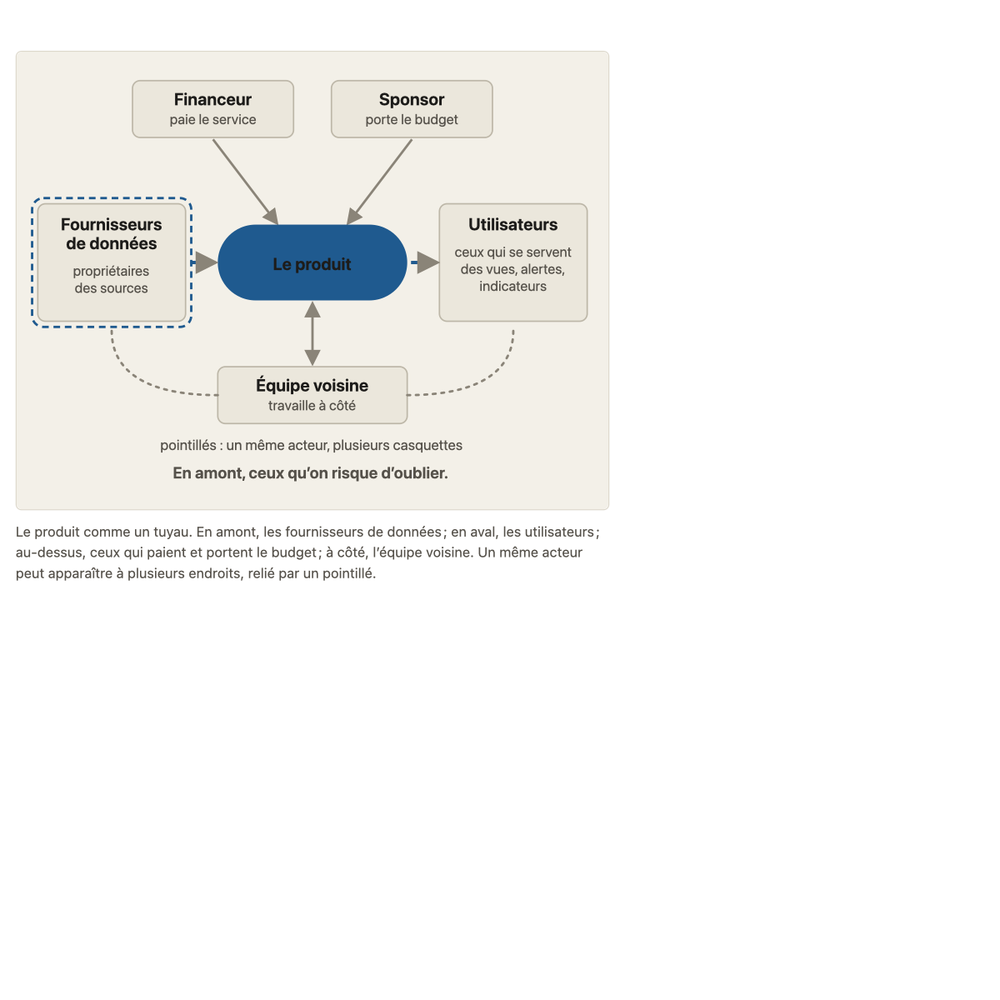
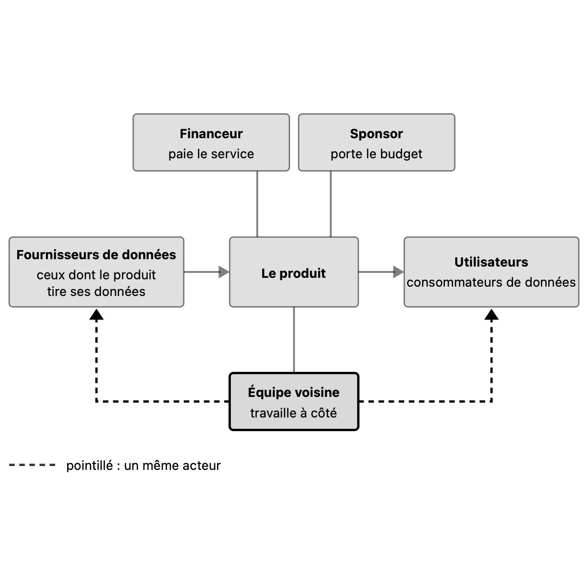
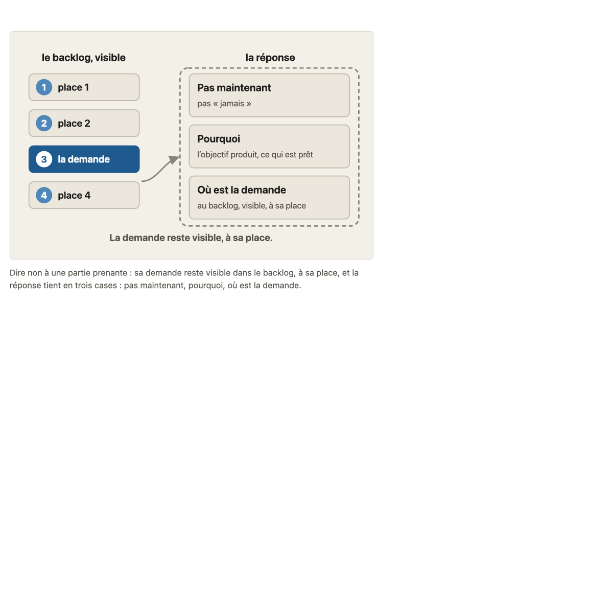
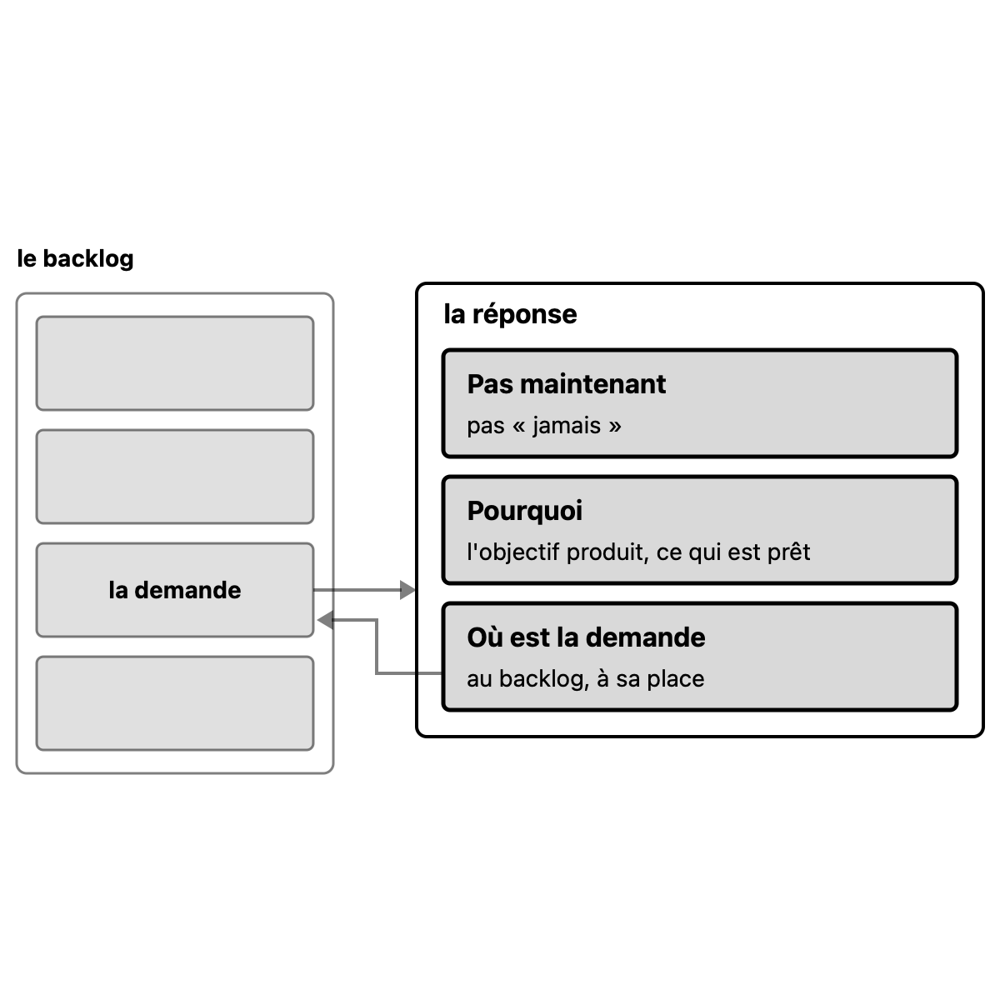
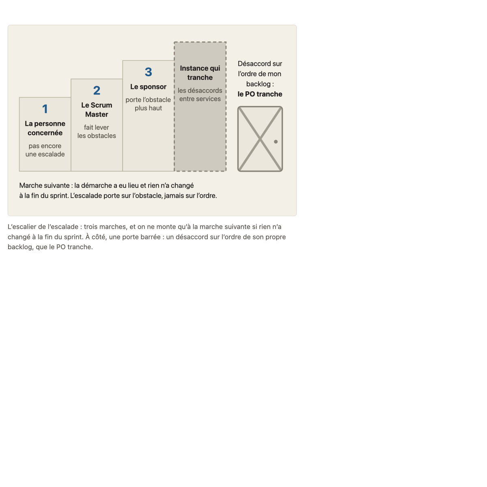
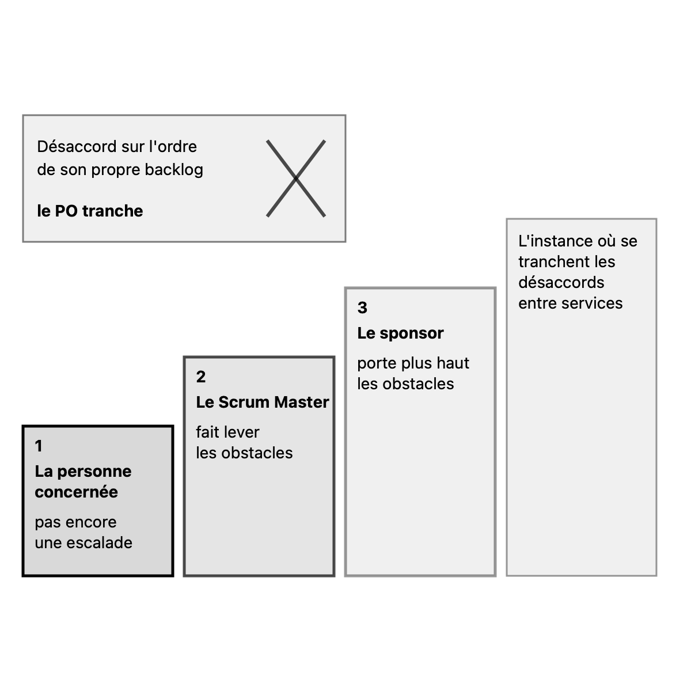

# Migration report: concept 14

Workflow `migrate-concept` (run `wf_5fd5461f-092`), course `parcours-po`, concept folder `concepts/14-parties-prenantes/`. Paths in the course folder are relative to it; the old files are named from their repository folder (`parcours-po`, `parcours-po-website`).
Old files: `parcours-po/course/concepts/14-parties-prenantes.md` (CF), `parcours-po/course/sources/14-parties-prenantes.md` (SF), `parcours-po-website/src/content/concepts/fr/14-parties-prenantes.mdx` (MDX), `parcours-po-website/src/components/schemas/Schema14.astro` (ASTRO).

## Summary

| checks | target existed | old diagrams | new diagrams | captions of more than one sentence |
|---|---|---|---|---|
| fail (run), ok after the fixes below | no | 3 | 3 | 1 (run), 0 after |

Result: **failed**. checks is read in code from the output below, which the check agent returns; target existed is read in code from the listing below, which the scope agent returns. The new concept is not compared with the old one (rule D on #23): the fresh-agent review judges it against SPEC.md and PROTOCOL.md.

Captions of more than one sentence (SPEC.md 7.2, principle 1: a caption that needs two sentences means two diagrams): escalade-obstacle-marches.svg (2 sentences) in the run; rewritten as one sentence in the fixes below.

## Target before the run

`ls -ld concepts/14-parties-prenantes; ls -la concepts/14-parties-prenantes`, as the scope agent returned it: no such folder.

```
ls: cannot access 'concepts/14-parties-prenantes': No such file or directory
ls: cannot access 'concepts/14-parties-prenantes': No such file or directory
```

## Diagrams (M11)

Each old diagram was inventoried (what it shows, by idea), drawn anew from its inventory and concept.md alone under SPEC.md 7.2. Renderings: the old diagram from the frozen site's build; the new one in one colour.

### `parcours-po-website/src/components/schemas/Schema14.astro`, p="a"

Figure legende, in the section 14a: « Le produit comme un tuyau. En amont, les fournisseurs de données ; en aval, les utilisateurs ; au-dessus, ceux qui paient et portent le budget ; à côté, l'équipe voisine. Un même acteur peut apparaître à plusieurs endroits, relié par un pointillé. »

One idea.

Its sentences, where the inventory sends them (M11):
- « Le produit comme un tuyau. »: title of parties-prenantes-cinq-familles.svg
- « En amont, les fournisseurs de données ; en aval, les utilisateurs ; au-dessus, ceux qui paient et portent le budget ; à côté, l'équipe voisine. »: labels of parties-prenantes-cinq-familles.svg
- « Un même acteur peut apparaître à plusieurs endroits, relié par un pointillé. »: caption of parties-prenantes-cinq-familles.svg

#### parties-prenantes-cinq-familles.svg

- Title: Le produit comme un tuyau
- Caption: Un même acteur peut apparaître à plusieurs endroits, relié par un pointillé.
- Sub-concept: 14a
- Idea: « Un même acteur peut apparaître à plusieurs endroits, relié par un pointillé. » (MDX section 14a (Figure legende))

| Id | Element | Labels | Role | State |
|---|---|---|---|---|
| E1 | le produit, vu comme un tuyau où les données entrent en amont et sortent en aval | « Le produit » | subject | none |
| E2 | les fournisseurs de données, en amont du produit, propriétaires des sources, ceux qu'on risque d'oublier | « Fournisseurs de données », « propriétaires des sources », « les fournisseurs de données », « En amont, ceux qu'on risque d'oublier. » | contrast | none |
| E3 | les utilisateurs, en aval du produit, ceux qui se servent des vues, des alertes et des indicateurs | « Utilisateurs », « ceux qui se servent des vues, alertes, indicateurs », « les utilisateurs » | context | none |
| E4 | le financeur, qui paie le service | « Financeur », « paie le service » | context | none |
| E5 | le sponsor, qui porte le budget | « Sponsor », « porte le budget » | context | none |
| E6 | le groupe de ceux qui paient et portent le budget, au-dessus du produit, formé du financeur et du sponsor | « ceux qui paient et portent le budget » | context | none |
| E7 | l'équipe voisine, qui travaille à côté du produit | « Équipe voisine », « travaille à côté », « l'équipe voisine » | context | none |
| E8 | le lien d'un même acteur qui apparaît à plusieurs endroits, avec plusieurs casquettes | « pointillés : un même acteur, plusieurs casquettes » | context | none |

Relations:
- E2 to E1: les données des fournisseurs entrent dans le produit (flèche de données, de l'amont vers le produit)
- E1 to E3: les données sortent du produit vers les utilisateurs (flèche de données, du produit vers l'aval)
- E4 and E5, grouped as E6, are linked to E1: ceux qui paient et portent le budget sont au-dessus du produit et reliés à lui
- E7 and E1 are linked in both directions: l'équipe voisine travaille à côté du produit
- E8 links E7 to E2 and E7 to E3: un même acteur, ici l'équipe voisine, peut apparaître à plusieurs endroits (chez les fournisseurs et chez les utilisateurs), relié par un pointillé
- Reading order of the pipe: E2 (en amont), then E1, then E3 (en aval); E6 above E1; E7 beside E1

Key of the inventory: E8 « pointillés : un même acteur, plusieurs casquettes ». Key drawn: « pointillés : un même acteur, plusieurs casquettes ».

| Old | New |
|---|---|
|  |  |

### `parcours-po-website/src/components/schemas/Schema14.astro`, p="b"

Figure legende, in the section 14b: « Dire non à une partie prenante : sa demande reste visible dans le backlog, à sa place, et la réponse tient en trois cases : pas maintenant, pourquoi, où est la demande. »

One idea.

Its sentences, where the inventory sends them (M11):
- « Dire non à une partie prenante : sa demande reste visible dans le backlog, à sa place, et la réponse tient en trois cases : pas maintenant, pourquoi, où est la demande. »: caption of dire-non.svg

#### dire-non.svg

- Title: Dire non : pas maintenant, pourquoi, où est la demande
- Caption: Dire non à une partie prenante : sa demande reste visible dans le backlog, à sa place, et la réponse tient en trois cases : pas maintenant, pourquoi, où est la demande.
- Sub-concept: 14b
- Idea: « Dire non à une partie prenante : sa demande reste visible dans le backlog, à sa place, et la réponse tient en trois cases : pas maintenant, pourquoi, où est la demande. » (MDX section 14b (legende of the Figure))

| Id | Element | Labels | Role | State |
|---|---|---|---|---|
| E1 | le backlog, vu de tous : une colonne de quatre places ordonnées, de la place 1 à la place 4 | « le backlog, visible » | context | none |
| E2 | les trois autres places du backlog, numérotées 1, 2 et 4 | « 1 », « 2 », « 4 », « place 1 », « place 2 », « place 4 » | context | none |
| E3 | la demande de la partie prenante, à sa place (la place 3) dans le backlog | « 3 », « la demande » | subject | none |
| E4 | la réponse du PO, qui contient trois cases | « la réponse » | subject | none |
| E5 | première case de la réponse : pas maintenant, et non jamais | « Pas maintenant », « pas « jamais » » | subject | none |
| E6 | deuxième case de la réponse : le pourquoi, par l'objectif produit et ce qui est prêt | « Pourquoi », « l'objectif produit, ce qui est prêt » | subject | none |
| E7 | troisième case de la réponse : où est la demande, au backlog, visible, à sa place | « Où est la demande », « au backlog, visible, à sa place » | subject | none |
| E8 | note sous le diagramme sur la demande | « La demande reste visible, à sa place. » | text | none |

Relations:
- E2, E3 et E4 (la place 3) forment le backlog E1, ordonné de la place 1 à la place 4; E3 est la demande, à sa place parmi les autres
- E3 mène à E4: la réponse vaut pour la demande
- E4 contient E5, E6 et E7 dans cet ordre: pas maintenant, pourquoi, où est la demande
- E7 renvoie à E3: la demande se retrouve au backlog, à sa place

Key of the inventory: none. Key drawn: none.

| Old | New |
|---|---|
|  |  |

### `parcours-po-website/src/components/schemas/Schema14.astro`, p="c"

Figure legende, in the section 14c: « L'escalier de l'escalade : trois marches, et on ne monte qu'à la marche suivante si rien n'a changé à la fin du sprint. À côté, une porte barrée : un désaccord sur l'ordre de son propre backlog, que le PO tranche. »

One idea.

Its sentences, where the inventory sends them (M11):
- « L'escalier de l'escalade : trois marches, et on ne monte qu'à la marche suivante si rien n'a changé à la fin du sprint. »: caption of escalade-obstacle-marches.svg
- « À côté, une porte barrée : un désaccord sur l'ordre de son propre backlog, que le PO tranche. »: caption of escalade-obstacle-marches.svg

#### escalade-obstacle-marches.svg

- Title: L'escalade d'un obstacle, en trois marches et un palier
- Caption (run, 2 sentences): L'escalier de l'escalade : trois marches, et on ne monte qu'à la marche suivante si rien n'a changé à la fin du sprint. À côté, une porte barrée : un désaccord sur l'ordre de son propre backlog, que le PO tranche.
- Caption (now, one sentence): L'escalade porte sur l'obstacle, jamais sur l'ordre : trois marches pour l'un, et pour un désaccord sur l'ordre de son propre backlog, que le PO tranche, aucune.
- Sub-concept: 14c
- Idea: « L'escalade porte sur l'obstacle, jamais sur l'ordre. » (MDX section 14c)

| Id | Element | Labels | Role | State |
|---|---|---|---|---|
| E1 | première marche : la personne concernée, de vive voix, à qui l'on parle d'abord; ce n'est pas encore une escalade | « 1 », « La personne concernée », « pas encore une escalade » | series | none |
| E2 | deuxième marche : le Scrum Master, qui fait lever les obstacles | « 2 », « Le Scrum Master », « fait lever les obstacles » | series | none |
| E3 | troisième marche : le sponsor, qui porte l'obstacle plus haut | « 3 », « Le sponsor », « porte l'obstacle plus haut » | series | none |
| E4 | palier au sommet, sans numéro : l'instance où se tranchent les désaccords entre services, à laquelle le sponsor peut porter le désaccord | « Instance qui tranche les désaccords entre services » | series | none |
| E5 | à part de l'escalier, une porte barrée : un désaccord sur l'ordre de son propre backlog, qui n'est pas un obstacle; le PO le tranche, on ne monte pas | « Désaccord sur l'ordre de mon backlog : », « le PO tranche » | contrast | refused (« on ne monte pas ») |
| E6 | note sous l'escalier sur le moment de passer à la marche suivante et sur l'objet de l'escalade | « Marche suivante : la démarche a eu lieu et rien n'a changé à la fin du sprint. L'escalade porte sur l'obstacle, jamais sur l'ordre. » | text | none |

Relations:
- E1 to E2 to E3 to E4 in this order, from the first marche to the palier: each marche is the next one up
- On passe de E1 à E2, de E2 à E3, quand la démarche a eu lieu et que rien n'a changé à la fin du sprint en cours
- E5 stands apart from the stairs E1 to E4: it is not climbed, the PO decides (on ne monte pas)
- E6 reads the passage from one marche to the next and what the escalade is about

Key of the inventory: none. Key drawn: none.

| Old | New |
|---|---|
|  |  |

Renderings in `S1-10-14-report/`, beside this report.

## Writing choices

- M9 citation line: none added. The old Sous-concepts cites all six cases by title in « » (La liste d'Anna; Charlotte passe après l'appli; Odile demande de passer Charlotte en tête; L'accès aux locations bloque depuis trois sprints; Faire trancher Odile entre Pia et Charlotte ?; Pia refuse le canal d'Abba).
- M9 Faits du fil rouge utilisés: lead words « Faits du fil rouge utilisés : » dropped, so the paragraph now starts with the lowercase « les acteurs (Étienne, ... ». I did not capitalize it, since no rule names a capital. No other lead text existed in Banque d'exemples.
- M9 Réexplication: two cases (Charlotte passe après l'appli; Faire trancher Odile entre Pia et Charlotte ?) carry a field « **Réexplication** (réponse fausse, ...) : » that SPEC.md 4.3 does not list. I kept it verbatim, as 'every field verbatim' says. The concept-folder check may flag it.
- M10 Nature, inferred from the MDX ecoles item because no MDX sources item states the claim: 'cinq catégories' = cours (ecoles.cours item 1); 'Pièges: escalader d'emblée...' = cours (ecoles.cours items on the order of steps and on désaccord/dépendance); 'Rechange Pia refuse le canal d'Abba' (two rows) = cours (ecoles.cours, dépendance bloquée chez une autre équipe); 'Un même acteur cumule' = cours (ecoles.cours item 1).
- M10 Nature, MDX sources item states the same claim: kinds copied as given. 'PO représente les besoins' and 'PO est une seule personne' both = consensus (one MDX item covers both). 'Le SM répond de l'efficacité...' and 'Le SM facilite la collaboration...' both = consensus (one MDX item). 'Les consommateurs de données sont des utilisateurs' = école (MDX writes ecole). 'Obstacle' = cours. 'Le sponsor n'ordonne pas le backlog' and 'Le sponsor convainc le PO' = cours.
- M10 Nature left empty: 'Comprendre ce qui bloque l'accès (DSI, colonnes)', 'Accès à la table des locations demandé', 'Acteurs de 14a classés', 'Les colonnes autorisées relèvent de la DSI'. No MDX item states them and no ecoles item matches (storyline facts or renvois).
- M10 orphans (as the run wrote it): references S5 (Scrum Alliance CSPO) and S6 (Scrum.org PSPO I) are cited by no source cell, and no row names either in its verification column as support. Left in Références; the sources check will fail on them, so the run fails on this point as the rule says.
- M10 paths rewritten (old text: new text): course/fil-rouge-velos.md: storyline.md (rows 'fournisseurs de données', 'Ordre des démarches', 'Accès à la table des locations', 'Acteurs de 14a classés', in the verification cells); course/glossary.md: glossary.md (rows 'Obstacle', 'Obstacle ou désaccord', source cell); course/sources/01-produit-et-po.md: concepts/01-produit-et-po/sources.md (2 rows); course/sources/02-objectif-produit-resultat.md: concepts/02-objectif-produit-resultat/sources.md; course/sources/10-hors-perimetre-dependances.md: concepts/10-hors-perimetre-dependances/sources.md; course/sources/12-donnees-produit.md: concepts/12-donnees-produit/sources.md (2 rows).
- M10 bare file names left as they are: `01-produit-et-po.md` (row 'Le Scrum Guide ne dit pas comment identifier...') and `00-scrum.md`, `01-produit-et-po.md` (verification cells of the rows 'PO peut représenter', 'PO est une seule personne', 'Consensus: l'organisation respecte', 'Developers choisissent', 'Scrum Master répond'). They carry no course/ directory, so I did not treat them as old-repository paths.
- M10 section name: in the row 'Dire pas maintenant: demander les faits...' the section '(14b, Sous-concepts, banque ...)' became '(14b, Consignes, banque ...)'. The column header became 'Affirmation (section de `concept.md` ou de `teaching.md`)' and a fourth column Nature was added.
- M10 pointer dropped in Non vérifié (as the run wrote it): 'Le PSPO ... : repris du cadrage T-018a, non relu ici.' became 'Le PSPO ... : non relu ici.' (task id T-018a dropped). The intro had no pointer to drop. T-018a stays in the Références cells of S6 and S10 (source cells stay as they are).
- M10 Références and Non vérifié: unchanged apart from the above. No old decision number (ADR-nnn) appears in the file, so no decisions/ lookup was needed.
- M13: no em-dash or arrow in CF or SF, so no replacement. Typographic apostrophes (’) in SF turned into ' (form). The H1 and frontmatter of CF and SF dropped. Both files start with a '## ' heading (sources.md has no intro line change: the intro paragraph is kept as is).
- M1: the objective is the course.yaml one, verbatim, with a capital first letter and a final period. MDX objectif said 'leur dire' and 'd'un produit'; S1-08 records 14 as 'flagged, CF kept' and the yaml follows CF, so no clause of either is left uncarried that the note does not cover.
- M3: no MDX ecoles.voisines, so no neighbors key. The CF consensus claims all match MDX items. One carry from CF: '(concept 1b)' added to consensus item 1 after 'pas un comité'. The CF 'sans source externe, à présenter comme tel' hint is by design, not written. CF choix du cours items all matched MDX course items, with nothing more to carry.
- M4: essentials are the MDX text plus two CF-only additions. First, after 'lui fournit ses données': '; ces fournisseurs, qu'on risque d'oublier, peuvent le bloquer' (in place of the MDX full stop). Second, the 'le PO le tranche' after 'ne s'escalade pas', followed by the CF sentence on the dependency blocked in another team's backlog. MDX wording 'que l'équipe ne lève pas seule' kept over CF's parenthesis.
- M6: 'Renvoi n=13 pour l'ordre lui-même' became '(concept 13 pour l'ordre lui-même)'. '(Renvoi 0a2, repris au Renvoi 15)' became '(concept 0a2, repris au concept 15)'. Pastilles kept right where they stood, with the space before: [école], [cours]. FilRouge became a '> **Fil rouge :**' blockquote, after the grille paragraph.
- M5: the three sections are leaves with no children, so '## 14a/14b/14c <title>' with the promise in italics; titles equal the course.yaml ones. No unlisted h4.
- M7: pitfalls follow the MDX list and wording, since every CF item is already in an MDX item (CF's items 4 and 5 are merged in MDX, and the escalate-at-once and wait items are too). CF has no more precise reference, so nothing changed. MDX 'demandent' and 'se demande à qui le détient' kept over CF's wording.
- M8: CF has a test paragraph, not a bare question, so the whole CF test is the blockquote (CF wording: 'ai-je parlé d'abord à la personne concernée, puis escaladé au Scrum Master, avant le sponsor ?', not the MDX short form). The paragraph is the Reflexe note verbatim, 'Formulation du cours : le Scrum Guide ne donne ni test, ni ordre d'escalade.' CF adds nothing beyond the blockquote, so nothing more in the paragraph. If the intended split was the question alone in the blockquote and the rest in the paragraph, this is the one to redo.
- M13: typographic apostrophes (’) in the MDX Reflexe and Erreurs texts were replaced by the straight apostrophe (form, not a writing choice). No em-dash or arrow occurred, so no replacement.
- M11: the three diagrams entries and the three image lines are the ones given in the task, in body order. The images' alt text equals each entry's title.

## Fixes after the run (contributor, rulings A to C of #23)

The four check failures and the SPEC.md 7.2 self-check were fixed in the output; the inventories above are the run's, the drawings below are the fixed ones (renderings regenerated, one colour).

- `Réexplication` (teaching.md, two cases): SPEC.md 4.3 has no such field. Each text is kept whole as a nested item of « Erreurs fréquentes » (« réponse « oui aux deux » (réexplication) : ... », « réponse « elle tranchera » (réexplication) : ... »), where follow-ups go inline. Nothing dropped.
- Orphan references (rule C): S5 (CSPO Learning Objectives) and S6 (PSPO I) removed from « Références ». The old site and sources file tie neither to a claim: the only mention is the « Non vérifié » line on the PSPO, which is not a claim. The remaining references keep their numbers (S7 to S11, no renumbering). The task id `T-018a` is dropped from S10's consultation cell (reader-facing text).
- Row of « Acteurs de 14a classés »: its verification says « le classement est celui du cours », so its Nature is now `cours`.
- Diagrams (SPEC.md 7.2): teaching sentences removed from the SVGs (notes, « En amont, ceux qu'on risque d'oublier », « La demande reste visible, à sa place. », the « marche suivante » band); labels only from concept.md and the captions. 14a: the subject is the neighbouring team and its dotted links (the idea of the caption), the product and the other families are context. 14b: the subject is the three-case answer; the request is drawn like the other places of the backlog. 14c: the stairs are the subject in falling opacity; the disagreement on the order, formerly a dashed « porte barrée » (dashed means uncertain), is the contrast, `secondary`, struck by a cross; caption cut to one sentence.
- teaching.md « Schéma » rewritten from the new drawings (the three sub-concepts declare a diagram; no « montré dans la correction »); « Faits du fil rouge utilisés » paragraph starts with a capital.
- `glossary-order`: ok here, nothing left for #166.
- The « Voir « Sous-concepts » » pointer: none in this concept.

## Checks

`mise exec -- node specs/linear-course/checks/check-course courses/parcours-po --concept 14`, after the fixes:

```
course-yaml: ok
concept-folder: ok
conventions: ok
svg-contract: ok
sources: ok
course-files: ok
glossary-order: ok
domain-first-sentence: ok
typography: ok
language-pack-keys: ok
```

In the run itself (run `wf_5fd5461f-092`) four checks failed: `concept-folder` on teaching.md:136 and :237 (field « Réexplication »), `sources` on sources.md:55 and :56 (references S5 and S6 cited by no claim). Fixed as above.
