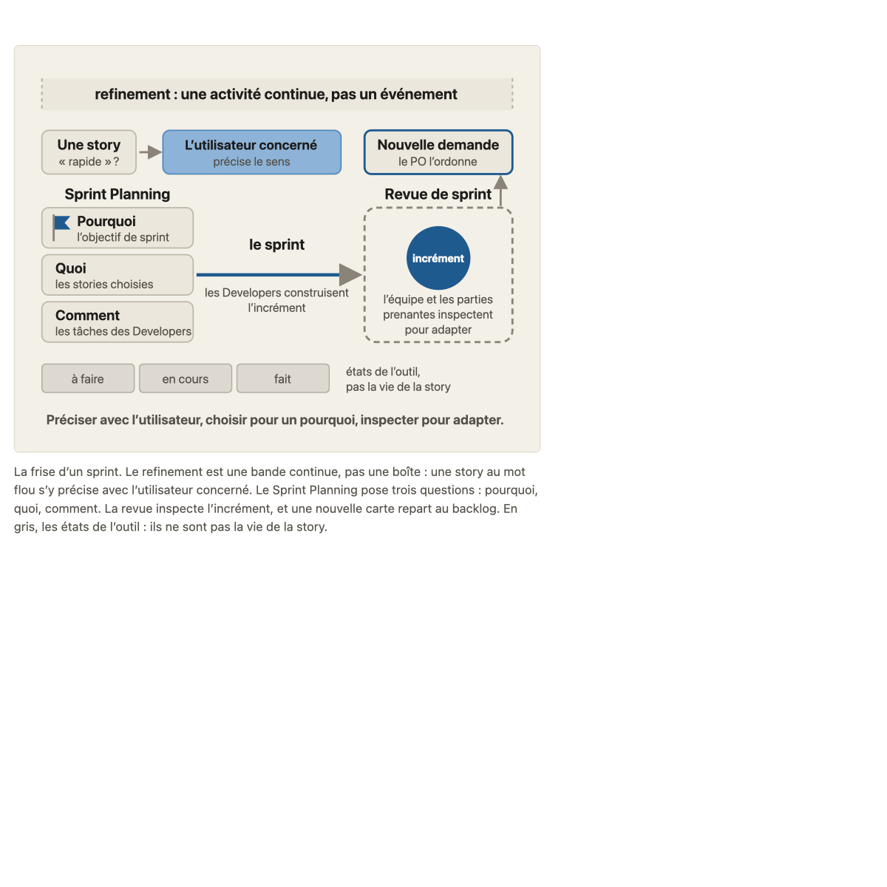
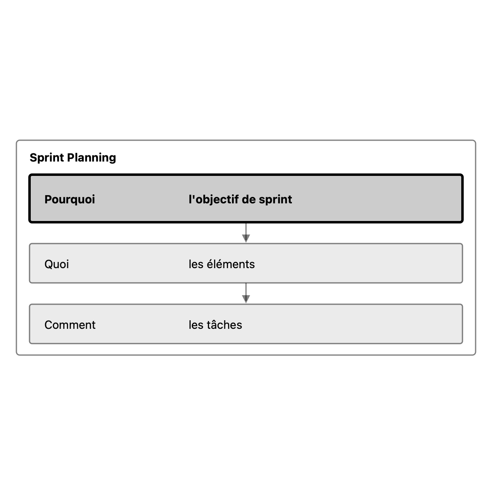

# Migration report: concept 15

Workflow `migrate-concept`, course `parcours-po`, concept folder `concepts/15-vie-story/`. Paths in the course folder are relative to it; the old files are named from their repository folder (`parcours-po`, `parcours-po-website`).
Old files: `parcours-po/course/concepts/15-vie-story.md` (CF), `parcours-po/course/sources/15-vie-story.md` (SF), `parcours-po-website/src/content/concepts/fr/15-vie-story.mdx` (MDX), `parcours-po-website/src/components/schemas/Schema15.astro` (ASTRO).

## Summary

| checks | target existed | old diagrams | new diagrams | captions of more than one sentence |
|---|---|---|---|---|
| fail, then fixed by the contributor (below) | no | 1 | 1 | 0 (after the fix) |

Result of the run: **failed** (four `sources` type cells, fixed below under rulings of #23). checks is read in code from the output below, which the check agent returns; target existed is read in code from the listing below, which the scope agent returns. The new concept is not compared with the old one (rule D on #23): the fresh-agent review judges it against SPEC.md and PROTOCOL.md.

The run's caption had 3 sentences (SPEC.md 7.2, principle 1); the contributor redrew the diagram on one idea (below).

## Target before the run

`ls -ld concepts/15-vie-story; ls -la concepts/15-vie-story`, as the scope agent returned it: no such folder.

```
ls: concepts/15-vie-story: No such file or directory
ls: concepts/15-vie-story: No such file or directory
```

## Diagrams (M11)

The run drew one diagram from the old `Schema15.astro` (a frise of the three temps, 3-sentence caption, teaching sentences inside the drawing, sub-concept 15a for parts of 15a, 15b and 15c). The contributor's self-check against SPEC.md 7.2 found it failing (a, b, c, d, f) and replaced it with one diagram of one idea, kept in the output only (the frozen source is untouched).

#### sprint-planning-trois-questions.svg

- Title: Les trois questions du Sprint Planning
- Caption (one sentence): Le Sprint Planning pose trois questions dans l'ordre, pourquoi, quoi, comment, et la première donne l'objectif de sprint.
- Sub-concept: 15b (every group id is `15b-...`)
- Roles: subject `primary` (« Pourquoi », « l'objectif de sprint »: thick outline, denser fill, bold); context `muted` (the frame « Sprint Planning », « Quoi » and « les éléments », « Comment » and « les tâches », the arrows). No contrast, no state, no key. No teaching sentence inside the drawing; every word comes from `concept.md` or the caption.
- Placement: the image moved from « L'essentiel » to the 15b section, after the three topics; « L'essentiel » keeps its text.
- Dropped with the old drawing: the refinement band, the revue and the tool states (the caption of the old drawing carried three ideas). « Schéma » of `teaching.md` describes the new drawing.

| Old | New |
|---|---|
|  |  |

Renderings in `S1-10-15-report/`, beside this report.

## Writing choices

- M9 citation line (ruling B): the old Sous-concepts cites 6 of 8 cases by title but writes two with straight inner quotes, so they do not match their headings. Added: `Cas de la banque : pour 15a2, « La story « définir le seuil » » ; pour 15c, « Tout est en « Fait » ».` (ids 15a2 and 15c, qualifiers dropped; bank order).
- M9: the lead paragraph of the old Banque d'exemples became « Faits du fil rouge utilisés » with the lead words 'Faits du fil rouge utilisés : ' dropped. No other lead text stays at the top of the bank. Consignes, the cases and Schéma are verbatim.
- M10 form: the old sources file split its claims into sub-tables under ### headings (15a, 15b, 15c, Piège, Renvois, Ajouts). SPEC 4.4 wants one table, so I merged them into one Affirmations table, same rows in the same order, and dropped the ### sub-headings (rule M10 'same rows, same order' plus SPEC 4.4). Header is the new four-column one.
- M10 path rewrite: the intro `course/sources/00-scrum.md` became `concepts/00-scrum/sources.md`, and `course/sources/11-dor-dod.md` became `concepts/11-dor-dod/sources.md`.
- M10 path rewrite: in Source and verification cells, every `course/sources/NN-slug.md` became `concepts/NN-slug/sources.md` (04-hierarchie, 07-invest, 08-criteres-regles, 09-decoupage-vertical, 10-hors-perimetre-dependances, 11-dor-dod, 12-donnees-produit, 13-ordonner-backlog, 14-parties-prenantes, 00-scrum). The range cell `course/sources/00-scrum.md` à `14-parties-prenantes.md` became `concepts/00-scrum/sources.md` à `concepts/14-parties-prenantes/sources.md`.
- M10 path rewrite: `course/fil-rouge-velos.md` became `storyline.md`, `course/plan.md` became `plan.md`, and in Non vérifié `course/glossary.md` became `glossary.md`.
- M10 decision number: ADR-018 in the Source cells of the two 'Sans sprint : renvoi à l'annexe A2' rows became `decisions/team-in-sprints.md`, which says it carries over the old decisions 018, 031 and 033.
- M10 kept as is: the verification cells 'Décision interne du cours (T-021)' and 'historique git', and the Références S9 entry with `15-vie-story.md` and 'historique git'. They sit in source or verification cells, not in the intro or Non vérifié, so the drop rule does not apply, and the bare `15-vie-story.md` is not an old repository path of the rewritten forms. No pointer needed dropping in the intro or Non vérifié.
- M10 orphan: none. S1 to S10 are all cited by a Source cell (S9 and S10 by the 'définir X' row), so no '[Sx] added'.
- M10 Nature: the 'Le PO propose, les Developers choisissent avec lui ; le PO ne choisit pas à leur place' row has no MDX sources item, so it takes the stance of the ecoles Sprint Planning item: consensus.
- M10 Nature: the row 'La revue n'est ni une séance où le PO « accepte » ..., elle n'est pas non plus une recette' states two MDX items (consensus for the démonstration/accepte part, cours for the recette part). I took its lead claim and its [S6], [S1] sources: consensus.
- M10 Nature: the row 'Une story qui sort du sprint après renégociation de la portée revient au backlog produit' has no MDX sources item, so it takes the stance of the ecoles objectif de sprint item (renegotiating scope without touching the goal): consensus.
- M10 Nature: the row 'En attendant le seuil, livrer d'abord une story dont les règles sont connues' has no MDX sources item, so it takes the stance of the matching ecoles cours item (livrer d'abord ce dont les règles sont connues): cours.
- M10 Nature left empty: the rows on storyline facts (Vélo en panne, Situation, Étienne et Maud, tournée de Théo, Maud fixe), the two A1 rows (the MDX item has no kind), the Renvois rows, the A2 pointers, the PO préparant le lien avec l'objectif produit, exploration bornée (17), the proposed objective, the 'sprint a-t-il échoué ?' tip, the blocking-list row, the 'avant-première' row, the 'Fait chez elle' tip, and the 'aucune' row. No MDX item gives them a kind, and no ecoles item matches.
- M1: Objectif is the course.yaml objective with a capital and final period. CF Objectif and MDX objectif carry nothing beyond it, so no clause is left over.
- M3 (consensus, objectif de sprint): CF's reference '(concept 0a3)' added to the item, since MDX had none.
- M3 (consensus, revue de sprint): CF's sentence 'Une story qui ne remplit pas la DoD n'y est pas présentée (concept 0b).' added to the item.
- M3 (school, Cohn): CF's '(cohérent avec le Scrum Guide)' added after 'n'est pas un bon objectif de sprint'. CF's closing 'à dire seulement si l'échange y mène' is a teaching hint, not a claim, so it is left out.
- M3 (course): CF's '(banque « La revue en recette »)' is a teaching pointer, not a claim, so it is left out. The MDX sentence 'Aucune source externe ne traite ce cas.' is kept.
- M4: MDX text as the base. Added from CF: ', pas par une story « définir X »', '(pourquoi, quoi, comment)' after Sprint Planning, and '(annexe A1)' at the end. MDX bold kept (refinement, Sprint Planning, revue de sprint). CF's bold on 'objectif de sprint' not taken, because MDX has none.
- M7 item 2: MDX sentence kept. Added from CF: 'sans demander à chaque utilisateur', '(plusieurs utilisateurs, mesure de l'objectif produit)', 'sous son nom' and the reference '(concept 7a2)'.
- M7 item 3: CF's 'X se précise au refinement, et on livre d'abord ce dont les règles sont connues' appended to the MDX sentence.
- M7 item 4: MDX sentence kept. CF's sentence 'Le repère des 10 % figurait encore dans le Scrum Guide 2017.' appended, which names the source MDX left generic.
- M7 items 5 and 7: the MDX items that merge two CF items are kept as they are. CF's separate items for the PO fixing the goal alone, promising in session and presenting a non-DoD story add nothing MDX lacks.
- M7 last item: CF's '« Fait » ne dit rien s'il ne veut pas dire DoD remplie (annexe A1)' appended. The MDX final period inside the bold became ' : ' after it.
- M8: CF has no separate question, so the three MDX Reflexe tests are the blockquote. The Reflexe note is the paragraph. CF adds nothing to it beyond punctuation.
- M5: 15a has children, so its section holds the promise and the ### 15a1 and 15a2 sections. 15b and 15c have no children, so their reader text follows the promise. MDX has no h4 outside course.yaml.
- M6: the Figure was first placed in L'essentiel (later redrawn and moved to the 15b section, see Diagrams). The FilRouge became a blockquote '**Fil rouge :** Rappel de concept 7a2 : ...'. The MDX renvoi to A2 stays 'annexe A2', where CF said A2b and A2c.
- M13: no banned character (em-dash, arrow) and no typographic apostrophe in the source texts, so no replacement was needed.

## Checks

Run on the output after the contributor's fixes: `mise exec -- node specs/linear-course/checks/check-course courses/parcours-po --concept 15`: course-yaml, concept-folder, conventions, svg-contract, sources, course-files, glossary-order, domain-first-sentence, typography, language-pack-keys all `ok`.

Fixes of the run's four `sources` failures (ruling on #23, « interne »): S7 `primaire (pour ce que fait l'outil : documentation de l'éditeur)`, S8 `primaire (pour ce que fait l'outil)`, S9 and S10 `primaire (interne : un seul apprenant : base faible)`. Also: three rows of `sources.md` whose first column named no section now end with one (`(Consignes)`, `(Faits du fil rouge utilisés)`).
