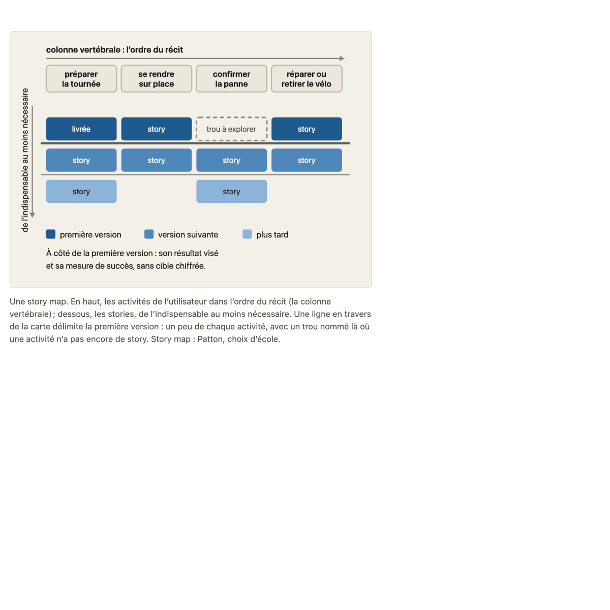
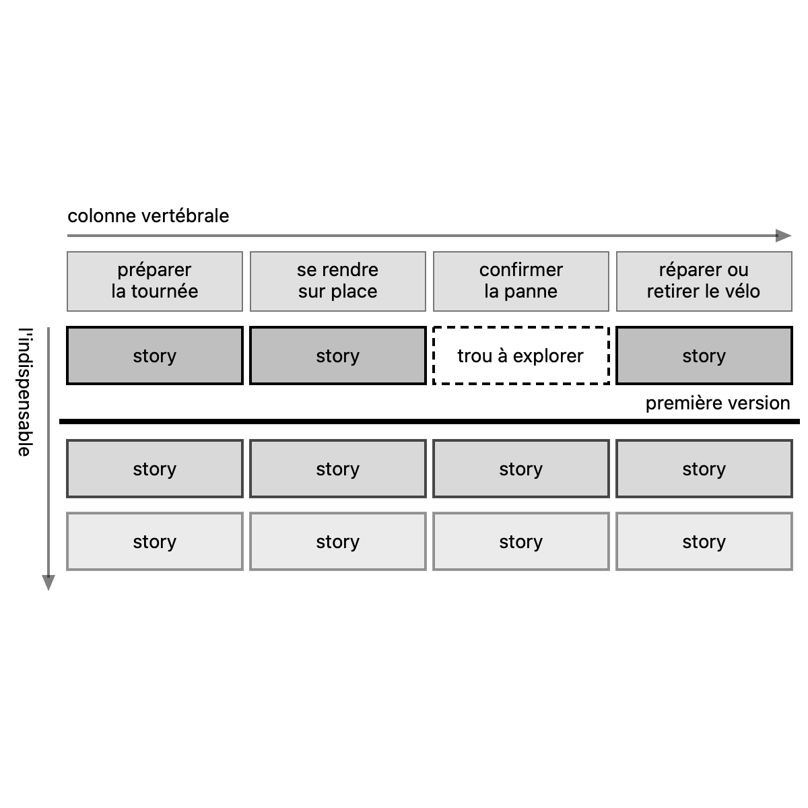
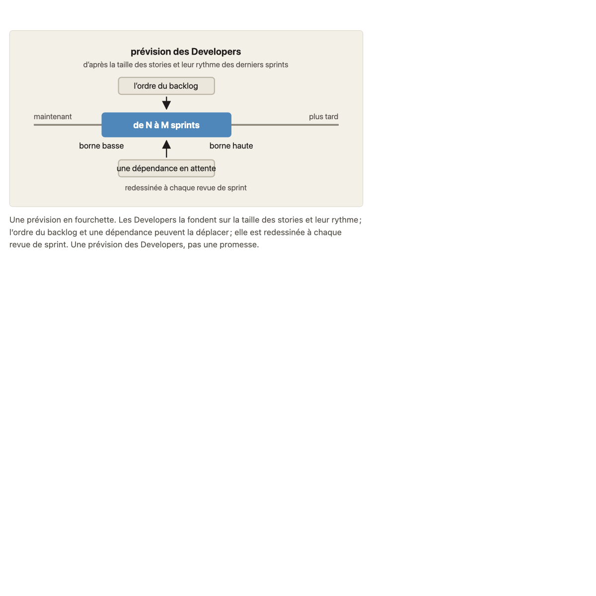
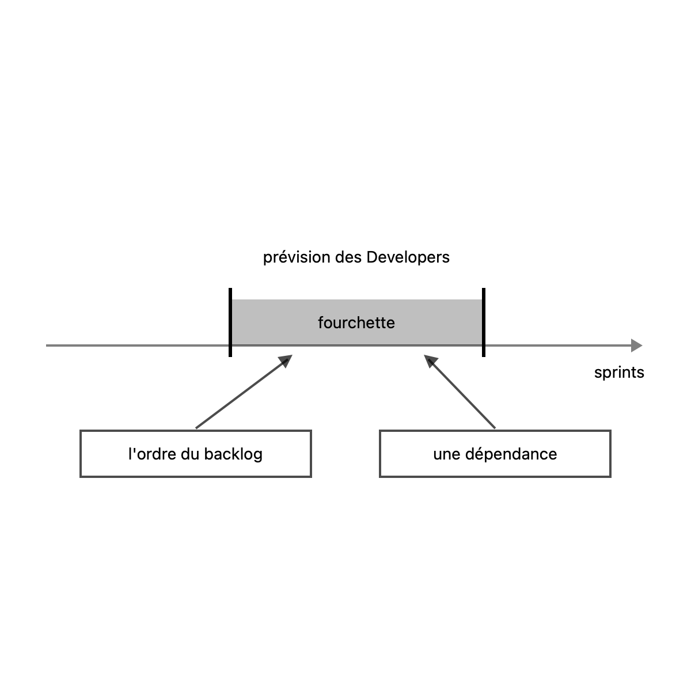

# Migration report: concept 16

Workflow `migrate-concept`, course `parcours-po`, concept folder `concepts/16-story-map/`. Paths in the course folder are relative to it; the old files are named from their repository folder (`parcours-po`, `parcours-po-website`).
Old files: `parcours-po/course/concepts/16-story-map.md` (CF), `parcours-po/course/sources/16-story-map.md` (SF), `parcours-po-website/src/content/concepts/fr/16-story-map.mdx` (MDX), `components/schemas/Schema16.astro`, `components/schemas/Schema16Prevision.astro` (ASTRO).

## Summary

| checks | target existed | old diagrams | new diagrams | captions of more than one sentence |
|---|---|---|---|---|
| fail (glossary-order only, rule A of #23) | no | 2 | 2 | 0 (2 at the run, fixed in the review pass) |

Result: **failed** at the run, on `glossary-order` only: expected under rule A of #23 (#166 fixes it at the end). After the review pass every other check passes. checks is read in code from the output below, which the check agent returns; target existed is read in code from the listing below, which the scope agent returns. The new concept is not compared with the old one (rule D on #23): the fresh-agent review judges it against SPEC.md and PROTOCOL.md.

Captions of more than one sentence at the run: both diagrams (SPEC.md 7.2, principle 1). Fixed in the review pass (see "Corrections after the run"): one sentence each.

## Target before the run

`ls -ld concepts/16-story-map; ls -la concepts/16-story-map`, as the scope agent returned it: no such folder.

```
ls: cannot access 'concepts/16-story-map': No such file or directory
ls: cannot access 'concepts/16-story-map': No such file or directory
```

## Diagrams (M11)

Each old diagram was inventoried (what it shows, by idea), drawn anew from its inventory and concept.md alone under SPEC.md 7.2. Renderings: the old diagram from the frozen site's build; the new one in one colour.

### `components/schemas/Schema16.astro`

Figure legende, in « L'essentiel »: « Une story map. En haut, les activités de l'utilisateur dans l'ordre du récit (la colonne vertébrale) ; dessous, les stories, de l'indispensable au moins nécessaire. Une ligne en travers de la carte délimite la première version : un peu de chaque activité, avec un trou nommé là où une activité n'a pas encore de story. Story map : Patton, choix d'école. »

One idea.

Its sentences, where the inventory sends them (M11):
- « Une story map. »: title of story-map.svg
- « En haut, les activités de l'utilisateur dans l'ordre du récit (la colonne vertébrale) ; dessous, les stories, de l'indispensable au moins nécessaire. »: labels of story-map.svg
- « Une ligne en travers de la carte délimite la première version : un peu de chaque activité, avec un trou nommé là où une activité n'a pas encore de story. »: caption of story-map.svg
- « Story map : Patton, choix d'école. »: caption of story-map.svg

#### story-map.svg

- Title: Une story map : le parcours de l'utilisateur en haut, les stories dessous, la première version en travers
- Caption (after the review pass): Une ligne en travers de la carte délimite la première version : un peu de chaque activité, avec un trou nommé là où une activité n'a pas encore de story. (one sentence; the run's second sentence, the school label, stays in the stances)
- Sub-concept: 16b1
- Idea: « Une ligne en travers de la carte délimite la première version : un peu de chaque activité, avec un trou nommé là où une activité n'a pas encore de story. » (la légende de la Figure, dans « L'essentiel » du MDX)

| Id | Element | Labels | Role | State |
|---|---|---|---|---|
| E1 | la tranche de version : la ligne en travers de la carte qui délimite la première version, un peu de chaque activité | « première version » | subject | none |
| E2 | la colonne vertébrale : les activités de l'utilisateur côte à côte, de gauche à droite, dans l'ordre du récit (elle ne s'ordonne pas par importance) | « colonne vertébrale : l'ordre du récit », « les activités de l'utilisateur dans l'ordre du récit », « la colonne vertébrale » | context | none |
| E3 | première activité de la journée du technicien de maintenance | « préparer la tournée » | context | none |
| E4 | deuxième activité | « se rendre sur place » | context | none |
| E5 | troisième activité | « confirmer la panne » | context | none |
| E6 | quatrième activité | « réparer ou retirer le vélo » | context | none |
| E7 | l'axe de nécessité sous les activités : les stories, de haut en bas, de l'indispensable au moins nécessaire | « de l'indispensable au moins nécessaire », « les stories » | text | none |
| E8 | niveau 1 des stories : les stories de la première version, une par activité sauf la troisième | « story », « première version » | series | none |
| E9 | niveau 2 des stories : la version suivante, entre les deux lignes | « story », « version suivante » | series | none |
| E10 | niveau 3 des stories : ce qui vient plus tard, sous la seconde ligne | « story », « plus tard » | series | none |
| E11 | la première story de la première colonne, marquée livrée | « livrée » | context | done (« marquée livrée ») |
| E12 | le trou nommé : la place de la première version où la troisième activité n'a pas encore de story | « trou à explorer » | context | not done (« n'a pas encore de story ») |
| E13 | la seconde ligne de version, qui traverse aussi les quatre colonnes : entre les deux lignes la version suivante, en dessous ce qui vient plus tard | « version suivante », « plus tard » | context | none |
| E14 | note : à côté de la première version, son résultat visé et sa mesure de succès, sans cible chiffrée | « À côté de la première version : son résultat visé et sa mesure de succès, sans cible chiffrée. » | text | none |

Relations:
- E3 à E6, dans cet ordre de gauche à droite, forment E2 ; l'ordre est celui du récit, il ne s'ordonne pas par importance
- E8, E9 et E10 sont empilés sous chacune de E3 à E6, de l'indispensable (E8) au moins nécessaire (E10), selon E7
- E1 traverse les quatre colonnes E3 à E6 ; au-dessus de E1 se trouvent les stories de la première version (E8), une par activité
- E12 occupe la place de E8 sous E5 : la première version n'y a pas encore de story
- E11 est la première story de E3 (niveau E8)
- E13 traverse aussi les quatre colonnes, sous E1 : entre E1 et E13 la version suivante (E9), en dessous de E13 ce qui vient plus tard (E10)
- E14 se lit à côté de E1 : le résultat visé et la mesure de la première version

Key of the inventory: E8 « première version »; E9 « version suivante »; E10 « plus tard ». Key drawn: « première version »; « version suivante »; « plus tard ».

| Old | New |
|---|---|
|  |  |

### `components/schemas/Schema16Prevision.astro`

Figure legende, in the section 16c1: « Une prévision en fourchette. Les Developers la fondent sur la taille des stories et leur rythme ; l'ordre du backlog et une dépendance peuvent la déplacer ; elle est redessinée à chaque revue de sprint. Une prévision des Developers, pas une promesse. »

One idea.

Its sentences, where the inventory sends them (M11):
- « Une prévision en fourchette. »: title of prevision-fourchette.svg
- « Les Developers la fondent sur la taille des stories et leur rythme ; l'ordre du backlog et une dépendance peuvent la déplacer ; elle est redessinée à chaque revue de sprint. »: caption of prevision-fourchette.svg
- « Une prévision des Developers, pas une promesse. »: caption of prevision-fourchette.svg

#### prevision-fourchette.svg

- Title: Une prévision en fourchette, que deux poids peuvent déplacer
- Caption (after the review pass): Une prévision des Developers, donnée en fourchette, que l'ordre du backlog et une dépendance peuvent déplacer. (one sentence)
- Sub-concept: 16c
- Idea: « Les Developers la fondent sur la taille des stories et leur rythme ; l'ordre du backlog et une dépendance peuvent la déplacer ; elle est redessinée à chaque revue de sprint. » (MDX section 16c1)

| Id | Element | Labels | Role | State |
|---|---|---|---|---|
| E1 | la prévision des Developers, donnée en fourchette (sans chiffre, un cas inventé), fondée sur la taille des stories et leur rythme | « prévision des Developers », « de N à M sprints » | subject | none |
| E2 | la borne basse de la fourchette | « borne basse » | subject | none |
| E3 | la borne haute de la fourchette | « borne haute » | subject | none |
| E4 | le fondement de la prévision : la taille des stories et le rythme des derniers sprints | « d'après la taille des stories et leur rythme des derniers sprints » | text | none |
| E5 | le temps, de maintenant à plus tard, sur lequel se place la fourchette | « maintenant », « plus tard » | context | none |
| E6 | l'ordre du backlog, un des deux poids qui peuvent déplacer la prévision | « l'ordre du backlog » | contrast | none |
| E7 | une dépendance en attente, l'autre poids qui peut déplacer la prévision | « une dépendance en attente » | contrast | none |
| E8 | la revue de la prévision : elle est redessinée à chaque revue de sprint | « redessinée à chaque revue de sprint » | text | none |

Relations:
- E5 : la fourchette E1 s'étend sur le temps, de E2 (borne basse, à gauche) à E3 (borne haute, à droite)
- E4 se lit avec E1 : il dit sur quoi les Developers fondent la prévision
- E6 agit sur E1 : l'ordre du backlog peut la déplacer
- E7 agit sur E1 : une dépendance en attente peut la déplacer
- E8 porte sur E1 : la prévision est redessinée à chaque revue de sprint

Key of the inventory: none. Key drawn: none.

| Old | New |
|---|---|
|  |  |

Renderings in `S1-10-16-report/`, beside this report. The new PNGs are those of the drawings after the review pass; the inventory tables above are those of the run (elements E1 to E14 and E1 to E8), before it.

## Corrections after the run

Self-check of the two diagrams against SPEC.md 7.2 (the contributor's pass, before the PR):
- story-map.svg: caption cut to one sentence (a). The teaching sentences are gone (b): the note « À côté de la première version… », the second ribbon label pair, the duplicate spine labels. The first version is the most marked (c): its ribbon, its stories and the dashed hole are `primary` at full opacity, the next stories fall to 0.7 and 0.4; the second ribbon and the key are removed. The « livrée » story is removed (e, d: not in concept.md nor in the caption). Labels kept are words of concept.md or the caption (d): « colonne vertébrale », the four activities, « story », « trou à explorer », « première version », « l'indispensable ». The whole drawing is declared and grouped under 16b1 (f), and the figure now sits in the 16b1 section (it was in « L'essentiel »).
- prevision-fourchette.svg: caption cut to one sentence (a), title reworded without the image « poids » (d). Removed as teaching or not in the caption: the foundation line, the « redessinée à chaque revue de sprint » arrow, « borne basse », « borne haute », « de N à M sprints », « maintenant », « plus tard ». The two weights are the contrast (`secondary`, solid, not dashed: a dashed outline means uncertain) (c).
- teaching.md « Schéma » rewritten for the two new drawings (h); sources.md first columns and cross-reference paths read as (g) asks: no change.
- Rules: B no citation line added (the old « Sous-concepts » cites the six cases already); C no orphan reference (every S1 to S12 is cited); « Voir « Sous-concepts » » pointer: none in the stances; « interne » reference type: none in the sources; 16a and 16c are bold-led paragraphs; « annexe A2d » is plain text.

## Writing choices

- M9 citation line: none added. The old « Sous-concepts » cites all six cases by title in « »: « La journée d'Étienne rangée par vues », « On peut supprimer le backlog ? », « Le point du matin d'abord », « Un MVP, même bâclé », « Pour quand ? », « Il me faut une date ». « Consignes » is the old « Sous-concepts » verbatim (lines 60-82, including its closing « Déjà enseigné » paragraph).
- M9 « Faits du fil rouge utilisés »: lead words « Faits du fil rouge utilisés : » dropped. The rest of that CF paragraph, including its « Situations d'exercice… » sentence, is the section body, copied as it is. It therefore starts with a lowercase « la journée d'Étienne », since no rule asks for a capital.
- M9: no other lead text in « Banque d'exemples », so it opens directly on the first ### case.
- M10 intro: `course/plan.md` became `plan.md` (writing choice: old text « `course/plan.md`, les consignes de T-018g et les promesses », new text « `plan.md` et les promesses »). The pointer to the task id T-018g is dropped by the smallest change.
- M10 bare file names: `NN-slug.md` (04-hierarchie, 03-backlog-produit, 01-produit-et-po, 13-ordonner-backlog, 09-decoupage-vertical, 00-scrum, 11-dor-dod, 14-parties-prenantes, 10-hors-perimetre-dependances, A2-sans-sprint) in the source cells became `concepts/NN-slug/sources.md`. Same for the three in verification cells, `05-user-story.md` (row 1), `02-objectif-produit-resultat.md` (the Une mesure de succès row) and `13-ordonner-backlog.md` (the Le Scrum Guide cite des pratiques row). I read them as the old sources files, abbreviated, though the rule lists only the `course/sources/NN-slug.md` form. Rows 7 (carte complète le backlog), 8, 10 (deux stories), 16 (couche), 22 (DoD), 23 (sponsor), 26 (taille) and the 16c rows carry them.
- M10 section names: « Sous-concepts » became « Consignes » in the two rows that name it (journée type; carte sert à voir le tout). « Consensus et choix d'école » stays.
- M10 Affirmations: the three tables under the ### 16a, 16b and 16c sub-headings are merged into one table of 38 rows in the old order. SPEC 4.4 asks for one table and the ### headings are not rows. Writing choice.
- M10 orphans: none. Every reference S1 to S12 is cited by a source cell, so no « orphan [Sx] added ».
- M10 « Références » and « Non vérifié » are unchanged. The « cadrage T-018a » mentions in the S4 and S8 consultation dates and in the PSPO row stay (not in the intro or « Non vérifié »). « Non vérifié » holds no pointer to drop.
- M10 Nature, taken from the MDX sources.affirmations kind (MDX ecole written école). Stated by an MDX item: Patton rows (story map, colonne vertébrale, journée type, haut en bas, voir le tout) école; carte complète le backlog, hiérarchie, deux stories sans ordre unique, couche, DoD, prévision d'une version vient des Developers, ce qui fait bouger, date comme échéance: cours; tranche, première version utile, traverse la colonne, résultat visé, mesure (both rows), MVP Ries, MVP pas au rabais, walking skeleton, fourchette, story points: école; planification d'une version, pratiques de prévision, taille, prévision pas une promesse: consensus.
- M10 Nature, MDX item without kind, so empty: usage courant du MVP, flux continu et temps de cycle, échéance du bilan au conseil.
- M10 Nature, no MDX item states the claim, so I took the stance of the matching ecoles item. Inferred école: tâches et format de story (Patton item). Inferred cours: ce que la carte montre que l'arbre ne montre pas (the cours item on the same view under several activities and the trou à explorer). Inferred école: on reparle de la prévision à chaque revue de sprint (the Cohn item says it is revised at each sprint). Inferred consensus: une prévision se fonde sur ce qui s'est déjà passé, and la prévision d'un sprint est celle des Developers (Scrum Guide item).
- M10 Nature, no matching item, so empty: le sponsor n'ordonne pas le backlog, un accès qui bloque longtemps est un obstacle à escalader (14c), la prévision du travail distincte de celle des stations à risque (the voisines item is not consensus, école or cours).
- M1 objective: not written (concept.md is not in my two files). Not examined for the CF and MDX clauses.
- M13: no banned character (em-dash, arrow) and no typographic apostrophe found in the copied text of either file, so no replacement was needed. No other word changed.
- M1: no writing choice; the course.yaml objective carries every clause of CF and MDX objectives (MDX 'une prévision, pas une promesse' is a shorter form of CF's), so nothing to report.
- M3: CF '(concepts 1b, 3)' written '(concepts 1b et 3)' to follow the SPEC 4.5 list form; CF bare '(0a3)' written '(concept 0a3)' (convention needs the word); added to the Scrum Guide consensus item.
- M3: CF '(repris en 17)' written '(repris au concept 17)' in the Ries item (CF-only reference carried in).
- M3: Patton item, CF's 'que le cours réserve au sens de Cockburn (concept 9)' merged into MDX wording as 'un autre usage du mot que celui du cours, qui le réserve au sens de Cockburn (concept 9)' (a small wording choice to avoid a duplicate clause).
- M3: CF-only sentence 'En flux continu, la prévision passe par le temps de cycle (annexe A2d)' added to the 'Story points et vélocité' school item; CF '(13c)' added as '(concept 13c)' to the course item on 'ce qui la fait bouger'.
- M3: CF teacher hint 'sans source externe, à présenter comme tel' not written (by design).
- M4: CF-only sentence '« MVP » a deux sens : on dit lequel on emploie.' inserted after the sentence on the tranche de version, at the place CF says it.
- M5: the non-listed MDX h4 (16a1, 16a2, 16c1, 16c2) became paragraphs led by their title in bold, each followed by a period ('**La carte complète le backlog.** ...'); the period after the bold title is my choice.
- M5: 16a and 16c have no children in course.yaml, so their reader text follows the promise; 16b has children, so ### 16b1 and ### 16b2.
- M6: '(Renvoi 17)' after 'le concept 17 y revient' in 16b2 renders literally as 'le concept 17 y revient (concept 17)', a redundancy kept (no rewording allowed).
- M6: pastille placement kept exactly where MDX stood; the FilRouge blockquote is the only blockquote in the sub-concept sections.
- M7: CF-only items/sentences merged: item 'Placer une story sans savoir quand l'utilisateur s'en sert' added at its CF place (after 'Croire que la carte remplace le backlog'); 'Dessous, ses stories.' added to the first pitfall; 'le backlog reste la liste ordonnée par le PO (choix du cours)' added to the third; '(concept 9)' added after 'couche' in the 'Finir une activité' item; 'Dire lequel on emploie ; la DoD vaut pour tout ce qui entre dans l'incrément.' added to the MVP item; 'Le cours garde le sens de Cockburn (concept 9).' added to the walking skeleton item. CF wording 'Une première version qui finit une activité...' not used; MDX sentences kept as base.
- M8: quick test blockquote is the CF question verbatim (outer « » kept, as CF has them); the paragraph is the MDX Reflexe note 'Résumé du cours, sans équivalent dans les sources.' followed by CF's 'Un non à l'une des trois : le concept n'est pas appliqué.'
- M13: typographic apostrophes (’) in MDX FilRouge and pitfalls replaced by '; no banned characters were present, so no other replacement. The diagrams frontmatter entries are those given, in body order (story-map first, prevision-fourchette second).

## Checks

`mise exec -- specs/linear-course/checks/check-course courses/parcours-po --only course-yaml,concept-folder,conventions,svg-contract,sources,glossary-order,typography --concept 16`

```
course-yaml: ok
concept-folder: ok
conventions: ok
svg-contract: ok
sources: ok
glossary-order: fail: concepts/16-story-map/concept.md:104 uses the term "Flux continu", introduced by concept A2 (glossary.md:90), which comes later
glossary-order: fail: concepts/16-story-map/concept.md:104 uses the term "Temps de cycle", introduced by concept A2 (glossary.md:97), which comes later
typography: ok
```

Form fixes:
- concepts/16-story-map/concept.md: frontmatter diagrams entry prevision-fourchette.svg, subconcept 16c1 changed to 16c (16c1 is not a sub-concept of the concept; 16c is the leaf whose section holds the Figure). Failed: svg-contract subconcept.
- concepts/16-story-map/prevision-fourchette.svg: six group ids renamed from 16c1-<element> to 16c-<element> (fondement, temps, fourchette, ordre-backlog, dependance, revue). Failed: svg-contract group id form.

Left:
- glossary-order, concepts/16-story-map/concept.md:104 "Flux continu" and "Temps de cycle" (introduced by concept A2, which comes later): the sentence "En flux continu, la prévision passe par le temps de cycle (annexe A2d)." is migrated reader text; removing or rewording it would change what the text says, so it is left for the review.

Failing the run:
- glossary-order: fail: concepts/16-story-map/concept.md:104 uses the term "Flux continu", introduced by concept A2 (glossary.md:90), which comes later
- glossary-order: fail: concepts/16-story-map/concept.md:104 uses the term "Temps de cycle", introduced by concept A2 (glossary.md:97), which comes later

After the review pass: `mise exec -- specs/linear-course/checks/check-course courses/parcours-po --concept 16`: every check ok (course-yaml, concept-folder, conventions, svg-contract, sources, course-files, domain-first-sentence, typography, language-pack-keys) except the two `glossary-order` lines above (rule A of #23).
