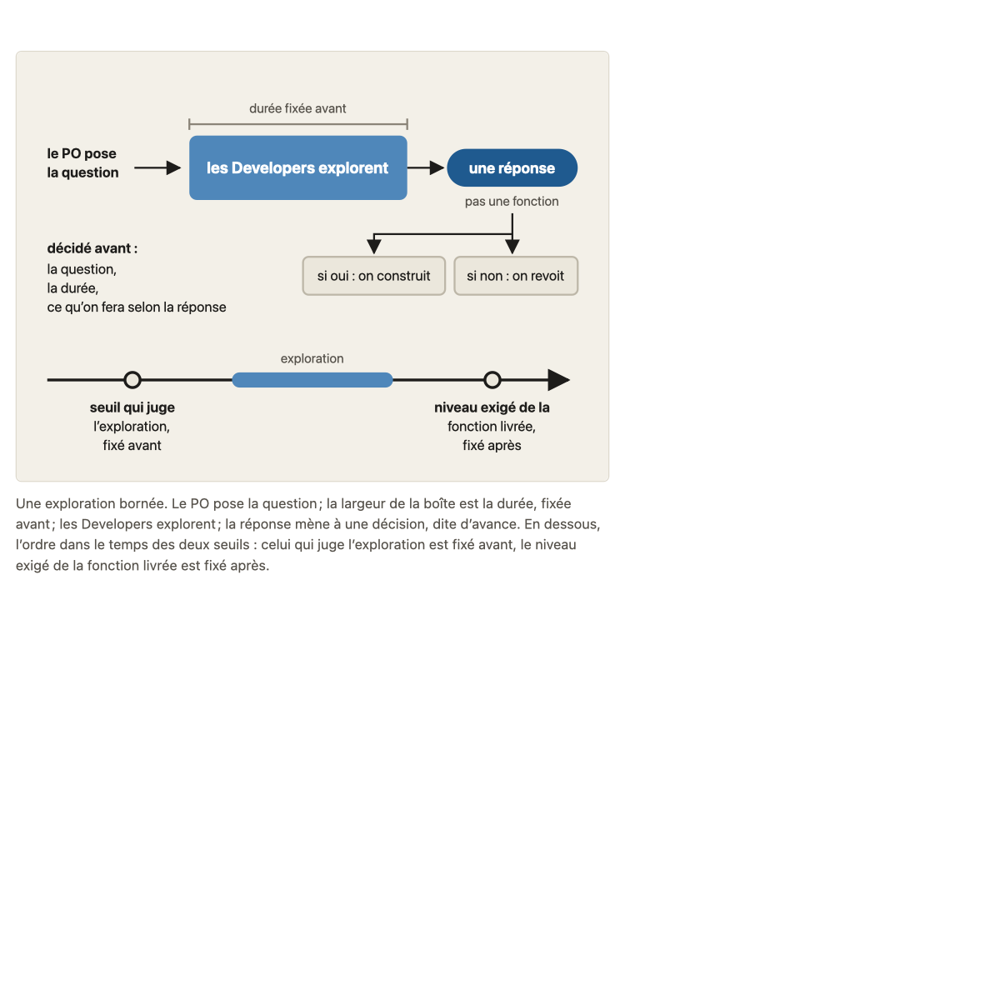
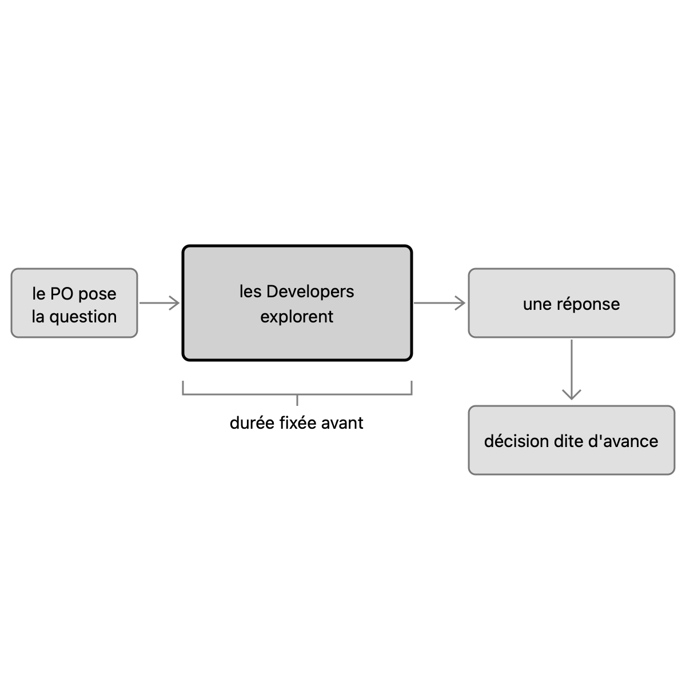
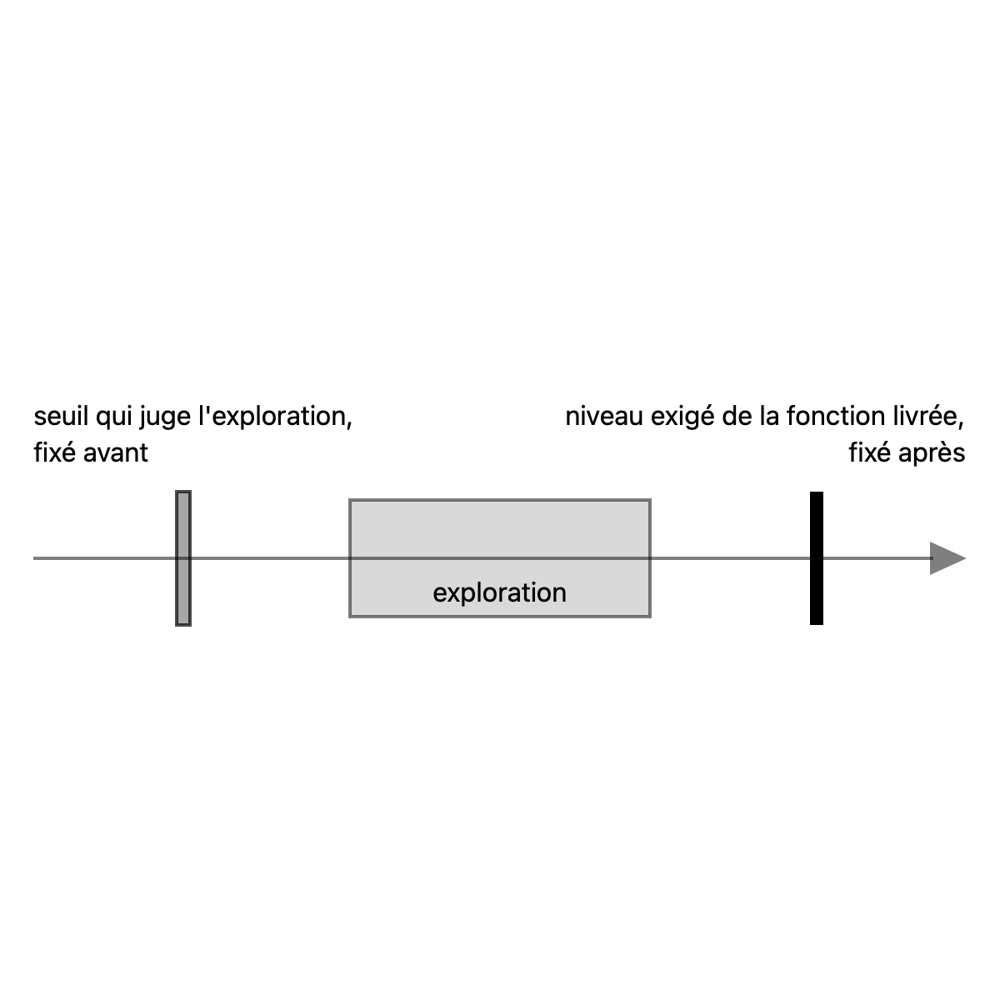

# Migration report: concept 17

Workflow `migrate-concept` (run `wf_b706b066-642`), course `parcours-po`, concept folder `concepts/17-hypotheses-exploration/`. Paths in the course folder are relative to it; the old files are named from their repository folder (`parcours-po`, `parcours-po-website`).
Old files: `parcours-po/course/concepts/17-hypotheses-exploration.md` (CF), `parcours-po/course/sources/17-hypotheses-exploration.md` (SF), `parcours-po-website/src/content/concepts/fr/17-hypotheses-exploration.mdx` (MDX), `parcours-po-website/src/components/schemas/Schema17.astro` (ASTRO).

## Summary

| checks | target existed | old diagrams | new diagrams | captions of more than one sentence |
|---|---|---|---|---|
| pass | no | 1 | 2 | 0 |

Result: **passed**. checks is read in code from the output below, which the check agent returns; target existed is read in code from the listing below, which the scope agent returns. The new concept is not compared with the old one (rule D on #23): the fresh-agent review judges it against SPEC.md and PROTOCOL.md.

## Target before the run

`ls -ld concepts/17-hypotheses-exploration; ls -la concepts/17-hypotheses-exploration`, as the scope agent returned it: no such folder.

```
ls: concepts/17-hypotheses-exploration: No such file or directory
ls: concepts/17-hypotheses-exploration: No such file or directory
```

## Diagrams (M11)

Each old diagram was inventoried (what it shows, by idea), drawn anew from its inventory and concept.md alone under SPEC.md 7.2. Renderings: the old diagram from the frozen site's build; the new one in one colour.

### `parcours-po-website/src/components/schemas/Schema17.astro`

Figure legende, in « L'essentiel »: « Une exploration bornée. Le PO pose la question ; la largeur de la boîte est la durée, fixée avant ; les Developers explorent ; la réponse mène à une décision, dite d'avance. En dessous, l'ordre dans le temps des deux seuils : celui qui juge l'exploration est fixé avant, le niveau exigé de la fonction livrée est fixé après. »

Split by idea: 2 diagrams.

Its sentences, where the inventory sends them (M11):
- « Une exploration bornée. »: title of exploration-bornee.svg
- « Le PO pose la question ; la largeur de la boîte est la durée, fixée avant ; les Developers explorent ; la réponse mène à une décision, dite d'avance. »: caption of exploration-bornee.svg
- « En dessous, l'ordre dans le temps des deux seuils : celui qui juge l'exploration est fixé avant, le niveau exigé de la fonction livrée est fixé après. »: caption of deux-seuils.svg

#### exploration-bornee.svg

- Title: Une exploration bornée : une question, une durée, une décision
- Caption: Dans une boîte dont la largeur est la durée fixée avant, les Developers explorent la question du PO, et la réponse mène à une décision dite d'avance.
- Sub-concept: 17b1
- Idea: « Le PO pose la question ; la largeur de la boîte est la durée, fixée avant ; les Developers explorent ; la réponse mène à une décision, dite d'avance. » (la legende de la Figure dans « L'essentiel » (MDX), et CF « L'essentiel »), reduced to one sentence of one idea at the self-check

| Id | Element | Labels | Role | State |
|---|---|---|---|---|
| E1 | la question, posée par le Product Owner, qui entre dans l'exploration | « le PO pose la question » | context | none |
| E2 | l'exploration bornée, menée par les Developers, dont l'étendue représente la durée | « les Developers explorent » | subject | none |
| E3 | la durée de l'exploration, qui borne le coût, fixée avant le début | « durée fixée avant » | context | none |
| E4 | la réponse, ce que livre l'exploration | « une réponse » | context | none |
| E5 | la décision, dite d'avance, à laquelle mène la réponse | « décision dite d'avance » | context | none |

Relations:
- E1 entre dans E2 : la question est posée avant l'exploration, du PO vers les Developers
- E3 borne E2 : la largeur de E2 est la durée, fixée avant
- E2 mène à E4 : l'exploration produit une réponse
- E4 mène à E5

Self-check changes (SPEC.md 7.2): the « rappel » band is removed (a teaching sentence); « pas une fonction » is removed from the answer box; the answer and the decision are `muted`, so the exploration is the only marked element; the two branches « si oui » / « si non » are replaced by one box « décision dite d'avance », since « si non » is in neither concept.md nor the caption.

Key of the inventory: none. Key drawn: none.

#### deux-seuils.svg

- Title: Deux seuils dans l'ordre du temps
- Caption: Le seuil qui juge l'exploration est fixé avant elle, et le niveau exigé de la fonction livrée est fixé après.
- Sub-concept: 17c
- Idea: « En dessous, l'ordre dans le temps des deux seuils : celui qui juge l'exploration est fixé avant, le niveau exigé de la fonction livrée est fixé après. » (la legende de la Figure dans « L'essentiel » (MDX) ; MDX 17c2 : « Deux seuils sont donc à ne pas mêler : celui qui juge l'exploration, fixé avant, et le niveau exigé de la fonction livrée, fixé après. »)

| Id | Element | Labels | Role | State |
|---|---|---|---|---|
| E1 | le temps, qui va de l'avant vers l'après de l'exploration | none | context | none |
| E2 | l'exploration, une période sur le temps, entre les deux seuils | « exploration » | context | none |
| E3 | le seuil qui juge l'exploration (ce qui compte comme « oui »), placé avant l'exploration | « seuil qui juge l'exploration, », « fixé avant » | contrast | none |
| E4 | le niveau exigé de la fonction livrée, placé après l'exploration, quand elle a montré ce qu'on peut atteindre | « niveau exigé de la fonction livrée, », « fixé après » | subject | none |

Relations:
- Dans l'ordre du temps : E3, puis E2, puis E4 (E3 fixé avant l'exploration, E4 fixé après)
- E3 et E4 sont deux seuils distincts, à ne pas mêler
- E1 porte E3, E2 et E4 dans cet ordre

Self-check changes (SPEC.md 7.2): the diagram is declared 17c, whose sentence closes on the level fixed after, so the level (E4) is the subject (`primary`, solid) and the threshold fixed before (E3) the contrast (`secondary`, paler); each label sits next to its bar; the exploration label no longer sits on the axis.

Key of the inventory: none. Key drawn: none.

| Old | New |
|---|---|
|  |  |
|  |  |

Renderings in `S1-10-17-report/`, beside this report.

## Writing choices

- M9 citation line: none written. The old « Sous-concepts » cites all 7 bank cases by title in « » (« Prévoir les stations à risque : on sait ou on suppose ? », « De quoi dépend la story de Régis ? », « On verra ce qu'Anna trouve », « Régis ira-t-il plus tôt ? », « Le critère à 90 % », « Les chiffres d'Anna », « Presque vide d'après l'historique »), so « Consignes » is the old text verbatim.
- M9: the lead paragraph of « Banque d'exemples » became « Faits du fil rouge utilisés » with its lead words « Faits du fil rouge utilisés : » dropped; no other lead text, so nothing stays at the top of the bank. « Schéma » rewritten in this PR: the two new drawings, plus the 17a panel and the 17c balance, which have no declared diagram.
- M10 path rewrite: `course/plan.md`: `plan.md` (intro).
- M10 path rewrite: `course/glossary.md`: `glossary.md` (row « Hypothèse » and row « Prévision a deux sens »).
- M10 path rewrite: `course/fil-rouge-velos.md`: `storyline.md` (7 places: source cells and the verification cell of the SMS row).
- M10 path rewrite: `course/sources/NN-slug.md`: `concepts/NN-slug/sources.md` for 00-scrum, 02-objectif-produit-resultat, 07-invest, 08-criteres-regles, 09-decoupage-vertical, 12-donnees-produit, 13-ordonner-backlog (each in its source cell).
- M10 path rewrite: `course/concepts/05-user-story.md`: `concepts/05-user-story/sources.md` (cross-reference rows, in the Source column).
- M10 pointer dropped in the intro: old text « , les consignes du lot (T-018g) et les promesses des concepts », new text « et les promesses des concepts » (task id, no new path).
- M10 pointer dropped in « Non vérifié », Découverte continue: « vient d'une source secondaire (cadrage T-018a, §8) ; le livre n'a pas été lu »: « vient d'une source secondaire ; le livre n'a pas été lu ».
- M10 pointer dropped in « Non vérifié », Origine du terme MVP: « par des sources secondaires (cadrage T-018a, §8), non vérifiée ici »: « par des sources secondaires, non vérifiée ici ».
- M10 task ids: `T-018g` (row « Restent non fixés ») and « cadrage T-018a, §8 » (Références S3 and S10) removed by the review of the PR; they are internal ids, reader-facing text keeps what they refer to.
- M10 orphan: none. All references S1 to S14 are cited by a source cell, so no « orphan [Sx] added ».
- M13 replacement: em-dash in the CRISP-DM quotation of the row « Un critère sur un niveau atteint » (« in technical terms—for example »): « in technical terms, for example » (comma, smallest change). The en-dash in the S8 quotation (« proving anything – like ») is not a banned character and stays. No typographic apostrophe in either file.
- M10 Nature, from an MDX sources.affirmations item (kind): rows 1-3 consensus; « Hypothèse » cours; « Le lien non établi » cours; Cagan four risks, Cagan PM/roles/early (the MDX item merges these two claims) école; « Le cours retient deux risques » cours; spike origin, spike delivers an answer, time-boxed cost, business-question use, backlog placement école; Torres decide-before école; PO pose la question cours; prototypes école; maquette école; « oui » de l'utilisateur cours; prototype 17b2 not morceau c cours; analyse d'historique cours; découverte continue école; MVP Ries école; niveau atteint, niveau mesuré sur données mises de côté, pesée des deux erreurs consensus; utilisateur concerné cours; niveau fixé après cours; deux seuils cours; story qui exige une prévision sûre cours; deux sens de « prévision » cours; « Restent non fixés » empty (the MDX item has no kind).
- M10 Nature choice: row « Une exploration s'ordonne au backlog : le facteur apprentissage de Cohn (renvoi 13) » has no MDX item of its own; the Cohn claim is stated in the verification text of the MDX item « Une exploration peut figurer au backlog… », so I took that item's kind: école. Writing choice.
- M10 Nature choice: row « Une prévision n'est jamais sûre (17c) » has no MDX item stating exactly it; I took consensus (the MDX item on empirisme / « ce qui va arriver est inconnu », and the matching stances consensus item, agree). Writing choice.
- M10 Nature left empty (no MDX item states the claim, and no stances item matches it): « L'objectif produit vu comme une hypothèse, pour Scrum.org » (no Scrum.org item in the MDX ecoles); « Pour ranger une supposition, se demander ce qui arrive si elle est fausse »; « Situation 17 : la tendance... » (bank); « Le seuil « presque vide » relève de la même logique »; « La pluie compte-t-elle ? La météo n'est pas collectée ». Writing choice for each.
- M10 header and section names: « Affirmations » header set to « Affirmation (section de `concept.md` ou de `teaching.md`) | Source | Ce qui a été vérifié | Nature »; « Sous-concepts » in the section names is now « Consignes » (fixed in this PR).
- M1 objective merge: not applicable to these two files (course.yaml and concept.md carry it).
- M1: Objectif is the course.yaml objective verbatim, capital S, final period; no clause of CF or MDX objectif is left out, so nothing to report
- M3: school item 'exploration bornée' gets CF's '(concept 7)' after the business-question clause (CF precise reference carried)
- M3: school item 'MVP' reference 'concept 16' (MDX) replaced by CF's 'concept 16b' (CF precise reference wins)
- M3: course item 'Deux seuils' gets CF's pointer '(17b1)' after 'sans le chiffrer' (kept as a bare id, plain text; MDX wording 'les utilisateurs concernés' kept as base)
- M3: neighbors item keeps MDX 'concept 16' (CF's 16c is not in the Consensus section, so not carried)
- M4: CF L'essentiel adds nothing MDX lacks; MDX text kept, two image lines (exploration-bornee.svg, deux-seuils.svg) after the paragraph where the Figure stood
- M5: 17a is a leaf in course.yaml, so 17a1 and 17a2 are paragraphs of the 17a reader text, each led by its title in bold followed by a period (period is my choice of separator); same for 17c1 and 17c2 in 17c; 17b1 and 17b2 are ### leaf headings
- M6: FilRouge of 17a2 becomes a blockquote placed after the last 17a paragraph; Renvois written 'concept 11b', 'concept 2', 'concept 13', 'concept 8a2' (twice), 'concept 16b2', 'concept 9', 'concept 16c'; bare '(17c)' and '(17b1)' left as plain text as in the MDX
- M7: Pièges item 1: CF's parenthesis '(« tout le monde sait que… »)' added
- M7: Pièges item 2: CF sentence 'Un profil data vérifie volontiers que le modèle marche, plus rarement que l'utilisateur s'en servira.' appended after the MDX sentence (partly redundant, kept by rule)
- M7: Pièges item 3: CF sentences added after the MDX sentence, capitalised: 'Le PO la fait vérifier ; il ne dit pas si elle est vraie. Les Developers explorent et disent le temps qu'il leur faut.' (CF's separate 'Trancher' and 'Mener' items are merged into the MDX item)
- M7: Pièges item 4: CF's 'la fonction est une autre story' and 'elle n'a pas de fin, et rien ne change à son terme' added; I added the connective 'Sans question ni décision,' (small wording change) to give 'elle' an antecedent
- M7: Pièges items 6, 7, 8: CF explanations added after the colon (niveau 'il se fixe après, par l'utilisateur concerné'; 'il faut les fausses alertes et les cas manqués'; for item 8, CF's 'elle l'éclaire, l'utilisateur concerné la fixe' and CF's 'Mêler les deux seuils' sentences with (17b1), (17c) and 'Le PO ne chiffre ni l'un ni l'autre.'); the MDX item 8 title kept ('l'exploration', not CF's 'une donnée ou une exploration ... règle métier')
- M7: item 9 (prévision confondue) has no CF counterpart; kept as in MDX; no CF item left unplaced
- M8: quick test question is CF's, without its enclosing « » (the blockquote marks the quotation; my choice); the paragraph is the Reflexe note 'Formulation du cours, sans équivalent dans les sources.' followed by CF's sentence 'Si l'apprenant n'en trouve aucune...'
- M13: no banned character present, no replacement; no typographic apostrophe found; no em-dash or arrow replaced
- Frontmatter: item key 'auteur' written 'author', 'texte' 'text'; diagrams entries verbatim, order of body; 'ecoles.voisines' written as neighbors
- Corrections of the PR (SPEC.md 7.2 self-check, then the fresh review): captions of one sentence and one idea; `exploration-bornee.svg` reduced to the exploration as subject, declared 17b1; `deux-seuils.svg` declared 17c with the level fixed after as subject; `sources.md` section names, `sources.md` paths for cross-references, empty Nature cells filled where the row's text names it, the CRISP-DM cut marked « […] »; « Pièges » items 2, 3 and 8 reworded; « Schéma » of `teaching.md` keeps the 17a panel and the balance of 17c.

## Checks

`mise exec -- node specs/linear-course/checks/check-course courses/parcours-po --concept 17`, run after the corrections of the PR:

```
course-yaml: ok
concept-folder: ok
conventions: ok
svg-contract: ok
sources: ok
course-files: ok
glossary-order: ok
domain-first-sentence: ok
typography: ok
language-pack-keys: ok
```
