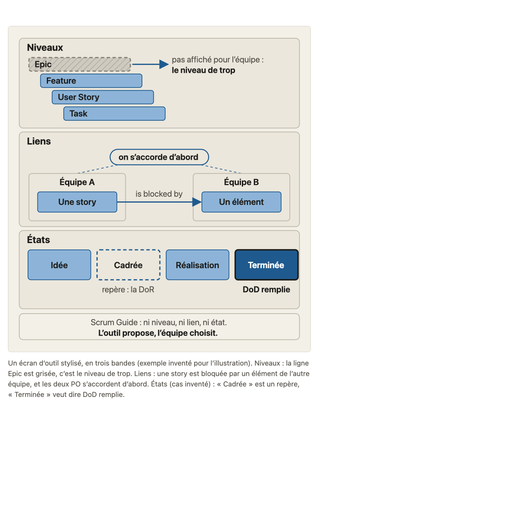
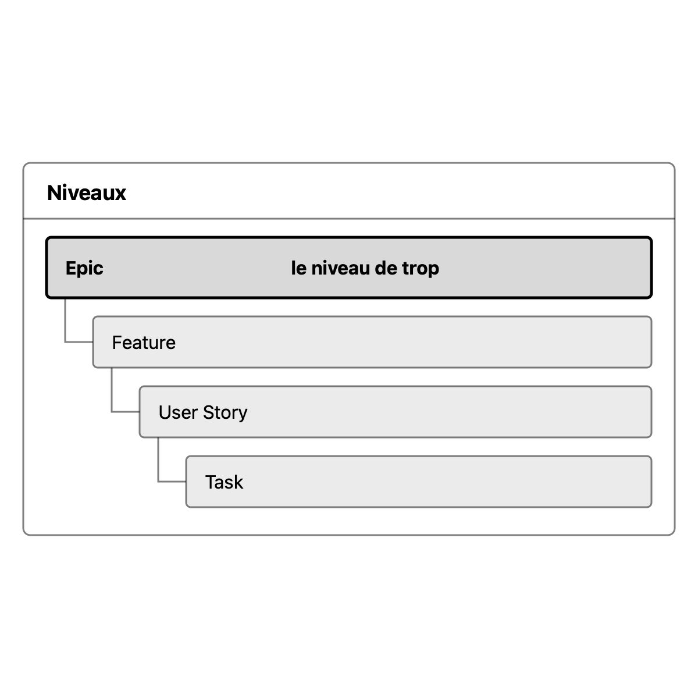
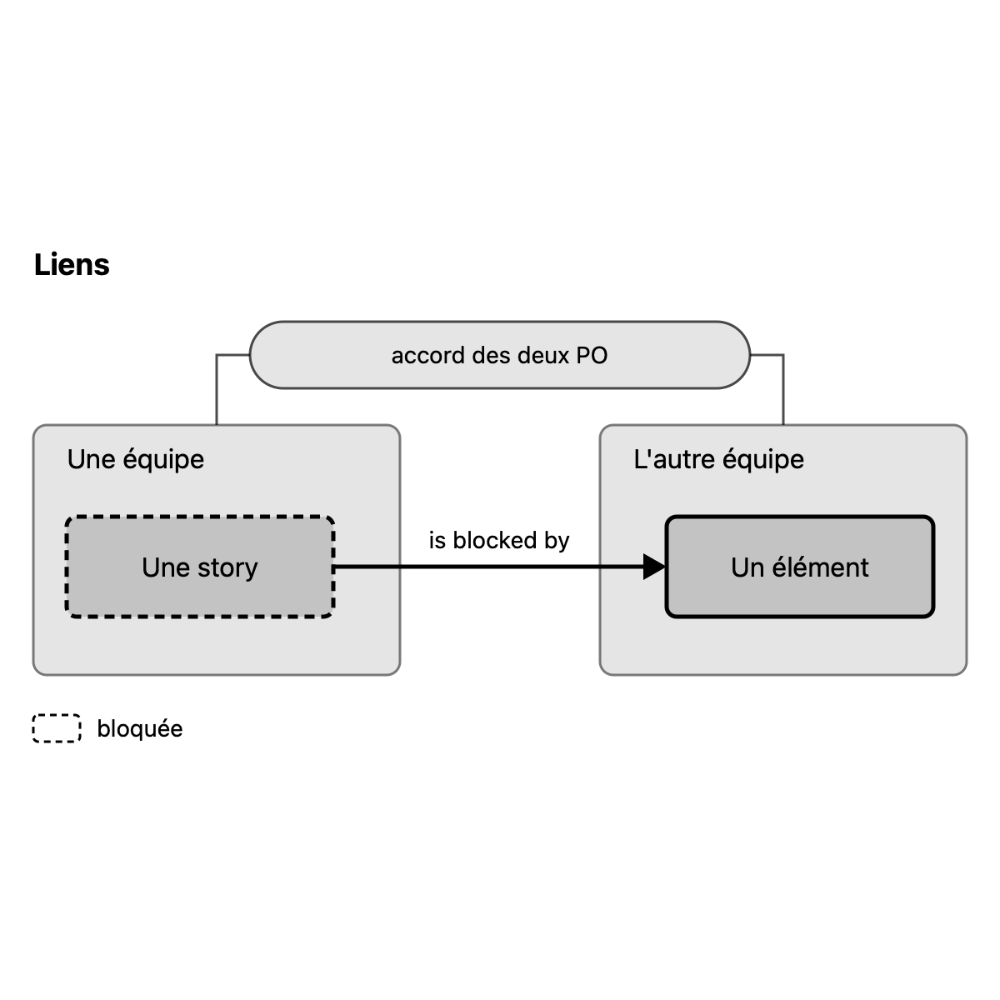
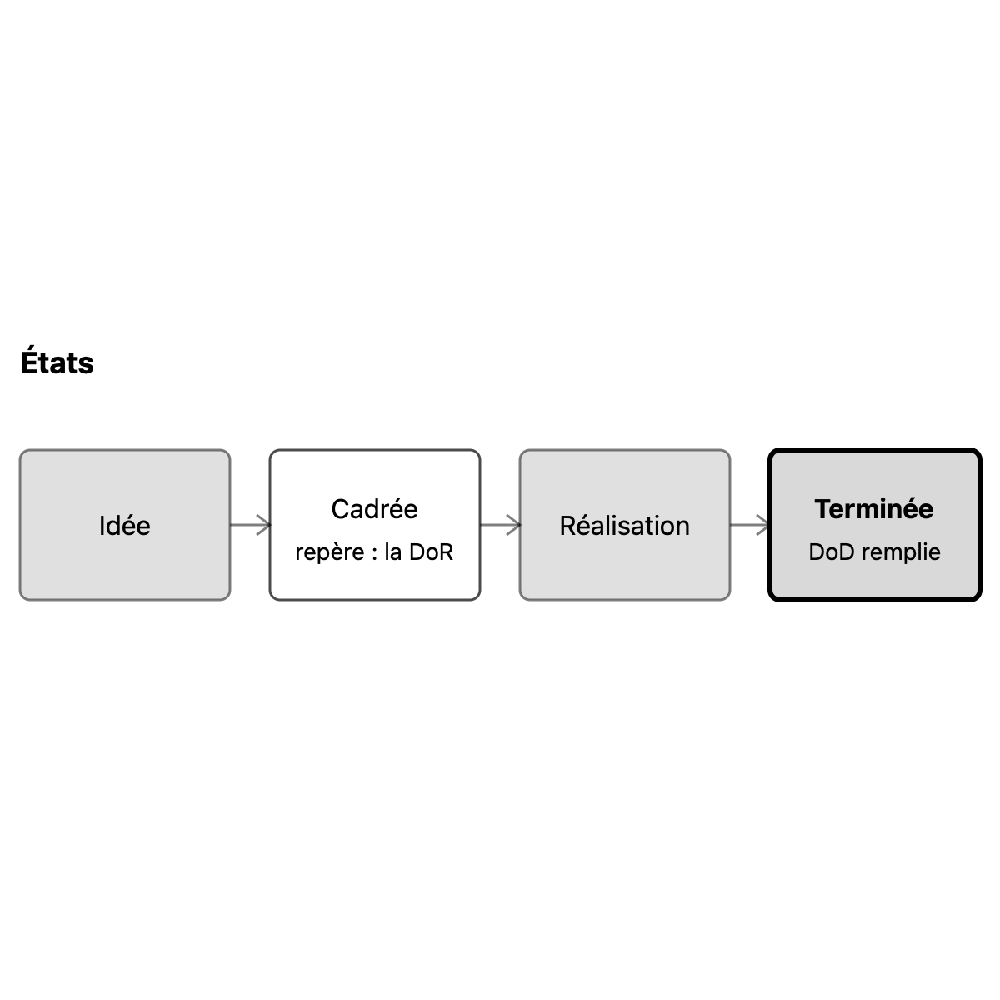

# Migration report: concept A1

Workflow `migrate-concept` (run `wf_78e977df-326`), course `parcours-po`, concept folder `concepts/A1-outil-backlog/`. Paths in the course folder are relative to it; the old files are named from their repository folder (`parcours-po`, `parcours-po-website`).
Old files: `parcours-po/course/concepts/A1-outil-backlog.md` (CF), `parcours-po/course/sources/A1-outil-backlog.md` (SF), `parcours-po-website/src/content/concepts/fr/A1-outil-backlog.mdx` (MDX), `parcours-po-website/src/components/schemas/SchemaA1.astro` (ASTRO).

## Summary

| checks | target existed | old diagrams | new diagrams | captions of more than one sentence |
|---|---|---|---|---|
| pass | no | 1 | 3 | 0 |

Result: **passed**. checks is read in code from the output below, which the check agent returns; target existed is read in code from the listing below, which the scope agent returns. The new concept is not compared with the old one (rule D on #23): the fresh-agent review judges it against SPEC.md and PROTOCOL.md.

## Target before the run

`ls -ld concepts/A1-outil-backlog; ls -la concepts/A1-outil-backlog`, as the scope agent returned it: no such folder.

```
ls: cannot access 'concepts/A1-outil-backlog': No such file or directory
ls: cannot access 'concepts/A1-outil-backlog': No such file or directory
```

## Diagrams (M11)

Each old diagram was inventoried (what it shows, by idea), drawn anew from its inventory and concept.md alone under SPEC.md 7.2. Renderings: the old diagram from the frozen site's build; the new one in one colour.

### `parcours-po-website/src/components/schemas/SchemaA1.astro`

Figure legende, in « L'essentiel »: « Un écran d'outil stylisé, en trois bandes (exemple inventé pour l'illustration). Niveaux : la ligne Epic est grisée, c'est le niveau de trop. Liens : une story est bloquée par un élément de l'autre équipe, et les deux PO s'accordent d'abord. États (cas inventé) : « Cadrée » est un repère, « Terminée » veut dire DoD remplie. »

Split by idea: 3 diagrams.

Its sentences, where the inventory sends them (M11):
- « Un écran d'outil stylisé, en trois bandes (exemple inventé pour l'illustration). »: title of ecran-niveaux.svg (« en trois bandes » dropped: one diagram per band)
- « Niveaux : la ligne Epic est grisée, c'est le niveau de trop. »: caption of ecran-niveaux.svg, « grisée » dropped (the Epic line is the subject, the most marked)
- « Liens : une story est bloquée par un élément de l'autre équipe, et les deux PO s'accordent d'abord. »: caption of ecran-liens.svg
- « États (cas inventé) : « Cadrée » est un repère, « Terminée » veut dire DoD remplie. »: caption of ecran-etats.svg

#### ecran-niveaux.svg

- Title: Un écran d'outil stylisé (exemple inventé pour l'illustration) : les niveaux
- Caption: Niveaux : la ligne Epic est le niveau de trop.
- Sub-concept: A1a
- Idea: « Niveaux : la ligne Epic est grisée, c'est le niveau de trop. » (MDX « L'essentiel », Figure legende)

| Id | Element | Labels | Role | State |
|---|---|---|---|---|
| E1 | titre de la bande des niveaux | « Niveaux » | text | none |
| E2 | le niveau Epic, premier niveau de l'arbre, le niveau de trop (exemple inventé pour l'illustration) | « Epic », « le niveau de trop » | subject | none |
| E3 | le niveau Feature, deuxième niveau de l'arbre | « Feature » | context | none |
| E4 | le niveau User Story, troisième niveau de l'arbre | « User Story » | context | none |
| E5 | le niveau Task, quatrième niveau de l'arbre | « Task » | context | none |

Relations:
- E2, E3, E4, E5 forment un arbre à quatre niveaux, lu dans cet ordre, d'Epic à Task : E3 est sous E2, E4 sous E3, E5 sous E4
- E2 est le niveau de trop, seul marqué ; E3, E4 et E5 sont le contexte
- E1 titre la bande

Key of the inventory: none. Key drawn: none.

#### ecran-liens.svg

- Title: Un écran d'outil de backlog : les liens de dépendance entre deux équipes
- Caption: Liens : le lien d'une story vers un élément de l'autre équipe ne remplace pas l'accord des deux PO.
- Sub-concept: A1b
- Idea: « Liens : une story est bloquée par un élément de l'autre équipe, et les deux PO s'accordent d'abord. » (MDX « L'essentiel », Figure legende)

| Id | Element | Labels | Role | State |
|---|---|---|---|---|
| E1 | titre de la bande des liens | « Liens » | text | none |
| E2 | le backlog d'une équipe, qui contient la story | « Une équipe » | context | none |
| E3 | le backlog de l'autre équipe, qui contient l'élément dont dépend la story | « L'autre équipe » | context | none |
| E4 | une story de la première équipe, bloquée | « Une story », « bloquée » (clé) | subject | blocked (pointillé) |
| E5 | un élément de l'équipe B, qui bloque la story | « Un élément » | subject | none |
| E6 | le lien de dépendance de la story vers l'élément de l'autre équipe | « is blocked by » | subject | none |
| E7 | l'accord entre les deux PO, la conversation que le lien ne remplace pas | « accord des deux PO » | contrast | none |

Relations:
- E4 est dans E2 ; E5 est dans E3
- E4 is blocked by E5 : le lien E6 va de E4 vers E5, de la première équipe vers l'autre
- E7 est entre les deux PO, celui de E2 et celui de E3, et vient d'abord : on s'accorde, le lien suit ensuite
- E1 titre la bande

Key of the inventory: none. Key drawn: none.

#### ecran-etats.svg

- Title: Un écran d'outil de backlog : les états, où « fait » veut dire DoD remplie
- Caption: États (cas inventé : Idée, Cadrée, Réalisation, Terminée) : « Terminée » veut dire DoD remplie.
- Sub-concept: A1c
- Idea: « États (cas inventé) : « Cadrée » est un repère, « Terminée » veut dire DoD remplie. » (MDX « L'essentiel », Figure legende)

| Id | Element | Labels | Role | State |
|---|---|---|---|---|
| E1 | titre de la bande des états | « États » | text | none |
| E2 | premier état du tableau (cas inventé) | « Idée » | context | none |
| E3 | deuxième état du tableau, un repère qui suit la DoR, pas une barrière | « Cadrée », « repère : la DoR » | contrast (trait plein, opacité 0.7) | none |
| E4 | troisième état du tableau | « Réalisation » | context | none |
| E5 | dernier état du tableau, qui veut dire DoD remplie | « Terminée », « DoD remplie » | subject | done (« « Terminée » veut dire DoD remplie ») |

Relations:
- E2, E3, E4, E5 sont les quatre états du tableau, dans cet ordre, de Idée à Terminée
- E3 est un repère : il suit la DoR, il n'est pas une barrière
- E5 est mis en regard des autres états : seul il veut dire DoD remplie
- E1 titre la bande

Key of the inventory: none. Key drawn: none.

| Old | New |
|---|---|
|  |  |
|  |  |
|  |  |

Renderings in `S1-10-A1-report/`, beside this report.

### Self-check against SPEC.md 7.2 (contributor's pass, after the run)

Corrections made in the output, never in the frozen source:
- ecran-niveaux: the Epic line is now the subject (`primary`, opacity 1, solid); Feature, User Story, Task are context (`muted`). The run drew it dashed and faint with the series as subject, against the caption.
- Teaching sentences cut from the drawings: the notes « Scrum Guide : ni niveau, ni lien, ni état. » and « L'outil propose, l'équipe choisit. » (ecran-niveaux), the label « pas affiché pour l'équipe : ». Still carried by `concept.md`: L'essentiel (« Le Scrum Guide ne dit rien des outils de suivi : ni niveau, ni lien, ni état »; « l'équipe les change »), A1a (« l'équipe choisit les siens », « ne pas l'afficher quand l'outil le permet »). The title lost « en trois bandes » (one diagram per band) and the caption lost « grisée ».
- ecran-liens: labels « Équipe A », « Équipe B » became « Une équipe », « L'autre équipe » (the caption's words); the agreement is the contrast, drawn lighter than the subject (opacity 0.7, 1.5 wide); the blocked story is dashed, with a key « bloquée » (the caption says « bloquée »).
- ecran-etats: the caption now lists the four state names of the invented case, so every label comes from the caption; « Cadrée » (contrast) is drawn at opacity 0.7, below « Terminée » (subject).
- teaching.md « Schéma » rewritten for the three new drawings (lead line, file names, no sub-concept without a diagram, so no metaphor kept as text). Its run version described the single old drawing and its « légende ».
- sources.md: « (A1c, renvoi 11a, 0b) », « consigne » and « raison de régler l'outil » no longer stand in the first column as sections; « consigne du lot (T-018g) » and « consigne du lot » became « choix du cours »; bare file names in Références (`04-hierarchie.md`, `10-hors-perimetre-dependances.md`, `11-dor-dod.md`) became their `concepts/.../sources.md` paths; row « Piège de vocabulaire : Azure DevOps... » takes Nature `cours` (its verification says « constat du cours »).
- Rule C: no orphan reference (S1 to S14 are all cited), so none attached or removed. Rule A: `glossary-order` passes on this concept, none left for #166. No « interne » reference type, no « Voir « Sous-concepts » » pointer to delete. Rule B: « Consignes » ends with no citation line (the three cases are cited in the sub-concept lines).
- Fresh review (3 blocking findings, fixed): the agreement bubble is now the noun phrase « accord des deux PO » (« d'abord » left to the story's order, no longer in the SVG); « Cadrée » is solid, `secondary` at 0.7, so the dashed form means only « bloquée » (with its key); the states caption keeps the four names and carries the DoD idea alone (« Cadrée » stays a label); the links caption is one idea (the link does not replace the PO agreement). Also: « Schéma » lead says the diagrams are shown only on request; `sources.md` first-column qualifiers are sections (« Banque d'exemples » for the bank rows), the « Definition of Done » column row has no Nature (its fact is [S11]), the session pointer names `concepts/04-hierarchie/sources.md` [S8]; the writer instruction « Ne pas affirmer que Jira interdit… » left Pièges (it stays in « Non vérifié » and « Consignes »); a `> Task` continuation line in `teaching.md` was reflowed.
- The PNGs of the new diagrams were rendered again with `construction/scripts/diagram-renderings/render.mjs` (one colour); `old-1.png` is the run's.

## Writing choices

- M9 citation line: none written (rule B). The old « Sous-concepts » cites all three cases by title (« Coincés avec le niveau Feature ? », « Dana a tracé le canal d'Abba », « Le tableau proposé par Diego »), so « Consignes » is verbatim and ends with no added line.
- M9: « Faits du fil rouge utilisés » starts 'Les vues d'Étienne' with a capital L (CF has 'les'), after dropping the lead words 'Faits du fil rouge utilisés :'; writing choice, capital only. The first sentence of the old lead paragraph stays at the top of « Banque d'exemples ».
- M10 Nature: no orphan reference (S1 to S14 are all cited in a Source cell), so no source column was changed except the paths.
- M10 Nature, claims matched to an MDX sources.affirmations item (kind, or empty when the item has none): consensus for 'Scrum Guide ne parle ni d'outil', 'Scrum laisse le choix', 'PO veille', 'rétrospective inspecte les outils'; cours for 'niveau de trop', 'choisir peu de niveaux', 'lien ne remplace pas la conversation', 'fait = DoD', 'chaque état se tient à jour', 'états pas la vie d'une story', 'PO dit ce qu'il veut', 'ne décrit pas où cliquer'; école for 'état prêt en barrière'; empty for the Jira/Azure/Linear tool-fact rows, 'rendre visibles les dépendances', 'outil juge terminé', 'Definition of Done d'une colonne', 'recommandation d'éditeur' and 'faits de l'exemple A1b' (MDX items without kind).
- M10 Nature, no MDX item states the claim, stance of the matching ecoles item inferred: 'Régler le niveau de trop dans l'outil' = cours (ecoles.cours item on the niveau de trop); 'C'est Pia qui inscrit le canal... on lui soumet l'élément' = cours (ecoles.cours item 'le lien ne remplace pas la conversation'); '« Fait » suit la DoD de l'équipe vélos ; « Prêt » suit sa DoR' = cours (mixed claim, fait/DoD cours and prêt/DoR école; I took the course choice named in its verification cell); 'Sens du lien dans l'exemple A1b' = empty (no ecoles item matches).
- M10 header: 'Affirmation (section de `concept.md` ou de `teaching.md`) | Source | Ce qui a été vérifié | Nature'. No row had the section name 'Sous-concepts', so none renamed to 'Consignes'.
- M10 paths rewritten (old text -> new text): `course/sources/04-hierarchie.md` -> `concepts/04-hierarchie/sources.md`; `course/sources/10-hors-perimetre-dependances.md` -> `concepts/10-hors-perimetre-dependances/sources.md`; `course/sources/00-scrum.md` -> `concepts/00-scrum/sources.md`; `course/sources/11-dor-dod.md` -> `concepts/11-dor-dod/sources.md`; `course/plan.md` -> `plan.md`; `course/fil-rouge-velos.md` -> `storyline.md`; `course/concepts/04-hierarchie.md` -> `concepts/04-hierarchie/concept.md` (in « Non vérifié »). I took the NN-slug directory names from the old file names as the rule gives them, without checking course.yaml dirs of other concepts (not an allowed input).
- M10 not rewritten: the bare file names without 'course/' in the Références consulted-on cells (`04-hierarchie.md`, `10-hors-perimetre-dependances.md`, `11-dor-dod.md`) are not paths of the old repository, kept as they are; 'consigne du lot (T-018g)' in the verification cell of the 'ne décrit pas où cliquer' row kept (a cell, not intro or « Non vérifié »).
- M10 pointer dropped in « Non vérifié » (last item, the git-history pointer, smallest change): old 'L'entrée de session retirée (amélioration de session, historique git) n'a pas été relue (pas d'accès à l'historique dans ce lot) : la règle est reprise de ...' -> new 'L'entrée de session retirée n'a pas été relue : la règle est reprise de `concepts/04-hierarchie/concept.md` et `concepts/04-hierarchie/sources.md`.' The intro had no old path or pointer to drop.
- M13: no banned character (em-dash, arrow) found in either file, so no replacement; no typographic apostrophe remained after the straight-apostrophe normalisation (form, not a choice). Blank lines added after '## Consignes' / '## Affirmations' headings and before the numbered list (layout only).
- M1: no objective clause left over. CF « Objectif » and MDX objectif equal the course.yaml objective apart from capital and final period (S1-08 lists A1 as identical). « Objectif » is the course.yaml objective with capital and final period.
- M3: CF consensus claims all match the MDX items. CF-only content was added to the MDX tool-facts item (ecoles.consensus, 'Ce que font les outils'): Jira levels above only in Premium and Enterprise; Azure DevOps cannot remove an inherited level (rename, disable type, per-team display); the link can join two teams across two Jira spaces or two Azure DevOps projects; states ('Jira dit statuts', add/remove/rename depending on the tool, Azure DevOps and Linear default sets). The MDX wording is the base.
- M3: Cohn school item: MDX 'concept 11' became 'concept 11b' (CF's precise reference wins).
- M3: CF 'Conseil d'éditeur' (Atlassian) matched to the MDX school item 'Atlassian : peu d'états'; nothing added. CF teacher hint 'sans source externe, à présenter comme tels' left out by design (M3).
- M4: 'L'essentiel': MDX paragraph as the base; CF adds nothing beyond it (CF 'Le cours ne décrit pas où cliquer' is already the MDX 'Cette page ne dit pas où cliquer', MDX wording kept). The Figure becomes three image lines, one per paragraph, after the paragraph.
- M5: three first-level sections A1a, A1b, A1c with course.yaml titles (they equal the MDX titles); no <h4>, no sub-heading outside course.yaml.
- M6: the FilRouge becomes a blockquote starting '**Fil rouge :**'. 'Rappel du cas de concept 10b2' follows the rule that a renvoi prints as 'concept 10b2'. Pastilles [cours] placed where they stood (A1a twice, A1b once, A1c once).
- M7: pitfalls merged. 1: CF's '(par exemple un niveau intermédiaire hérité du processus)' and '(concept 4)' added. 2: CF sentence 'Ne pas affirmer que Jira interdit de retirer l'epic.' kept. 3: CF's tool names (Jira, Azure DevOps, Linear) kept. 4: CF 'on le convainc (10b2)' kept as '(concept 10b2)'. 6: CF parenthesis 'les critères pour passer une étape du tableau' kept. 7: MDX merged item kept, with CF's '(concept 11b)' and 'les états ne sont pas la vie d'une story (concept 15)'. 8: CF's 'l'équipe choisit ; l'administrateur règle' and '(la hiérarchie de Jira, le processus d'Azure DevOps)' kept. Items 5 are identical in both files.
- M8: quick test: CF question as the blockquote (it has 'Un niveau contient-il d'habitude plus d'un élément ?', which the MDX Reflexe lacks); the Reflexe note as the paragraph; CF adds nothing more.
- M13: the typographic apostrophes of the FilRouge (’) became ' (form). No banned character (em-dash, arrow) in the source texts, so no replacement was made.
- Rule breach to report: before writing, I ran an ls of the concepts/ folder (to look for the target) and it printed the first three folder names (00-scrum, 01-produit-et-po, 02-objectif-produit-resultat). I opened no file there and used nothing from it. I did not read SF or ASTRO: M1 to M8 and M13 need neither.

## Checks

`mise exec -- specs/linear-course/checks/check-course courses/parcours-po --only course-yaml,concept-folder,conventions,svg-contract,sources,glossary-order,typography --concept A1`

```
course-yaml: ok
concept-folder: ok
conventions: ok
svg-contract: ok
sources: ok
glossary-order: ok
typography: ok
```

Form fixes:
- concepts/A1-outil-backlog/sources.md: Références, row S6, Type cell reshaped to the pack's list form 'primaire, marketing (remark)' keeping the original words as the parenthetical remark; fixed the sources check failure 'type must be one or more of primaire, secondaire, marketing, separated by commas'

Run again after the contributor's corrections: `mise exec -- specs/linear-course/checks/check-course courses/parcours-po --concept A1`: all ten checks `ok` (course-yaml, concept-folder, conventions, svg-contract, sources, course-files, glossary-order, domain-first-sentence, typography, language-pack-keys).
