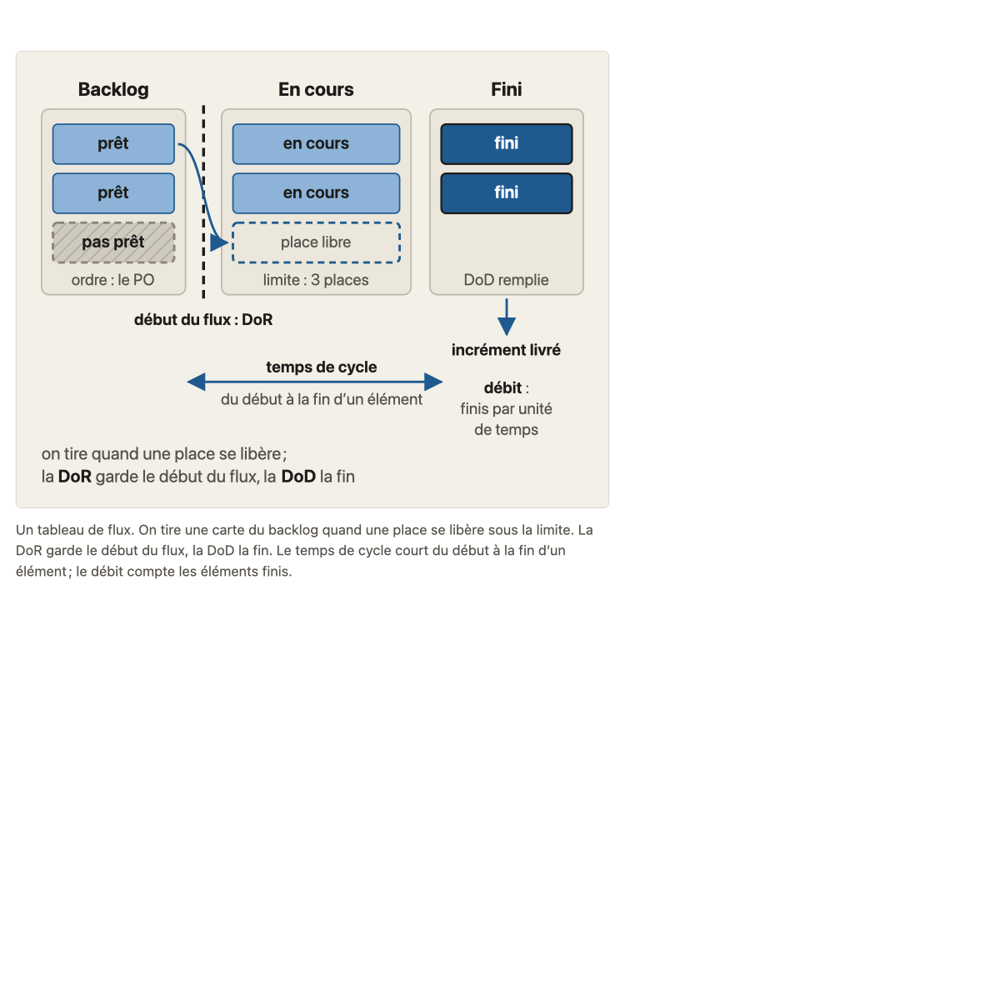
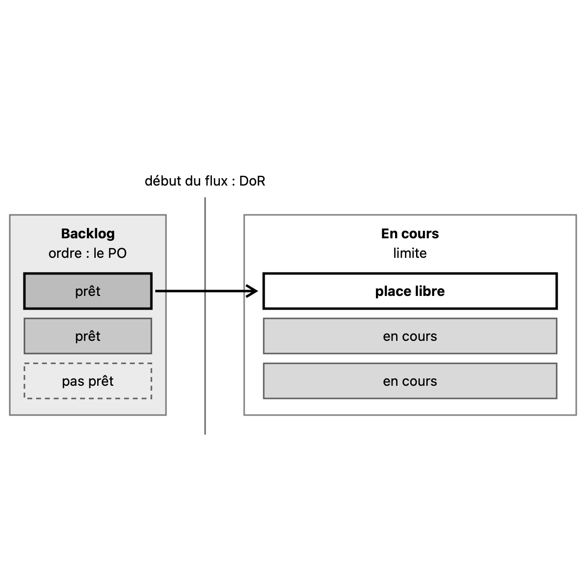

# Migration report: concept A2

Workflow `migrate-concept` (run `wf_a9152e61-28a`), course `parcours-po`, concept folder `concepts/A2-sans-sprint/`. Paths in the course folder are relative to it; the old files are named from their repository folder (`parcours-po`, `parcours-po-website`).
Old files: `parcours-po/course/concepts/A2-sans-sprint.md` (CF), `parcours-po/course/sources/A2-sans-sprint.md` (SF), `parcours-po-website/src/content/concepts/fr/A2-sans-sprint.mdx` (MDX), `parcours-po-website/src/components/schemas/SchemaA2.astro` (ASTRO).

## Summary

| checks | target existed | old diagrams | new diagrams | captions of more than one sentence |
|---|---|---|---|---|
| pass | no | 1 | 1 | 0 (3 before the corrections, see below) |

Result: **passed**. checks is read in code from the output below, which the check agent returns; target existed is read in code from the listing below, which the scope agent returns. The new concept is not compared with the old one (rule D on #23): the fresh-agent review judges it against SPEC.md and PROTOCOL.md.

Captions of more than one sentence (SPEC.md 7.2, principle 1): the run flagged tableau-de-flux.svg (3 sentences); corrected by the contributor, see "Corrections after the run".

## Target before the run

`ls -ld concepts/A2-sans-sprint; ls -la concepts/A2-sans-sprint`, as the scope agent returned it: no such folder.

```
ls: cannot access 'concepts/A2-sans-sprint': No such file or directory
ls: cannot access 'concepts/A2-sans-sprint': No such file or directory
```

## Diagrams (M11)

Each old diagram was inventoried (what it shows, by idea), drawn anew from its inventory and concept.md alone under SPEC.md 7.2. Renderings: the old diagram from the frozen site's build; the new one in one colour.

### `parcours-po-website/src/components/schemas/SchemaA2.astro`

Figure legende, in « L'essentiel »: « Un tableau de flux. On tire une carte du backlog quand une place se libère sous la limite. La DoR garde le début du flux, la DoD la fin. Le temps de cycle court du début à la fin d'un élément ; le débit compte les éléments finis. »

One idea.

Its sentences, where the inventory sends them (M11):
- « Un tableau de flux. »: title of tableau-de-flux.svg
- « On tire une carte du backlog quand une place se libère sous la limite. »: caption of tableau-de-flux.svg
- « La DoR garde le début du flux, la DoD la fin. »: caption of tableau-de-flux.svg
- « Le temps de cycle court du début à la fin d'un élément ; le débit compte les éléments finis. »: caption of tableau-de-flux.svg

#### tableau-de-flux.svg

As corrected by the contributor (the run's version drew the pull, the DoR and DoD, the cycle time and the throughput in one drawing, with a legend sentence inside).

- Title: Un tableau de flux : on tire un élément quand une place se libère
- Caption: On tire une carte prête du backlog quand une place se libère sous la limite du travail en cours. (one sentence)
- Sub-concept: A2a
- Idea: « On tire une carte du backlog quand une place se libère sous la limite. » (la légende de la Figure, dans « L'essentiel »)

| Id | Element | Labels | Role | State |
|---|---|---|---|---|
| E1 | le backlog, ordonné par le PO | « Backlog », « ordre : le PO » | context | none |
| E2 | la première carte prête, tirée | « prêt » | subject | none |
| E3 | l'autre carte prête | « prêt » | context | none |
| E4 | la carte pas prête, qui reste dans le backlog | « pas prêt » | context | not done (dashed) |
| E5 | le début du flux, où s'applique la DoR | « début du flux : DoR » | context | none |
| E6 | la colonne En cours et sa limite | « En cours », « limite » | context | none |
| E7 | les deux places occupées | « en cours » | context | none |
| E8 | la place libre sous la limite, où la carte est tirée | « place libre » | subject | none |
| E9 | la flèche de tirage de E2 vers E8, par-dessus E5 | none | subject | none |

Key of the inventory: none. Key drawn: none.

| Old | New |
|---|---|
|  |  |

Renderings in `S1-10-A2-report/`, beside this report.

## Writing choices

- M9 citation line: none written. The old « Sous-concepts » cites all four cases by title (« La place libérée par Anna », « Chacun tire ce qu'il veut », « Plus de revue, plus de retour ? », « Étienne demande pour quand »), so « Consignes » is the old text verbatim, nothing added.
- M9: the lead paragraph of « Banque d'exemples » becomes « Faits du fil rouge utilisés » with its lead words dropped; its first letter is capitalised (« l'équipe vélos » becomes « L'équipe vélos »). The whole paragraph is kept, including the sentences on the exercise situation and on what is not fixed. No other lead text remained for the top of « Banque d'exemples ».
- M10 Nature, sources row 'Distinguer le flux sans sprint du Kanban dans Scrum': no MDX sources item states this distinction and the matching ecoles item is the neighbors item (not consensus, ecole or cours), so Nature is left empty.
- M10 Nature, row 'Sans sprint, pas de Sprint Planning : le Kanban Guide n'a pas d'événement' (A2a): the MDX item 'ni rôles, ni événements' states it and has no kind, so Nature is empty.
- M10 Nature, row 'Sans sprint, pas de revue de sprint ; le Kanban Guide ne prévoit aucune réunion avec les parties prenantes' (A2c): no MDX item states it, so the matching ecoles item (the Kanban Guide, stance ecole) gives 'école'.
- M10 Nature, row 'Le Scrum Guide cite « cumulative flows »': no MDX sources item states it, so the stance of the matching ecoles.consensus item gives 'consensus'.
- M10 Nature, row 'Pour l'apprenant sans sprint, une réponse juste ... (Consignes)': no MDX item and no ecoles item match, so Nature is empty.
- M10 Nature, rows whose MDX item has no kind (Kanban Guide has no roles/events/cadence, WIP definition and control, Definition of Workflow, four measures, SLE forecast, data teams, drawing): empty, the absence being the site's choice. Rows with a kind take it: école (definition of Kanban, Kanban Guide for Scrum Teams, Anderson school, pull system, point d'engagement, réapprovisionnement, Service Delivery Review, throughput row), cours (what does not change, DoR, blocked item in WIP, Developers pull, product goal direction, inspection cadence, forecast by Developers), consensus (a finished item can be delivered without a review).
- M10 orphan: none. Every reference S1 to S8 is cited by a source cell; no '[Sx] added'. (The MDX split S6/S6b was not taken: the SF Référence S6 is kept as is.)
- M10 path rewrite: `course/plan.md` becomes `plan.md` (3 places: source cells of the 'Ce qui ne change pas', 'Pour l'apprenant sans sprint' and 'Le cours n'affirme pas' rows).
- M10 path rewrite: `course/sources/00-scrum.md` becomes `concepts/00-scrum/sources.md` (intro and the Scrum cumulative flows row); `course/sources/03-backlog-produit.md` becomes `concepts/03-backlog-produit/sources.md` (Ce qui ne change pas row and S1 Référence); `course/sources/11-dor-dod.md` becomes `concepts/11-dor-dod/sources.md`; `course/sources/13-ordonner-backlog.md` becomes `concepts/13-ordonner-backlog/sources.md` (two rows); `course/sources/01-produit-et-po.md` becomes `concepts/01-produit-et-po/sources.md`; `course/sources/16-story-map.md` becomes `concepts/16-story-map/sources.md`; `course/sources/00-scrum.md` in the S3 Référence becomes `concepts/00-scrum/sources.md`.
- M10 decision numbers: ADR-018 (3 rows: Ce qui ne change pas, Sans objectif de sprint, data teams) and ADR-031 (1 row: Pour l'apprenant sans sprint) become `decisions/team-in-sprints.md`, the only course decision, which says it carries over the old decisions 018, 031 and 033.
- M10 pointer dropped in the intro: 'd'après les consignes de T-018g et les références de T-021 (2026-10-22), revérifiées le 2026-10-23' becomes 'revérifié le 2026-10-23' (sentence: 'Ce fichier couvre ce que l'annexe affirme, revérifié le 2026-10-23.').
- M10 pointer dropped in the intro list: 'Écarts avec les références de T-021 :' becomes 'Écarts :'.
- M10 pointer dropped in « Non vérifié »: 'aucune enquête trouvée par T-021 ni ici' becomes 'aucune enquête trouvée'.
- M10 pointers kept as they are in source cells and verification cells (T-021, T-018g in the rows 'Pour l'apprenant sans sprint' and 'Le cours n'affirme pas', which are table cells, not intro or Non vérifié).
- M10 section name: '(Sous-concepts)' becomes '(Consignes)' in the 'Pour l'apprenant sans sprint' row; 'Consensus et choix d'école' rows unchanged; rows citing sections of teaching.md kept.
- M13: typographic apostrophes (none found in the sources read) normalised to ' in both files; no em-dash or arrow found in either file, so no replacement was made. Table 'Nature' cells are empty where no kind applies.
- M1: Objectif is the course.yaml objective verbatim plus a final period. The CF objective clause 'Pour l'apprenant dont l'équipe travaille...' is not carried; S1-08 records the ruling that the site wording was taken, so there is no new writing choice.
- M3: CF 'Consensus et choix d'école' matched item by item to the MDX items, and every claim is already carried. No CF-only claim and no more precise concept reference, so the stances are the MDX items unchanged (auteur->author, texte->text, ecole->school, voisines->neighbors). CF's teacher hint is not written.
- M4: Essentials are the MDX text, with nothing added from CF (every CF claim is already in the MDX, which keeps 'Cette page' for CF's 'Le cours'). The Figure becomes the tableau-de-flux.svg image line after the second paragraph.
- M5: no MDX heading outside course.yaml. Section titles equal the course.yaml titles.
- M6: Renvoi 11b, 1b, 13, 16c become 'concept 11b', 'concept 1b', 'concept 13', 'concept 16c'. Pastilles are [école], [cours], [consensus] where they stood. No FilRouge in the MDX.
- M7: two CF additions: in the 'Confondre les deux cas' item, the CF sentence 'A2 ne sert qu'au flux sans sprint.' is kept (a CF sentence absent from the MDX item); in the 'Supprimer l'inspection' item, CF's clause ', qui porte sur la performance du service' is added.
- M7: the CF-only item 'Affirmer que les équipes data travaillent surtout en flux' is added at its CF place, last. The MDX 'Commencer un élément qui n'est pas prêt « pour qu'il soit en route »' wording is kept (MDX order and sentences).
- M8: CF has no separate question (its Test rapide section is a sentence that also gives the answer), so the blockquote is the Reflexe slot: 'Pour chaque pièce du sprint, qu'est-ce qui la remplace, et qui la tient ?'. The one paragraph is the Reflexe note followed by the CF answer sentence, wording kept: 'Le Sprint Planning, une place libre sous la limite et la DoR au début du flux ; ...'. The leading 'Le' with a capital and the removal of CF's inner quotes around the question are writing choices.
- M13: no banned character or typographic apostrophe was found, so no replacement was needed. Frontmatter diagrams entry copied verbatim from the task, with subconcept A2a.

## Corrections after the run

Made by the contributor in the output, never in the frozen source (SPEC.md 7.2 self-check, rules A to D of #23).

- tableau-de-flux.svg: the caption was 3 sentences, so two or three ideas; the drawing now shows one, the pull (caption: one sentence). Cut from the drawing: the « Fini » column with « DoD remplie », the « incrément livré » box, the « temps de cycle » brace, the « débit » counter, and the legend note (a teaching sentence inside the SVG). The subject (the pulled card, the arrow, the free place) is `primary`; everything else is `muted`; the dashed card means « pas prêt ». Group ids start with `A2a`.
- Fresh review (2 blocking findings, fixed): A2a now says « la DoD pour en sortir » (and its sources row says « la DoD, celle de sa fin »); A2d defines the throughput (« le nombre d'éléments finis par unité de temps »). The image moved into the A2a section; the DoR line is thinner and the label « 3 places » became « limite » (the value is in no reader text). The teaching.md sentence on the legend is dropped.
- What the cut content became: cycle time and throughput are carried by concept.md A2d (« le temps de cycle va du début d'un élément à sa fin », « le débit est l'une des mesures suivies »); the DoD by A2a (« la DoD pour en sortir ») and the increment by « L'essentiel »; « on tire quand une place se libère » by the caption. « La DoR garde le début du flux, la DoD la fin » is carried by A2a. teaching.md « Schéma » now describes the new drawing, and keeps the cut parts as text for A2c and A2d, which declare no diagram.
- sources.md: first-column section names fixed (« Consignes », « Pièges », « Consensus et choix d'école » instead of « chaque sous-concept », « consigne », « Consensus, renvoi 16c »); the pointer « Voir « Général » » replaced by the row it means; the internal task ids (T-018g, T-021) removed from two cells; Nature set to « cours » on the row whose verification names a course choice; section names completed for the rows of the course stances (« Consensus et choix d'école ») and for the case-title rows (« Banque d'exemples »); the « cumulative flows » row points to `concepts/16-story-map/sources.md`.
- Rule C (orphan reference): none; every reference S1 to S8 is cited by a claim.
- Rule B: no citation line added; the four cases are already cited in « Consignes ».
- Reference type « interne »: none in this concept.
- Rule A: no `glossary-order` failure remains for this concept. Concept 16 (already merged) uses « Flux continu » and « Temps de cycle », which A2 introduces: that failure is concept 16's, for #166.

## Checks

`mise exec -- specs/linear-course/checks/check-course courses/parcours-po --only course-yaml,concept-folder,conventions,svg-contract,sources,glossary-order,typography --concept A2`

```
course-yaml: ok
concept-folder: ok
conventions: ok
svg-contract: ok
sources: ok
glossary-order: ok
typography: ok
```

After the contributor's corrections: `mise -C <worktree> exec -- specs/linear-course/checks/check-course courses/parcours-po --concept A2`: course-yaml, concept-folder, conventions, svg-contract, sources, course-files, glossary-order, domain-first-sentence, typography, language-pack-keys, all ok.

Form fixes (by the run):
- sources.md: merged the four per-group Affirmations tables into one table (removed the ### group headings and repeated headers, rows and order unchanged); failed concept-folder 'holds one table, found 4' and the S6 'cited by no claim' sources failure
- sources.md: reference types of S4 and S5 rewritten as 'primaire (pour ...), marketing (pour ...)' so the type column reads as primaire/marketing separated by a comma, qualifiers kept in parentheses; failed sources type check
- tableau-de-flux.svg: title and desc ids renamed tableau-titre/tableau-desc to tableau-de-flux-titre/tableau-de-flux-desc (also in aria-labelledby); failed svg-contract stem check

